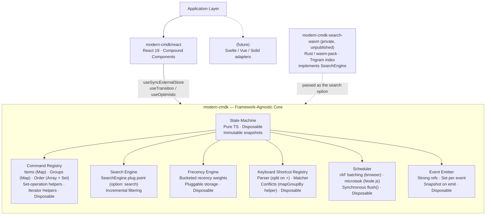
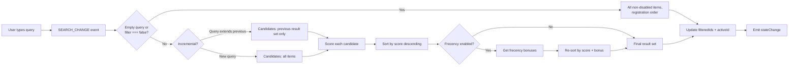
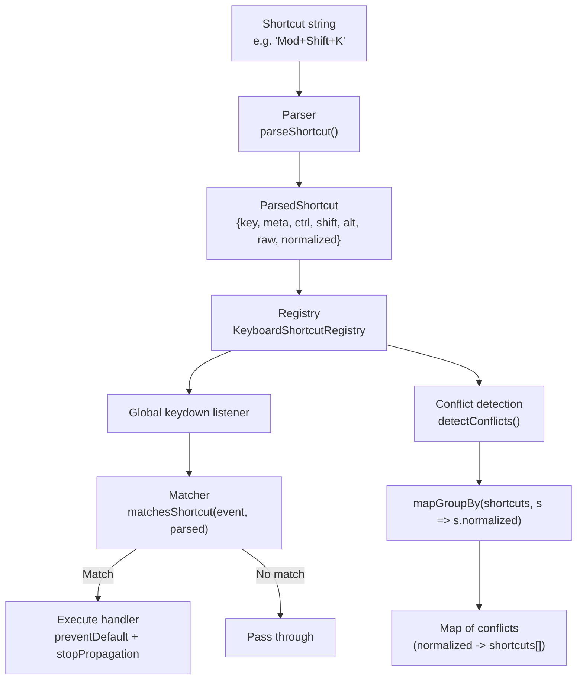
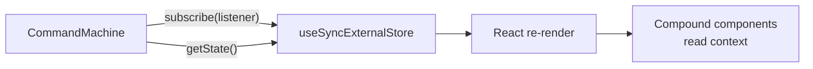
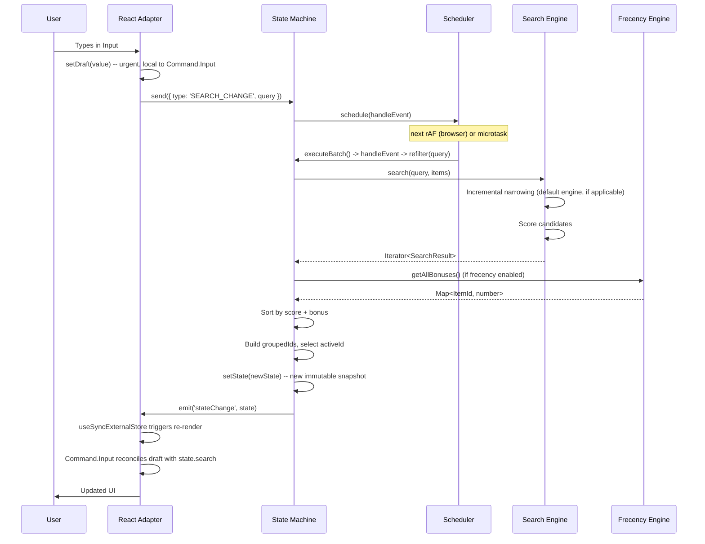

# Architecture

This document describes the technical architecture of `modern-cmdk` -- a ground-up rewrite of `cmdk` as a framework-agnostic, headless command palette engine. It is written from the sources under `packages/*/src`; where a number is a target rather than a measurement, it says so.

---

## Table of Contents

- [Overview](#overview)
- [Layered Design](#layered-design)
- [Core Engine](#core-engine)
  - [State Machine](#state-machine)
  - [Command Registry](#command-registry)
  - [Event Emitter](#event-emitter)
  - [Scheduler](#scheduler)
- [Search Pipeline](#search-pipeline)
  - [Default Scorer](#default-scorer)
  - [Plug Points: `search` and `filter`](#plug-points-search-and-filter)
  - [Incremental Filtering](#incremental-filtering)
  - [Frecency Re-Ranking](#frecency-re-ranking)
  - [WASM Search Engine](#wasm-search-engine)
- [Keyboard System](#keyboard-system)
  - [Parser](#parser)
  - [Matcher](#matcher)
  - [Registry](#keyboard-shortcut-registry)
  - [Conflict Detection](#conflict-detection)
- [React 19 Adapter](#react-19-adapter)
  - [Store Integration](#store-integration)
  - [Compound Components](#compound-components)
  - [Concurrent Features](#concurrent-features)
- [Event Flow](#event-flow)
- [CSS Architecture](#css-architecture)
  - [Animations and transitions](#animations-and-transitions)
  - [Scroll-Driven Animations](#scroll-driven-animations)
  - [Content Visibility](#content-visibility)
  - [Accessibility Media Queries](#accessibility-media-queries)
- [Performance Budget](#performance-budget)
- [Design Decisions](#design-decisions)
- [File Map](#file-map)

---

## Overview



---

## Layered Design

The architecture follows strict layering rules:

1. **Core layer** (`modern-cmdk`) -- Pure TypeScript. No DOM APIs required to construct or drive the machine (the keyboard registry attaches a `keydown` listener only when `document` exists). No framework imports. Runs in Node.js, Deno, Bun, or any browser.

2. **Adapter layer** (`modern-cmdk/react`) -- Thin React 19 wrapper. Consumes the core via `useSyncExternalStore`. Renders JSX. Handles DOM events. Has `"use client"` directives.

3. **Extension layer** (`modern-cmdk-search-wasm`) -- Optional WASM search engine. It implements the core's `SearchEngine` interface and is handed to the machine through the `search` option. It ships a Rust crate compiled with `wasm-pack`. The package is `private: true` in `packages/command-search-wasm/package.json`; it is not published to npm.

Dependencies flow strictly downward. The core never imports from adapters or extensions.

---

## Core Engine

### State Machine

**File:** `packages/modern-cmdk/src/core/machine.ts`

The state machine is the central coordinator. It implements the `CommandMachine` interface and the `Disposable` protocol.

```
createCommandMachine(options)
         |
         v
+------------------+
|  CommandMachine   |
|                   |
|  getState()      -+-> Returns immutable CommandState snapshot
|  send(event)     -+-> Enqueues CommandEvent on the scheduler (applied on its next tick)
|  subscribe(fn)   -+-> useSyncExternalStore-compatible (returns () => void)
|  subscribeState  -+-> Returns Disposable for `using` pattern
|  getRegistry()   -+-> Access the CommandRegistry
|  getKeyboard..() -+-> Access the KeyboardShortcutRegistry
|  getFilteredIdSet / getFilteredIdIndex -+-> O(1) membership / position lookup
|  [Symbol.dispose] +-> Cleans up all subsystems
+------------------+
```

`send()` never applies an event synchronously: it calls `scheduler.schedule(() => handleEvent(event))`, so state changes on the scheduler's next tick (a `requestAnimationFrame` in browsers, a microtask elsewhere).

**State shape** (`CommandState`):

| Field | Type | Description |
|---|---|---|
| `search` | `string` | Current search query |
| `activeId` | `ItemId \| null` | Currently highlighted item |
| `filteredIds` | `readonly ItemId[]` | Ordered list of visible item IDs |
| `groupedIds` | `ReadonlyMap<GroupId, readonly ItemId[]>` | Items bucketed by group |
| `filteredCount` | `number` | Total visible items |
| `loading` | `boolean` | Whether async items are loading |
| `page` | `string` | Current page name |
| `pageStack` | `readonly string[]` | Page navigation history |
| `open` | `boolean` | Dialog open state |
| `lastUpdated` | `number` | Timestamp of last state change (epoch ms) |

**Event types** (`CommandEvent`):

| Event | Payload | Effect |
|---|---|---|
| `SEARCH_CHANGE` | `query: string` | Re-filters, re-ranks, updates `activeId`, calls `onSearchChange` |
| `ITEM_SELECT` | `id: ItemId` | Fires the item's `onSelect`, records frecency, emits `select`, calls the machine's `onSelect` |
| `ITEM_ACTIVATE` | `id: ItemId` | Sets `activeId` if item is in filtered set |
| `NAVIGATE` | `direction: next \| prev \| first \| last` | Moves `activeId` with optional loop wrapping (`loop` defaults to `true`) |
| `PAGE_PUSH` | `page: string` | Pushes current page to stack, sets new page |
| `PAGE_POP` | -- | Pops page stack |
| `OPEN` / `CLOSE` / `TOGGLE` | -- | Controls dialog visibility |
| `ITEMS_LOADED` | `items: readonly CommandItem[]` | Registers items from async source and indexes them |
| `REGISTER_ITEM` | `item: CommandItem` | Registers a single item + its shortcut |
| `UNREGISTER_ITEM` | `id: ItemId` | Removes item from registry, search index, keyboard registry |
| `REGISTER_GROUP` / `UNREGISTER_GROUP` | group/id | Manages group lifecycle |

All state transitions produce a new immutable `CommandState` object (`setState` assigns a spread copy, then emits `stateChange`). The machine never mutates state in place.

### Command Registry

**File:** `packages/modern-cmdk/src/core/registry.ts`

The registry manages item and group storage with O(1) lookup performance.

```
CommandRegistry
  |
  +-- #items: Map<ItemId, CommandItem>      -- O(1) lookup
  +-- #groups: Map<GroupId, CommandGroup>    -- O(1) lookup
  +-- #itemOrder: ItemId[]                  -- insertion order
  +-- #itemOrderSet: Set<ItemId>            -- O(1) duplicate check
  |
  +-- registerItem(item) -> Disposable      -- `using` auto-deregister
  +-- registerItems(items) -> Disposable    -- batch registration
  +-- unregisterItem(id) -> void            -- single removal
  +-- unregisterItems(ids: Set) -> void     -- bulk removal (setDifference on the order set)
  +-- registerGroup(group) -> Disposable    -- group lifecycle
  +-- unregisterGroup(id) -> void
  +-- getItem(id) / getGroup(id)            -- O(1) Map lookup
  +-- getItems() -> readonly CommandItem[]  -- Iterator Helpers pipeline, cached
  +-- getGroups() -> readonly CommandGroup[]-- sorted by priority, cached
  +-- getGroupedItems() -> ReadonlyMap      -- mapGroupBy helper, emitted in group-priority order
  +-- getItemIds() -> ReadonlySet<ItemId>   -- internal set, zero allocation
  +-- intersectWith / differenceFrom / unionWith / symmetricDifferenceWith
  +-- isSubsetOf / isSupersetOf / isDisjointFrom
  +-- size / groupCount (getters) · clear()
```

The set methods above delegate to the helper functions in `utils/set-ops.ts` (`setIntersection`, `setDifference`, `setUnion`, `setSymmetricDifference`, `setIsSubsetOf`, `setIsSupersetOf`, `setIsDisjointFrom`). They are plain loops, not the native `Set.prototype` methods (Set methods are ES2025), so the registry does not depend on a runtime that ships them. Because the registry calls every one of them, none of these helpers is removed by tree-shaking when the registry is in the bundle.

`getItems()` and `getGroups()` memoize their results and invalidate the cache on the next mutation, so repeated reads inside a single filter pass are free. `getGroupedItems()` buckets with the `mapGroupBy` helper from `utils/group-by.ts` (the native `Map.groupBy` is ES2024; the helper is a plain loop) and then re-emits groups in `priority` order, appending an `__ungrouped` bucket last. `utils/group-by.ts` also exports `objectGroupBy`; nothing in `packages/*/src` calls it and the core entry does not export it.

### Event Emitter

**File:** `packages/modern-cmdk/src/core/utils/event-emitter.ts`

`TypedEmitter<T>` is a small typed emitter. It holds **strong references**; nothing about it observes garbage collection.

- Storage is `Map<event, Set<listener>>`: one `Set` per event.
- `.on(event, listener)` adds the listener to that event's `Set` and returns a `Disposable` whose `[Symbol.dispose]()` deletes it, so `using sub = emitter.on(...)` unsubscribes at block exit.
- `.emit(event, data)` iterates a **snapshot** of the `Set` (`[...set]`), so a listener added or removed during an emit does not change the pass in progress.
- `.has(event)` and `.listenerCount(event)` read `Set.size`.
- `.removeAll()` and `[Symbol.dispose]()` clear every listener.
- A listener that is never unsubscribed stays reachable from the emitter until the emitter is disposed. There is no pruning of dead listeners: the owner of a subscription is responsible for disposing it. The machine's own emitter is cleared when the machine is disposed.

The machine uses it for three events: `stateChange`, `select` and `openChange`.

### Scheduler

**File:** `packages/modern-cmdk/src/core/utils/scheduler.ts`

The scheduler coalesces state updates to prevent redundant re-renders:

```
Browser environment (requestAnimationFrame exists):
  schedule(update) -> pending[] -> requestAnimationFrame -> executeBatch()

Node.js / test environment:
  schedule(update) -> pending[] -> queueMicrotask -> executeBatch()
```

- `schedule()` pushes the update, then arms exactly one rAF (`rafId ??= requestAnimationFrame(...)`) or one microtask for the whole batch.
- `executeBatch()` snapshots and clears the queue before running it, so updates scheduled while a batch runs land in the next one. Each update runs in a `try`/`catch`; a throwing update is re-thrown from a `queueMicrotask` so it surfaces without stopping the rest of the batch.
- For a batch of more than 10 updates, if `navigator.scheduling.isInputPending()` is available and reports pending input, the batch is re-queued and resumed after `scheduler.yield()` (or the next rAF when `yield` is missing). `isInputPending` is Chromium-only and is declared ambiently in `core/es2026.d.ts`.
- `flush()` is **synchronous**: it cancels a pending rAF, clears the microtask flag and runs `executeBatch()` immediately. It returns `void`, not a promise.
- Implements `Disposable` -- cancels pending rAF and clears the queue.

---

## Search Pipeline



### Default Scorer

**File:** `packages/modern-cmdk/src/core/search/default-scorer.ts`

The built-in scorer matches against the item's `value` and `keywords` and keeps the best score. Per target it tries, in order: exact match (1), prefix, substring (with a position bonus), word-boundary (separators are found by character code, no regex), then a character-by-character fuzzy match. It returns a `SearchResult` with:
- `id: ItemId` -- the matched item
- `score: number` -- relevance score (higher is better)
- `matches: ReadonlyArray<readonly [number, number]>` -- character ranges for highlighting

`scoreItem(query, item)` is the public entry; the search engine calls the internal `scoreItemPreLowered` with lowercase text cached at index time.

`search/fuzzy-scorer.ts` exports `scoreItemAsync` and `batchScoreItems`: `Promise`-wrapped calls to the same `scoreItem`. They run synchronously inside the promise executor; they are not a separate matching algorithm and the machine does not use them.

### Plug Points: `search` and `filter`

Two options on `createCommandMachine()` (and, through `CommandMachineOptions`, on `<Command>`) change how items are matched. They are different things:

| Option | Type | What it does |
|---|---|---|
| `search` | `SearchEngine` | **The pluggable engine.** Replaces the whole default engine: `index(items)`, `search(query, items)` returning an iterator of `SearchResult` (with match ranges), `remove(ids)`, `clear()`, `[Symbol.dispose]()`. The WASM engine implements this interface. |
| `filter` | `(item, query) => number \| false`, or `false` | A **score override** for the default engine. Return a score, or `false` to drop the item. The machine wraps it as the engine's scorer with `matches: []`, so a `filter` cannot supply highlight ranges. `filter: false` skips searching altogether and lists every non-disabled item. |

When `search` is given, it is used as is (`options.search ?? createSearchEngine(...)` in `machine.ts`), and a `filter` function is not consulted. The engine's `ScorerFn` type (`(query, item) => SearchResult | null`) is only the option type of `createSearchEngine({ scorer })`.

### Incremental Filtering

**File:** `packages/modern-cmdk/src/core/search/index.ts`

When the user appends characters to the search query (e.g., "cop" -> "copy"), the default engine only re-scores items that matched the previous query. This is tracked via:
- `previousQuery: string` -- the last query string
- `previousResults: Set<ItemId>` -- the IDs that matched

If the new query starts with the previous (non-empty) query, candidates are narrowed to `previousResults` before scoring. This reduces work from O(n) to O(k) where k << n. `index()` resets the cache, because newly indexed items may match the current query; `remove(ids)` prunes it with the `setDifference` helper.

In browser development builds the engine also registers itself with a `FinalizationRegistry` and warns if it is garbage collected without being disposed. This is a diagnostic only; it never affects delivery or pruning.

### Frecency Re-Ranking

**File:** `packages/modern-cmdk/src/core/frecency/index.ts`

After scoring, results are optionally re-ranked by frecency bonus:

```
Final rank = search_score + frecency_bonus
```

The bonus uses **bucketed recency weights**: the elapsed time since last use picks one of five fixed weights. It is a step function, not a continuous time decay.

| Time Since Last Use | Weight (default) |
|---|---|
| < 1 hour | 4.0 |
| < 1 day | 2.0 |
| < 1 week | 1.5 |
| < 1 month (30 days) | 1.0 |
| Older | 0.5 |

```
frecency_bonus = frequency_count * recency_weight
```

The weights are the defaults in `DEFAULT_FRECENCY_DECAY` (`types.ts`) and can be overridden per bucket through `decayConfig`. Time elapsed is computed using `(now - lastUsed) / 3_600_000` for hours. `FrecencyEngine.recordSelection()` runs on `ITEM_SELECT`; the bonus is applied only on the non-empty-query path.

`FrecencyEngine` implements `Disposable` and `AsyncDisposable`. `[Symbol.dispose]()` starts a best-effort `save` and logs a warning if it fails; `await using` (`[Symbol.asyncDispose]()`) awaits the save first.

**Storage interface:**

```ts
interface FrecencyStorage extends Disposable {
  load(namespace: string): FrecencyData | Promise<FrecencyData>;
  save(namespace: string, data: FrecencyData): void | Promise<void>;
  [Symbol.dispose](): void;
}
```

Ships with `MemoryFrecencyStorage` (in-memory, no persistence) and `IdbFrecencyStorage` (IndexedDB persistence via `idb-keyval`, which is imported dynamically on first use so non-persisting consumers never load it).

### WASM Search Engine

**Files:** `packages/command-search-wasm/crate/src/` (Rust), `packages/command-search-wasm/src/` (TypeScript wrappers)

The optional WASM engine implements the core's `SearchEngine` interface; you pass it as `search:` to `createCommandMachine()` (or `<Command search={...}>`). It is **not** a `filter` function and not a `ScorerFn`.

- **Trigram index** (`crate/src/trigram.rs`) -- `index_items` receives a JSON array of `[id, value]` pairs and maps every lowercase 3-character window of `value` to the items containing it. Only `value` is indexed; `keywords` are not. A query's score is the share of its trigrams found in an item, results at or below 0.1 are dropped, and match ranges are exact substring hits.
- **`createWasmSearchEngine()`** (`src/wasm-engine.ts`) -- main-thread wrapper. If the WASM module cannot be loaded it falls back to the TypeScript engine from `modern-cmdk` (`isWasm: false`). `remove(ids)` clears the whole WASM index and does not re-index the remaining items (a known gap).
- **`createWorkerSearchEngine()`** (`src/worker-engine.ts`) -- runs the same engine in a Web Worker; scores travel in a `SharedArrayBuffer` only when the page is cross-origin isolated, otherwise they are structured-cloned. Its synchronous `search()` yields the results of the most recent `searchAsync()` call, and nothing in `createCommandMachine` calls `searchAsync()`, so pair it with explicit `await engine.searchAsync(query)` calls. This file is the only place in `packages/*/src` that uses `Promise.withResolvers` (ES2024): for the worker-ready signal and for per-request tracking.
- **Edit distance** -- `crate/src/scorer.rs` (Levenshtein helpers) is compiled under `cfg(test)` only and is not part of the search path.

**Measurements.** The `.wasm` binary is 113,223 bytes raw and 52,100 bytes under `gzip -9` (measured 2026-11-05 on the `pkg/command_search_wasm_bg.wasm` that wasm-pack 0.15.1 builds with the nightly of 2026-11-05, rustc 1.101.0-nightly 2d20b42b8; the 2026-11-04 nightly gave 113,495 and 52,188), so "about 52 kB gzip". **No search-latency figure has been measured for the WASM engine**; `benchmarks/wasm-search.bench.ts` exists but asserts nothing and its numbers are not published. Any latency stated elsewhere is a target, not a result.

---

## Keyboard System



### Parser

**File:** `packages/modern-cmdk/src/core/keyboard/parser.ts`

Parses human-readable shortcut strings into structured `ParsedShortcut` objects. It builds no pattern from user input; the only regular expressions involved are two fixed literals, the lone-surrogate pattern inside `ensureWellFormed` (`utils/string-wellformed.ts`) and the module-level platform test `MAC_PLATFORM_RE` (`parser.ts`):

1. Replace lone surrogates with U+FFFD (`ensureWellFormed`, a helper for `String.prototype.toWellFormed`).
2. Split on `+`, then `trim()` and `toLowerCase()` each part.
3. Look each part up in the alias map (`MODIFIER_MAP`). A part that is a modifier sets that flag; any other part becomes `key` (the last non-modifier part wins).
4. Build `normalized` from the set modifiers in the fixed order `meta`, `ctrl`, `shift`, `alt`, then `key`, joined with `+`.

- `"Mod+K"` -- `Mod` resolves to `meta` on Apple platforms and `ctrl` elsewhere (decided once at module load, from `navigator.userAgentData` or `navigator.platform`)
- `"Ctrl+Shift+P"` -- explicit modifier specification
- `"Alt+Enter"` -- named key support
- Aliases: `Cmd`/`Command` -> `meta`, `Option`/`Opt` -> `alt`, `Control` -> `ctrl`

Because the key is whatever remains after the split, a literal `+` key cannot be written (`"Mod++"` yields an empty key).

The `normalized` field is a deterministic string (`meta+ctrl+shift+alt+key`, absent modifiers omitted) used as the registry's map key and for conflict comparison: `"Shift+Cmd+K"` and `"cmd + shift + k"` normalize to the same value.

`formatShortcut()` renders platform-appropriate display labels (Mac symbols vs. Windows text).

### Matcher

**File:** `packages/modern-cmdk/src/core/keyboard/matcher.ts`

Compares `KeyboardEvent` properties against `ParsedShortcut` fields. All four modifier keys (`metaKey`, `ctrlKey`, `shiftKey`, `altKey`) must match exactly -- no partial matching -- and `event.key.toLowerCase()` must equal the parsed `key`.

### Keyboard Shortcut Registry

**File:** `packages/modern-cmdk/src/core/keyboard/index.ts`

Global shortcut management:

- `.register(shortcutStr, itemId, handler)` returns a `Disposable` -- enables `using` for automatic deregistration. Bindings are keyed by `normalized`, so registering the same shortcut twice replaces the first binding.
- Attaches a single `document.addEventListener('keydown', ...)` listener, in the constructor.
- Safe in SSR -- checks `typeof document` before attaching.
- Implements `Disposable` -- removes the global listener and clears all bindings.

### Conflict Detection

`detectConflicts` (in `matcher.ts`) uses the `mapGroupBy` helper to group shortcuts by normalized form:

```ts
const grouped = mapGroupBy(shortcuts, (s) => s.normalized);
// Any group with length > 1 is a conflict
return new Map(grouped.entries().filter(([, group]) => group.length > 1));
```

`KeyboardShortcutRegistry.getConflicts()` feeds it the registered bindings. Since the registry itself is keyed by `normalized`, two bindings of one shortcut cannot coexist there; `detectConflicts` is most useful on a list of shortcuts collected elsewhere.

---

## React 19 Adapter

### Store Integration



The machine's `.subscribe()` returns an unsubscribe function -- the exact signature `useSyncExternalStore` expects. No wrapper needed.

The machine's `.getState()` returns the same object reference until the next state change -- this satisfies `useSyncExternalStore`'s identity check.

### Compound Components

All components consume the machine via React context using `use(CommandContext)` (React 19):

| Component | Role | Key Props |
|---|---|---|
| `Command` | Root -- creates machine, provides context | every `CommandMachineOptions` field (`items`, `groups`, `filter`, `search`, `loop`, `frecency`, ...) plus `label`, `className` |
| `Command.Dialog` | Radix Dialog wrapper with overlay and portal | `open`, `onOpenChange` |
| `Command.Input` | Search input bound to machine state; keeps its own urgent draft value | `placeholder`, `onValueChange` |
| `Command.List` | Scrollable list with auto-virtualization and `aria-live` | `virtualize` |
| `Command.Item` | Selectable item -- registers/unregisters on mount/unmount | `value`, `onSelect`, `shortcut`, `disabled` |
| `Command.Group` | Logical group with heading | `heading` |
| `Command.Empty` | Rendered when `filteredCount === 0` | -- |
| `Command.Loading` | Rendered when its `loading` prop is `true`; when the prop is omitted, rendered while `state.loading` is true or the optimistic active-item transition is pending (`loading={false}` hides it in all cases) | `loading` |
| `Command.Separator` | Visual divider | -- |
| `Command.Highlight` | Fuzzy match character highlighting | `text`, `ranges` |
| `Command.Badge` | Status badge on items | -- |
| `Command.Shortcut` | Keyboard shortcut display (platform-aware) | `shortcut` |
| `Command.Page` | Nested page for hierarchical navigation | `id` |
| `Command.AsyncItems` | Suspense-powered async data loading | `items` (a `Promise<readonly CommandItem[]>`), `fallback`, `children` (render fn) |
| `Command.Activity` | React Activity API state preservation (falls back to conditional rendering) | `mode` |

All components:
- Have `"use client"` directives
- Accept `ref` as a prop (React 19 -- no `forwardRef`)
- Use `useId()` for stable, SSR-safe ARIA IDs

### Concurrent Features

| React 19 Feature | Usage |
|---|---|
| `useSyncExternalStore` | Subscribe to machine state without tearing |
| `useTransition` | Wraps **only** the optimistic active-item setter (`setOptimisticActiveId`). It does not wrap search: `isPending` never reflects a search. |
| `useOptimistic` | Optimistic `activeId` updates -- instant visual feedback on navigation |
| `useId` | Generate stable IDs for `aria-labelledby`, `aria-controls`, `aria-activedescendant` |
| `use()` | Consume `CommandContext` (replaces `useContext`) |
| `ref` as prop | All components accept `ref` directly -- no `forwardRef` wrapper |

**Search is not a transition.** `Command.Input` keeps the typed text in local state (`draft`), set inside the change event, so the input is always responsive. The same handler then calls `machine.send({ type: 'SEARCH_CHANGE', query })`, which only enqueues the event on the machine's scheduler (see [Scheduler](#scheduler)). Filtering and the state update happen on that scheduler tick, outside React; React sees the result through `useSyncExternalStore`. On every machine tick `Command.Input` reconciles its draft: an echo of a query typed here is ignored, and any other `search` value (an external `SEARCH_CHANGE`, a reset) replaces the draft. No `startTransition` wraps a search, so a search never marks `isPending` and `Command.Loading` does not appear for one.

---

## Event Flow

Complete cycle from user action to re-render:



---

## CSS Architecture

### Animations and transitions

**File:** `packages/modern-cmdk/src/react/styles.css`

What resolves today:

- Item background: `[data-command-item]` declares a `background-color` transition over `--command-duration-item` (120ms) with a `linear()` ease (styles.css:213); it runs on the background the app sets for `[data-active]` (the library sets one only under `forced-colors`, :570). `content-visibility: auto` skips off-screen item rendering (:215).
- List height: `[data-command-list]` declares `transition: height` over `--command-duration-list` with `--command-spring-easing` and sets `will-change: height` (styles.css:195-196). Both tokens resolve because the list sits inside `[data-command-root]`. The library sets only `--command-list-height` on the list (list.tsx:107), not `height`, so the transition interpolates once the app sets `height: var(--command-list-height)` on `[data-command-list]` (apps/docs/guide/migration-from-cmdk.md:111).
- Virtual positioning: each virtual item is absolutely positioned and offset with the `translate` property (`translate: 0 <start>px`, item.tsx:79), and the virtual list sets `will-change: transform` (styles.css:234). The motion is transform-based, which keeps it off the layout path.
- Overlay tint: `--command-overlay-opacity` is a registered property (:30) read by the overlay background (:140) and set to 0 or 0.4 by the state rules (:324, :334). The value switches with `data-state`; the `transition` declarations beside it (:326-331, :335-341) read unset tokens, so it does not interpolate.

What is declared and inert until DT-19:

The tokens are declared only in `[data-command-root]` (styles.css:51-104). The overlay and dialog elements sit outside it: `dialog.tsx` renders the Command root inside the dialog content (dialog.tsx:116). Every `transition`, `backdrop-filter` and size declaration that reads an unset token is invalid at computed-value time, so the dialog and overlay open and close transitions (styles.css:319-380) do not run. DT-19 moves the tokens to a selector the overlay and dialog match. Until then an app sets all twelve tokens on `[data-command-overlay], [data-command-dialog]`; see `apps/docs/guide/theming.md` (Library Tokens).

```
declared (inert until DT-19)

Dialog open:
  @starting-style { opacity: 0; scale: 0.96; translate: 0 8px; }
  -> opacity: 1; scale: 1; translate: 0 0;
  -> opacity 200ms spring linear() easing
  -> scale/translate 250ms bouncy spring linear() easing (slight overshoot)
  -> display/overlay: allow-discrete

Dialog close:
  -> opacity: 0; scale: 0.96; translate: 0 4px;
  -> 150ms cubic-bezier(0.4, 0, 1, 1)  // quicker, no spring overshoot
```

The spring easings are `linear()` stop lists (styles.css:52-90): `--command-spring-easing` rises to 1 without overshoot (critically damped), and `--command-spring-easing-bouncy` peaks at 1.033 before settling. They also live in `[data-command-root]`, so only the list height transition reads them today, and it animates only when the app sets the list height (see above).

`@starting-style` (CSS Transitions Level 2) is written for the overlay (:320-323) and the dialog (:348-354). Once the tokens resolve, the browser interpolates from the starting style to the final style on first render. `display` and `overlay` transitions use `allow-discrete` to animate to and from `display: none`.

### Scroll-Driven Animations

`styles.css` declares a `scroll-timeline` on the list and a matching progress-indicator
rule driven by it:

```css
[data-command-list] {
  scroll-timeline: --list-scroll block;
}

[data-command-scroll-indicator] {
  animation: scroll-progress linear;
  animation-timeline: --list-scroll;
}
```

No JavaScript scroll event listeners. Zero main-thread cost.

> [!NOTE]
> The timeline is declared, but **no built-in component renders a
> `[data-command-scroll-indicator]` element** -- the rule is a styling hook for consumers
> who want a progress bar. Render your own element with that attribute inside
> `<Command.List>` and it picks up the timeline with no JavaScript.

### Content Visibility

Every item (`[data-command-item]`) uses `content-visibility: auto` with `contain-intrinsic-size`. The `[data-command-virtual-item]` selector below is a reserved hook for custom rows built on `useVirtualizer`; no component emits that attribute.

```css
[data-command-item],
[data-command-virtual-item] {
  content-visibility: auto;
  contain-intrinsic-size: auto var(--command-item-height); /* 44px */
}
```

The browser skips rendering off-screen items entirely. Combined with the auto-virtualization threshold, rendering cost tracks the visible rows rather than the item count.

### Accessibility Media Queries

| Media Query | Behavior |
|---|---|
| `prefers-reduced-motion: reduce` | Disables all animations and transitions |
| `prefers-contrast: more` | Thicker outlines (3px) on active/focused items |
| `forced-colors: active` | Uses system `Highlight`/`HighlightText` colors, disables `forced-color-adjust` |

Five custom properties are registered with `@property` (`--command-list-height`, `--command-count`, `--command-overlay-opacity`, `--command-dialog-scale`, `--command-dialog-translate`), each with a syntax and an initial value so that it animates.

---

## Performance Budget

| Metric | Target | Enforcement |
|---|---|---|
| Core bundle | ≤ 6.5 kB | **Enforced**: `size-limit` (`pnpm size`, CI "Bundle Size" job), `packages/modern-cmdk/dist/core/index.mjs`, gzip. Measured 6399 B |
| React adapter only | ≤ 5.6 kB | **Enforced**: `dist/react/index.mjs`, gzip, with `modern-cmdk`, `react`, `react-dom`, `react/jsx-runtime` and `radix-ui` ignored (the core is not counted). Measured 5558 B |
| Core + React adapter | ≤ 10.1 kB | **Enforced**: `dist/react/index.mjs`, gzip, `modern-cmdk` not ignored, so the one core is counted once. Measured 10019 B (1.4 measured 9830 B; 1.3 inlined the core in the adapter: 6355 B + 9844 B = 16199 B) |
| `modern-cmdk/react/dialog` only | ≤ 1.5 kB | **Enforced**: `dist/react/dialog.mjs`, gzip, same ignore list. Measured 1422 B |
| `CommandSeparator` only | ≤ 5 kB | **Enforced**: `import { CommandSeparator }` from `dist/react/index.mjs`, gzip, same ignore list. Measured 4830 B; the bundle still contains `CommandDialog`, `CommandRoot` and the `radix-ui` import (the compound), so this entry is a regression tripwire and not a tree-shaking claim |
| `modern-cmdk/styles.css` | ≤ 4 kB | **Enforced**: `dist/react/styles.css`, gzip. Measured 3959 B |
| Codemod bin | ≤ 3.4 MB | **Enforced**: `dist/codemod/cli.mjs` plus `dist/codemod/transforms/*.mjs` (the whole bin), installed size (no compression). The record `benchmarks/size-history/1.4.0.json` (5f1e01e, measured at 07bfe79) holds 3325793 B |
| WASM binary (gzipped) | no budget; about 52 kB measured (113,223 bytes raw) | Not enforced (package private, not in `size-limit`) |
| Search latency (10K items, TS scorer) | < 16 ms | Tripwire on the named task `search:ts-scorer-10k`: `pnpm bench:compare` against `benchmarks/baseline.json` warns above a 5% regression and fails the CI bench job above 15% or when the median exceeds the 16 ms `target_ms` (see below). |
| Search latency (100K items, WASM engine) | none (unmeasured) | Target (not enforced); no figure has been measured |
| Time to first render | < 50 ms | Target (not enforced) |
| State update cycle (send -> re-render) | < 4 ms | Tripwire on `stateUpdate:searchChange` (the machine side only, 1K items; no re-render is timed); a median above the 4 ms `target_ms` fails the bench job |
| Filter 10K items (incremental) | < 2 ms | Target (not enforced); `benchmarks/filter-10k.bench.ts` prints timings and asserts nothing |
| Memory per 10K items | < 5 MB | Target (not enforced) |
| Coverage threshold | `coverage-thresholds.json`: 85% lines, 83% statements, 80% functions, 76% branches | **Enforced**: Vitest V8 coverage in the CI "coverage" job, plus `scripts/coverage-ratchet.mjs`, which fails when a threshold is lower than the one on `origin/main` |

A row marked "Target (not enforced)" has no check in CI or in the test suites: it is a goal, and nothing fails if it is missed.

**What `ci.yml` does with benchmarks.** The `bench` job (needs `build`, downloads the `dist` artifact) runs `pnpm bench:compare`, which measures the three named operations (`search:ts-scorer-10k`, `stateUpdate:navigate`, `stateUpdate:searchChange`) three times each and compares the medians with `benchmarks/baseline.json`. Exit code 1 (a regression above 5%) is turned into a warning annotation and the job continues; exit code 2 (a regression above 15%, a median above its `target_ms`, or a harness error) fails the job. A baseline median below `regressionThresholds.floor_ms` (0.01 ms; today only `stateUpdate:navigate`, 0.75 microseconds) is reported, not compared, because runner noise at that scale exceeds the thresholds. If the baseline was recorded on a different CPU or Node version the table says so, and the thresholds are a tripwire, not a verdict. The job then runs `pnpm bench --run` (the Vitest bench files, which print timings but assert nothing), type-checks `benchmarks/tsconfig.json`, and uploads `benchmarks/results/` as the `benchmark-results` artifact. There is no separate benchmark workflow.

Bundle sizes are checked on every CI run by the `size` job, which uploads `size-report.json`. The measured figures above are the committed record [`benchmarks/size-history/1.4.0.json`](benchmarks/size-history/1.4.0.json) (size-limit 14.3.0, measured at `07bfe79`, committed in `5f1e01e`); every entry and its limit is in `size-limit` in the root `package.json`, whose paths point at `packages/modern-cmdk/dist`.

---

## Design Decisions

### Why `useSyncExternalStore` over React Context for state?

React Context triggers re-renders in all consumers when any value changes. The machine exposes a single state object that changes on every event. Using context would cause every `Command.Item` to re-render on every keystroke.

`useSyncExternalStore` integrates with React's concurrent rendering pipeline. It guarantees no tearing, supports selective subscription, and the identity check on `getState()` means React can bail out of re-renders when the snapshot reference hasn't changed.

### Why a pure TypeScript core with no framework code?

1. **Testability** -- The core can be tested with Vitest in a Node.js environment, no DOM simulation needed. Tests run in milliseconds, not seconds.
2. **Portability** -- A Svelte, Vue, or Solid adapter can wrap the same core. The state machine logic is written once.
3. **Bundle efficiency** -- Users who only need the core (e.g., for a CLI tool or a non-React app) get a bundle under the 6.5 kB gzip `size-limit` budget whose only runtime dependency, `idb-keyval`, is imported dynamically by `IdbFrecencyStorage`, so it is loaded only when IndexedDB frecency persistence is used.
4. **Separation of concerns** -- Framework quirks (React's batching, Svelte's reactivity) are isolated in the adapter layer.

### Why `Date.now()` for timestamps?

- Simple epoch milliseconds (`number`) fit the immutable state model with zero serialization overhead.
- Elapsed hours computed via `(now - lastUsed) / 3_600_000` -- straightforward and cross-browser compatible.
- No polyfill or runtime dependency required (the Temporal API is not used).

### Which language features does the source use, and from which edition?

The compile target is `ESNext` with the `ESNext` and `DOM` libs (`tsconfig.base.json`), and `modern-cmdk` declares no `engines` (consumers' runtimes are not restricted by the library), while developing this repository needs the root `engines` (Node.js 26.4.0 or newer) and the Node version in `.nvmrc`. What `packages/*/src` actually uses:

- **Iterator Helpers** (ES2025: `.values().map()`, `.filter()`, `.toArray()`, `.find()`, `.entries().filter()`) -- native, used in the registry, search engine, machine and keyboard code to pipe Map/Set/array iterators without intermediate arrays.
- **`using` / `await using` / `Symbol.dispose`** (Explicit Resource Management, ESNext) -- every stateful class implements `Disposable`, so cleanup can be `using machine = createCommandMachine(...)`. `FrecencyEngine` also implements `AsyncDisposable`.
- **Array copy methods** (ES2023: `toSorted`, `toSpliced`) -- native.
- **`Promise.withResolvers`** (ES2024) -- native, used only by `packages/command-search-wasm/src/worker-engine.ts`. The core does not use it.
- **Replaced with plain helpers** so the core does not need a runtime that ships them: Set methods (ES2025, `utils/set-ops.ts`), `Map.groupBy` / `Object.groupBy` (ES2024, `utils/group-by.ts`) and `String.prototype.toWellFormed` (ES2024, `utils/string-wellformed.ts`).
- **Not used anywhere in `packages/*/src`:** `Temporal`, and no pattern escaping of any kind (the shortcut parser needs none; see [Parser](#parser)).

### Why `Disposable` everywhere?

Every stateful object (machine, registry, emitter, scheduler, search engine, frecency engine, keyboard registry) implements `[Symbol.dispose]()`. This enables:

```ts
// Automatic cleanup -- no manual teardown
using machine = createCommandMachine({ ... });
// machine is disposed when the block exits

// In React components
useEffect(() => {
  const sub = machine.subscribeState(listener);
  return () => sub[Symbol.dispose]();
}, []);
```

Without `Disposable`, cleanup relies on convention. With it, the language gives a block-scoped way to enforce it.

### Why Radix UI for the React adapter dialog?

The `Command.Dialog` component wraps Radix UI's Dialog primitive (the `radix-ui` package) and is also exported as `CommandDialog` from the `modern-cmdk/react/dialog` subpath. `Command.Dialog` is a member of the `Command` compound, so any `modern-cmdk/react` import loads `radix-ui`: it is a required peer dependency (`>=1.4.0 <2.0.0`) through 1.x and becomes optional again in 2.0, when the barrel drops `Command.Dialog`. It is used for:
- Portal rendering (escapes z-index stacking contexts)
- Focus trapping and restoration
- Scroll locking
- Escape key handling
- Overlay click-to-close

Building a production-quality dialog from scratch would add significant bundle size and maintenance burden. Radix provides these behaviors in a well-tested, accessible package.

### Why Vite for the playground?

The interactive playground (`apps/playground`) uses **Vite 8.3.6** with `@vitejs/plugin-react` 6.2.1 and `build.target: 'esnext'`, so Iterator Helpers and `using` syntax are not downleveled. Vite passes CSS nesting, `@layer` and `@starting-style` through unchanged.

### Why `@starting-style` over JavaScript animations?

This is the design intent. The dialog and overlay transitions are declared in `styles.css` (:319-380) and inert until DT-19 moves their tokens (see Animations and transitions). `@starting-style` is meant to give CSS-only entry animations:
- No JavaScript is needed to set up the animation
- Opacity, scale and translate changes can be handled by the browser without React state
- Works with `display: none` transitions via `allow-discrete`
- Gracefully degrades in older browsers (no animation, but no breakage)
- Respects `prefers-reduced-motion` via one media query (styles.css:513-530)

JavaScript animation libraries (Framer Motion, React Spring) would add 10-30 KB to the bundle and require main-thread execution.

### Why branded types for IDs?

```ts
declare const __itemIdBrand: unique symbol;
export type ItemId = string & { readonly [__itemIdBrand]: never };

declare const __groupIdBrand: unique symbol;
export type GroupId = string & { readonly [__groupIdBrand]: never };
```

This prevents accidentally passing a `GroupId` where an `ItemId` is expected. The runtime cost is zero -- brands are erased by the compiler. `itemId()` and `groupId()` create them from plain strings (and replace lone surrogates).

### Build output and the scoped `sideEffects` array

`packages/modern-cmdk/tsdown.config.ts` holds three tsdown configs. The core (`dist/core/index.mjs`, with declarations). The React adapter: two entries, `modern-cmdk/react` and `modern-cmdk/react/dialog`, in one config so shared code is emitted once as a chunk in `dist/react`; the core is external (the adapter imports it as `modern-cmdk` through `deps.neverBundle`, so a bundle holds one core), `radix-ui` stays external, every output carries a `'use client'` banner, and `styles.css` is copied to `dist/react`. The codemod (`dist/codemod`): the CLI and its transforms, bundled, without declarations.

`packages/modern-cmdk/package.json` declares `"sideEffects": ["./dist/react/styles.css"]`. That tells bundlers (Vite, webpack, Rollup) that every JavaScript module is side-effect-free, so an export nobody uses can be dropped, while `import "modern-cmdk/styles.css"` is never dropped. The React entry is deliberately not listed.

What that does and does not buy: it removes **unused exports**, not subsystems the machine itself uses. `createCommandMachine` imports and constructs the `CommandRegistry`, `KeyboardShortcutRegistry`, `FrecencyEngine`, `TypedEmitter` and scheduler, so a consumer who imports only `createCommandMachine` still ships all of them, and with them the parser, the matcher's `detectConflicts`, the `mapGroupBy` helper and every set helper the registry calls. Bundling `dist/core/index.mjs` with esbuild 0.28.2 from a single `createCommandMachine` import (checked 2026-11-04) drops the exports the machine never reaches: `IdbFrecencyStorage` (and with it the `idb-keyval` import), `createTelemetryMiddleware`, `formatShortcut`, `findMatchingShortcut`, `scoreItem` (the engine calls the internal `scoreItemPreLowered`), `scoreItemAsync` / `batchScoreItems`, `itemId`, `groupId` and `DEFAULT_MACHINE_OPTIONS`. `parseShortcut` ships whenever `createCommandMachine` or `KeyboardShortcutRegistry` is imported, and `TypedEmitter` whenever `createCommandMachine` is; importing `CommandRegistry` alone pulls in neither. `objectGroupBy` is not in `dist/core/index.mjs` at all: it is not exported, so the package build already removes it. The set helpers in `utils/set-ops.ts` are not exported from `modern-cmdk`; they ship whenever `CommandRegistry` is bundled, which `createCommandMachine` always does.

The `modern-cmdk/react` side gets nothing from `sideEffects`: `Command` is built with `Object.assign(CommandRoot, { ..., Dialog: CommandDialog, ... })`, so importing any export, even `CommandSeparator` alone, keeps `CommandDialog`, `CommandRoot` and the `radix-ui` import (4767 B gzip against 5403 B for the whole adapter, `benchmarks/size-history/1.4.0.json`). Dropping that cost is the 2.0 change (D33).

---

## File Map

```
packages/modern-cmdk/src/core/
  index.ts               -- Public API exports
  types.ts               -- Branded types, interfaces, defaults (DEFAULT_FRECENCY_DECAY, createInitialState)
  machine.ts             -- State machine (createCommandMachine)
  registry.ts            -- Item/group registry (Map + Set)
  telemetry.ts           -- Telemetry middleware hooks
  es2026.d.ts            -- Ambient declaration for Navigator.scheduling.isInputPending (absent from lib.dom)
  search/
    types.ts             -- SearchEngine (the plug point), SearchResult, ScorerFn type
    index.ts             -- createSearchEngine (incremental filtering, optional scorer)
    default-scorer.ts    -- Built-in fuzzy scorer
    fuzzy-scorer.ts      -- scoreItemAsync / batchScoreItems (Promise wrappers over scoreItem)
  frecency/
    index.ts             -- FrecencyEngine, computeFrecencyBonus (bucketed weights)
    storage.ts           -- FrecencyStorage interface
    memory-storage.ts    -- In-memory storage implementation
    idb-storage.ts       -- IndexedDB storage (idb-keyval, dynamically imported)
  keyboard/
    parser.ts            -- Shortcut string parser (split, trim, lowercase, alias map)
    matcher.ts           -- KeyboardEvent matcher, detectConflicts
    index.ts             -- KeyboardShortcutRegistry (Disposable)
  utils/
    env.ts               -- isDev flag (NODE_ENV)
    event-emitter.ts     -- TypedEmitter (strong refs, Set per event)
    scheduler.ts         -- rAF/microtask batching, synchronous flush()
    set-ops.ts           -- Plain-loop Set operation helpers
    group-by.ts          -- mapGroupBy / objectGroupBy helpers
    string-wellformed.ts -- ensureWellFormed()

packages/modern-cmdk/src/react/
  index.ts               -- Public API exports
  command.tsx            -- <Command> root component
  context.ts             -- React context definitions
  dialog.tsx             -- <Command.Dialog> (Radix)
  input.tsx              -- <Command.Input> (urgent local draft value)
  list.tsx               -- <Command.List> (virtualization, ResizeObserver)
  item.tsx               -- <Command.Item> (register/unregister lifecycle)
  group.tsx              -- <Command.Group>
  empty.tsx              -- <Command.Empty>
  loading.tsx            -- <Command.Loading>
  separator.tsx          -- <Command.Separator>
  highlight.tsx          -- <Command.Highlight> (match ranges)
  badge.tsx              -- <Command.Badge>
  shortcut.tsx           -- <Command.Shortcut> (platform-aware)
  page.tsx               -- <Command.Page>
  activity.tsx           -- <Command.Activity> (Activity API)
  async-items.tsx        -- <Command.AsyncItems> (Suspense)
  error-boundary.tsx     -- <CommandErrorBoundary>
  primitives.ts          -- Slot/ref-merge helper; imported by nothing and excluded from the build and from coverage (dead file)
  styles.css             -- tokens, item and list transitions; dialog transitions inert until DT-19
  hooks/
    use-command.ts       -- useCommand hook
    use-command-setup.ts -- Machine creation + wiring for <Command>
    use-command-state.ts -- useCommandState hook
    use-register.ts      -- useRegisterItem, useRegisterGroup
    use-virtualizer.ts   -- useVirtualizer hook
    use-keyboard.ts      -- createKeydownHandler
    use-devtools.ts      -- useCommandDevtools hook

packages/modern-cmdk/src/codemod/
  cli.ts                 -- Codemod CLI runner (bin: modern-cmdk)
  transforms/            -- import-rewrite, data-attrs, forward-ref, should-filter

packages/command-search-wasm/        -- private, unpublished
  src/
    index.ts             -- TypeScript entry point
    wasm-engine.ts       -- Main-thread WASM engine wrapper (SearchEngine, TS fallback)
    worker-engine.ts     -- Web Worker engine wrapper (Promise.withResolvers)
    worker.ts            -- Worker entry
    env.ts               -- isDev flag
  crate/
    Cargo.toml           -- Rust crate configuration (edition 2024)
    src/
      lib.rs             -- WASM entry point (WasmSearchEngine)
      trigram.rs         -- Trigram index and search
      scorer.rs          -- Levenshtein helpers (compiled under cfg(test) only)
```
