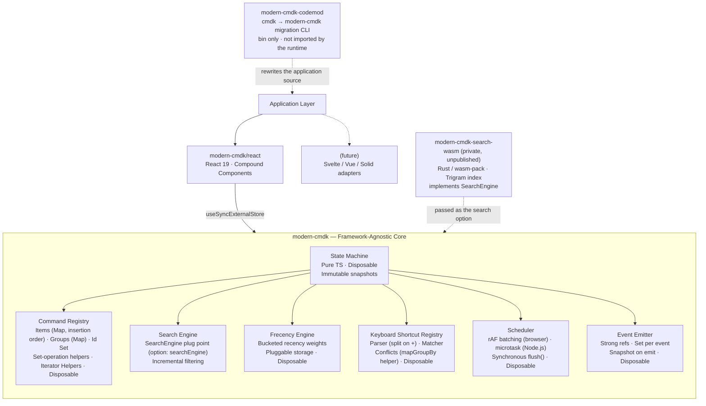
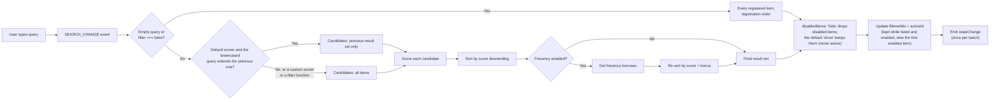
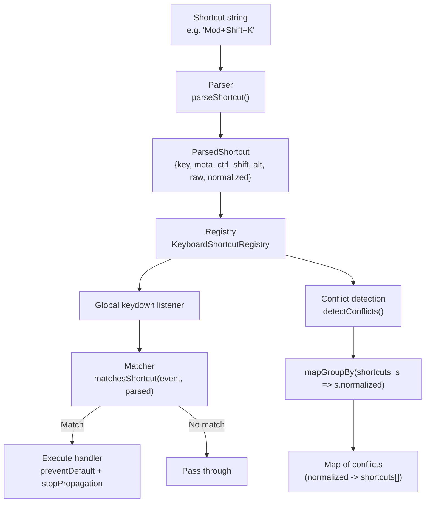
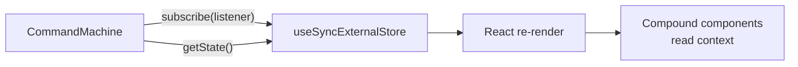
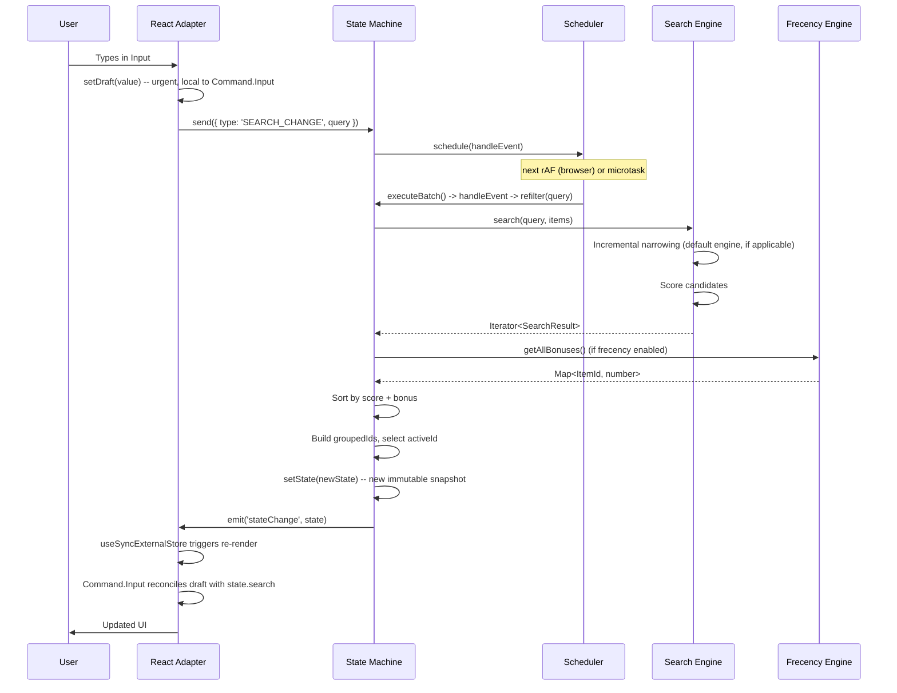

# Architecture

This document describes the technical architecture of `modern-cmdk` -- a ground-up rewrite of `cmdk` as a framework-agnostic, headless command palette engine. It is written from the sources under `packages/*/src`; where a number is a target rather than a measurement, it says so.

---

## Table of Contents

- [Overview](#overview)
- [Layered Design](#layered-design)
- [Core Engine](#core-engine)
  - [State Machine](#state-machine)
  - [Command Registry](#command-registry)
  - [Event Emitter](#event-emitter)
  - [Scheduler](#scheduler)
- [Search Pipeline](#search-pipeline)
  - [Default Scorer](#default-scorer)
  - [Plug Points: `search` and `filter`](#plug-points-search-and-filter)
  - [Disabled Items](#disabled-items)
  - [Incremental Filtering](#incremental-filtering)
  - [Frecency Re-Ranking](#frecency-re-ranking)
  - [WASM Search Engine](#wasm-search-engine)
- [Keyboard System](#keyboard-system)
  - [Parser](#parser)
  - [Matcher](#matcher)
  - [Registry](#keyboard-shortcut-registry)
  - [Conflict Detection](#conflict-detection)
- [React 19 Adapter](#react-19-adapter)
  - [Store Integration](#store-integration)
  - [Compound Components](#compound-components)
  - [Concurrent Features](#concurrent-features)
- [Event Flow](#event-flow)
- [CSS Architecture](#css-architecture)
  - [Animations and transitions](#animations-and-transitions)
  - [Scroll-Driven Animations](#scroll-driven-animations)
  - [Content Visibility](#content-visibility)
  - [Accessibility Media Queries](#accessibility-media-queries)
- [Performance Budget](#performance-budget)
- [Design Decisions](#design-decisions)
- [File Map](#file-map)

---

## Overview



---

## Layered Design

The architecture follows strict layering rules:

1. **Core layer** (`modern-cmdk`) -- Pure TypeScript. No DOM APIs required to construct or drive the machine (the keyboard registry attaches a `keydown` listener only when `document` exists). No framework imports. Runs in Node.js, Deno, Bun, or any browser.

2. **Adapter layer** (`modern-cmdk/react`) -- Thin React 19 wrapper. Consumes the core via `useSyncExternalStore`. Renders JSX. Handles DOM events. Carries the `'use client'` directive in its shipped output: the shipped `dist/react/index.mjs` and `dist/react/dialog.mjs` begin with `'use client'`, added as the banner of the React config in `packages/modern-cmdk/tsdown.config.ts`; no module under `src/react` carries the directive (`tests/dist/one-core.test.ts` enforces both).

3. **Extension layer** (`modern-cmdk-search-wasm`) -- Optional WASM search engine. It implements the core's `SearchEngine` interface and is handed to the machine through the `searchEngine` option (`search` is the deprecated name, removed in 2.0). It ships a Rust crate compiled with `wasm-pack`. The package is `private: true` in `packages/command-search-wasm/package.json`; it is not published to npm.

4. **Tooling layer** (`modern-cmdk-codemod`) -- The cmdk to modern-cmdk migration CLI (bin: `modern-cmdk-codemod`; source `packages/modern-cmdk-codemod/src`). It is a separate package with `jscodeshift` as its own dependency, no `exports` and no `types`, and nothing in the runtime imports it. `modern-cmdk` keeps a deprecated `modern-cmdk` bin until 2.0 (see [Build output](#build-output-and-the-scoped-sideeffects-array)).

Dependencies flow strictly downward. The core never imports from adapters or extensions.

---

## Core Engine

### State Machine

**File:** `packages/modern-cmdk/src/core/machine.ts`

The state machine is the central coordinator. `createCommandMachine()` returns `CommandMachine & AsyncDisposable`: the `CommandMachine` interface (which extends `Disposable`) plus `[Symbol.asyncDispose]()`.

```
createCommandMachine(options)
         |
         v
+------------------+
|  CommandMachine   |
|                   |
|  getState()      -+-> Returns immutable CommandState snapshot
|  send(event)     -+-> Enqueues CommandEvent on the scheduler (applied on its next tick)
|  subscribe(fn)   -+-> useSyncExternalStore-compatible (returns () => void)
|  subscribeState  -+-> Returns Disposable for `using` pattern
|  getRegistry()   -+-> Access the CommandRegistry
|  getKeyboard..() -+-> Access the KeyboardShortcutRegistry
|  getFilteredIdSet / getFilteredIdIndex -+-> O(1) membership / position lookup
|  suspend()/resume() -> Release / take back the global holds (reversible)
|  refresh()       -+-> Refilters with the options as they read now
|  [Symbol.dispose] +-> The terminal teardown (drops queued events)
|  [Symbol.asyncDispose] -> Awaits the pending frecency save, then disposes
+------------------+
```

`send()` never applies an event synchronously: it schedules a closure that handles the event, so state changes on the scheduler's next tick (a `requestAnimationFrame` in browsers, a microtask elsewhere). `getState()` right after `send()` returns the previous state, and the machine has no public `flush()`: subscribe with `machine.subscribe`, or wait for the next frame or microtask.

**One batch, at most one deferred refilter, at most one `stateChange`.** The closures of one scheduler batch (see [Scheduler](#scheduler)) run in the order sent:

- A registry event (`REGISTER_ITEM`, `UPDATE_ITEM`, `UNREGISTER_ITEM`, `ITEMS_LOADED`, `REGISTER_GROUP`, `UNREGISTER_GROUP`) only marks the results dirty.
- `SEARCH_CHANGE` refilters when it runs. A `NAVIGATE` or `ITEM_ACTIVATE` that follows a registry event of the batch refilters first, so it reads up-to-date ids.
- After the last event of the batch, `commit()` refilters once if the results are still dirty, then emits `stateChange` once, and only if the state changed.
- `setOpen` emits `openChange` and then calls `onOpenChange`; `onSearchChange` runs inside the `SEARCH_CHANGE` handler. All of them therefore come before the batch's single `stateChange`.
- An event sent from inside a handler runs in the next batch.
- `[Symbol.dispose]()` is terminal: it drops the queued events, a batch that is running stops without its commit, and afterwards `send()` reduces nothing and calls no option callback. `using` disposes at the end of its block. `await using` (`[Symbol.asyncDispose]()`) first awaits the pending frecency save, then disposes.

**Lifecycle: `suspend()`, `resume()` and `refresh()`.** `suspend()` is the reversible pause. It runs the pending batch at once, detaches the keyboard registry's `document` keydown listener, removes the frecency engine's `pagehide` and `visibilitychange` listeners and starts the save of pending frecency data. State, registered items and shortcut bindings, the search engine and the frecency storage stay, and `resume()` takes the listeners back. Both are idempotent and do nothing after dispose. They are optional members of the `CommandMachine` interface, and the machine `createCommandMachine` returns always has them. `refresh()` schedules one batch slot that runs the filter again over the registered items and recomputes the active item with the options as they read now; it is not a `CommandEvent` and reports no candidate to `onActiveChange`.

**Controlled `activeId`.** With the `activeId` option defined, `state.activeId` mirrors it while that id is listed and enabled, and is `null` otherwise (`activeId: null` means no active item). Every candidate the machine would choose is reported through `onActiveChange`, and the caller decides whether to pass it back.

**State shape** (`CommandState`):

| Field | Type | Description |
|---|---|---|
| `search` | `string` | Current search query |
| `activeId` | `ItemId \| null` | Currently highlighted item |
| `filteredIds` | `readonly ItemId[]` | Ordered list of visible item IDs |
| `groupedIds` | `ReadonlyMap<GroupId, readonly ItemId[]>` | Items bucketed by group; the keys are in group-priority order (lower first), while `filteredIds` and `NAVIGATE` keep the search order |
| `filteredCount` | `number` | Total visible items |
| `loading` | `boolean` | Whether async items are loading |
| `page` | `string` | Current page name |
| `pageStack` | `readonly string[]` | Page navigation history |
| `open` | `boolean` | Dialog open state |
| `lastUpdated` | `number` | Timestamp of last state change (epoch ms) |

**Event types** (`CommandEvent`):

| Event | Payload | Effect |
|---|---|---|
| `SEARCH_CHANGE` | `query: string` | Re-filters, re-ranks, updates `activeId`, calls `onSearchChange` |
| `ITEM_SELECT` | `id: ItemId` | For a registered, enabled item: fires its `onSelect`, records frecency, emits `select`, calls the machine's `onSelect` |
| `ITEM_ACTIVATE` | `id: ItemId` | Sets `activeId` only if the item is in the filtered set **and** enabled; calls `onActiveChange` |
| `NAVIGATE` | `direction: next \| prev \| first \| last` | Moves `activeId` through the enabled filtered items (disabled ones are skipped), with optional loop wrapping (`loop` defaults to `true`) |
| `PAGE_PUSH` | `page: string` | Pushes current page to stack, sets new page |
| `PAGE_POP` | -- | Pops page stack |
| `OPEN` / `CLOSE` / `TOGGLE` | -- | Controls dialog visibility |
| `ITEMS_LOADED` | `items: readonly CommandItem[]` | Registers items from an async source, indexes them and binds their shortcuts; marks the results dirty |
| `LOADING` | `source: string, pending: boolean` | Marks an async source as loading or done; `state.loading` is true while any source is pending |
| `REGISTER_ITEM` | `item: CommandItem` | Registers a single item, indexes it and binds its shortcut; marks the results dirty |
| `UPDATE_ITEM` | `item: CommandItem` | Upserts an item in place: its position is kept (an unknown id is appended), the search index is updated and its shortcut re-bound. It runs the same handler as `REGISTER_ITEM` |
| `UNREGISTER_ITEM` | `id: ItemId` | Removes the item from the registry, the search index and the keyboard registry |
| `REGISTER_GROUP` / `UNREGISTER_GROUP` | group/id | Manages group lifecycle |

All state transitions produce a new immutable `CommandState` object (`setState` assigns a spread copy and marks the state changed; `commit()` emits `stateChange` once per batch). The machine never mutates state in place.

### Command Registry

**File:** `packages/modern-cmdk/src/core/registry.ts`

The registry manages item and group storage with O(1) lookup performance.

```
CommandRegistry
  |
  +-- #items: Map<ItemId, CommandItem>      -- O(1) lookup
  +-- #groups: Map<GroupId, CommandGroup>    -- O(1) lookup
  +-- #itemOrderSet: Set<ItemId>            -- the id Set behind getItemIds() and the set operations
  |                                         (order = the Map's insertion order; there is no
  |                                          separate order array)
  +-- registerItem(item) -> Disposable      -- `using` auto-deregister; an existing id is replaced in place
  +-- registerItems(items) -> Disposable    -- batch registration
  +-- unregisterItem(id) -> void            -- single removal
  +-- unregisterItems(ids: Set) -> void     -- bulk removal (one Map and Set delete per id)
  +-- registerGroup(group) -> Disposable    -- group lifecycle
  +-- unregisterGroup(id) -> void
  +-- getItem(id) / getGroup(id)            -- O(1) Map lookup
  +-- getItems() -> readonly CommandItem[]  -- Iterator Helpers pipeline, cached
  +-- getGroups() -> readonly CommandGroup[]-- sorted by priority, cached
  +-- getGroupedItems() -> ReadonlyMap      -- mapGroupBy helper, emitted in group-priority order
  +-- getItemIds() -> ReadonlySet<ItemId>   -- internal set, zero allocation
  +-- intersectWith / differenceFrom / unionWith / symmetricDifferenceWith
  +-- isSubsetOf / isSupersetOf / isDisjointFrom
  +-- size / groupCount (getters) · clear()
```

The set methods above delegate to the helper functions in `utils/set-ops.ts` (`setIntersection`, `setDifference`, `setUnion`, `setSymmetricDifference`, `setIsSubsetOf`, `setIsSupersetOf`, `setIsDisjointFrom`). They are plain loops, not the native `Set.prototype` methods (Set methods are ES2025), so the registry does not depend on a runtime that ships them. Because the registry calls every one of them, none of these helpers is removed by tree-shaking when the registry is in the bundle.

`getItems()` and `getGroups()` memoize their results and invalidate the cache on the next mutation, so repeated reads inside a single filter pass are free. `getGroupedItems()` buckets with the `mapGroupBy` helper from `utils/group-by.ts` (the native `Map.groupBy` is ES2024; the helper is a plain loop) and then re-emits groups in `priority` order, appending the ungrouped bucket (`UNGROUPED_GROUP_ID`, the string `__ungrouped`) last. `utils/group-by.ts` also exports `objectGroupBy`; nothing in `packages/*/src` calls it and the core entry does not export it.

### Event Emitter

**File:** `packages/modern-cmdk/src/core/utils/event-emitter.ts`

`TypedEmitter<T>` is a small typed emitter. It holds **strong references**; nothing about it observes garbage collection.

- Storage is `Map<event, Set<listener>>`: one `Set` per event.
- `.on(event, listener)` adds the listener to that event's `Set` and returns a `Disposable` whose `[Symbol.dispose]()` deletes it, so `using sub = emitter.on(...)` unsubscribes at block exit.
- `.emit(event, data)` iterates a **snapshot** of the `Set` (`[...set]`), so a listener added or removed during an emit does not change the pass in progress.
- **Listener isolation.** Each listener runs in a `try`/`catch`: a throwing listener no longer skips the later listeners, and its error is rethrown from a `queueMicrotask`, the way the [Scheduler](#scheduler) reports a failing update. `emit()` itself does not throw (CE-75).
- `.has(event)` and `.listenerCount(event)` read `Set.size`.
- `.removeAll()` and `[Symbol.dispose]()` clear every listener.
- A listener that is never unsubscribed stays reachable from the emitter until the emitter is disposed. There is no pruning of dead listeners: the owner of a subscription is responsible for disposing it. The machine's own emitter is cleared when the machine is disposed.

The machine uses it for three events: `stateChange`, `select` and `openChange`.

### Scheduler

**File:** `packages/modern-cmdk/src/core/utils/scheduler.ts`

The scheduler coalesces state updates to prevent redundant re-renders:

```
Browser environment (requestAnimationFrame exists):
  schedule(update) -> pending[] -> requestAnimationFrame -> executeBatch()

Node.js / SSR / test environment (no requestAnimationFrame):
  schedule(update) -> pending[] -> queueMicrotask -> executeBatch()
```

- `schedule()` pushes the update, then arms exactly one rAF (`rafId ??= requestAnimationFrame(...)`) or one microtask for the whole batch. Which of the two is decided once at module load, by `typeof requestAnimationFrame === 'function'`.
- `executeBatch()` snapshots and clears the queue before running it, so an update scheduled while a batch runs lands in the next one (the next frame or microtask). The updates of a batch run whole and in the order they were scheduled.
- Error isolation: each update runs in a `try`/`catch`; a failing update is rethrown from a `queueMicrotask`, so the error surfaces and the rest of the batch still runs.
- `flush()` is **synchronous**: it cancels a pending rAF, clears the microtask flag and runs `executeBatch()` at once, so it applies the updates pending when it is called, in order. It returns `void`, not a promise. An update scheduled during the flush runs on the next frame or microtask, not inside it.
- Implements `Disposable` -- cancels a pending rAF and drops the queued updates, which never run.
- There is **no `isInputPending` / `scheduler.yield()` gate**. An earlier version re-queued whole batches when input was pending, so `flush()` could apply nothing. MDN (read 2026-11-07) marks `isInputPending` deprecated and experimental and Chromium-only, and `scheduler.yield()` is not Baseline (no Safari); a batch now always runs whole (`scheduler.ts`, header).
- The machine itself has no public `flush()`: `send()` goes through `scheduler.schedule`, so `getState()` right after `send()` returns the previous state. Code that needs the result subscribes (`machine.subscribe`) or waits for the next frame or microtask (see [State Machine](#state-machine)).

---

## Search Pipeline



### Default Scorer

**File:** `packages/modern-cmdk/src/core/search/default-scorer.ts`

The built-in scorer matches against the item's `value` and `keywords` and keeps the best score. Per target it tries, in order: exact match (1), prefix, substring (with a position bonus), word-boundary (separators are found by character code, no regex), then a character-by-character fuzzy match. It returns a `SearchResult` with:
- `id: ItemId` -- the matched item
- `score: number` -- relevance score (higher is better)
- `matches: ReadonlyArray<readonly [number, number]>` -- character ranges for highlighting

`scoreItem(query, item)` is the public entry; the search engine calls the internal `scoreItemPreLowered` with lowercase text cached at index time.

`search/fuzzy-scorer.ts` exports `scoreItemAsync` and `batchScoreItems`: `Promise`-wrapped calls to the same `scoreItem`. They run synchronously inside the promise executor; they are not a separate matching algorithm and the machine does not use them.

### Plug Points: `search` and `filter`

Two options on `createCommandMachine()` (and, through `CommandMachineOptions`, on `<Command>`) change how items are matched. They are different things:

| Option | Type | What it does |
|---|---|---|
| `searchEngine` | `SearchEngine` | **The pluggable engine** (`search` is its deprecated name, removed in 2.0; `searchEngine` wins when both are set). Replaces the whole default engine: `index(items)`, `search(query, items)` returning an iterator of `SearchResult` (with match ranges), `remove(ids)`, `clear()`, `[Symbol.dispose]()`. The WASM engine implements this interface. The machine disposes an engine only if it created it, so an engine you pass is yours to dispose and survives the machine's dispose, suspend and resume. |
| `filter` | `(item, query) => number \| false`, or `false` | A **score override** for the default engine. Return a positive score to keep the item (higher ranks first); `false`, `0` or a negative number drops it. The machine wraps it as the engine's scorer with `matches: []`, so a `filter` cannot supply highlight ranges. `filter: false` skips searching altogether and lists every registered item in registration order (disabled ones too, unless `disabledItems: 'hide'`). |

When `searchEngine` (or the deprecated `search`) is given, it is used as is (`options.searchEngine ?? options.search ?? createOwnedEngine(options)` in `machine.ts`), and a `filter` function is not consulted. The engine's `ScorerFn` type (`(query, item) => SearchResult | null`) is only the option type of `createSearchEngine({ scorer })`. A `filter` function is such a scorer, so it is called for every item on every non-empty query (see [Incremental Filtering](#incremental-filtering)).

### Disabled Items

By default (`disabledItems: 'show'`) a disabled item (`disabled: true`) is searched and listed like any other item whenever it matches, and `filteredIds` holds it. What differs is what can reach it:

- It renders with `aria-disabled` and `data-disabled` (`react/item.tsx`).
- Navigation (`NAVIGATE`), `ITEM_ACTIVATE` and `ITEM_SELECT` skip it. `activeId` is never a disabled item: a refilter keeps the active item while it is listed and enabled, and otherwise takes the first enabled one (`machine.ts`, `refilter`, `navigate`, `handleEvent`).
- `disabledItems: 'hide'` drops it from `filteredIds` under every query, after the search, so an engine that searches its own index is covered too. The default is `'show'`.
- Its keyboard shortcut is not bound (CE-09): the key stays free for the page and for other items. `UPDATE_ITEM` re-binds, so enabling an item binds its shortcut.

### Incremental Filtering

**File:** `packages/modern-cmdk/src/core/search/index.ts`

When the user appends characters to the search query (e.g., "cop" -> "copy"), the **default scorer** only re-scores items that matched the previous query. This is tracked via:
- `previousQuery: string` -- the last query, lowercased
- `previousResults: Set<ItemId>` -- the IDs that matched

If the new query, lowercased, starts with the previous (non-empty) lowercased query, candidates are narrowed to `previousResults` before scoring, so "Cop" after "co" is incremental. This reduces work from O(n) to O(k) where k << n. `index()` resets the cache, because newly indexed items may match the current query; `remove(ids)` prunes it.

The shortcut is for the default scorer only, because a custom scorer need not be monotone (a longer query may match an item a shorter one did not). A custom scorer -- a `filter` function, or `createSearchEngine({ scorer })` -- is called for every item on every non-empty query.

In browser development builds the engine also registers itself with a `FinalizationRegistry` and warns if it is garbage collected without being disposed. This is a diagnostic only; it never affects delivery or pruning. The engine a machine creates itself is not subject to the warning: the machine registers it with its own `FinalizationRegistry`, which disposes it when the machine is collected, and `machine[Symbol.dispose]()` or `using` disposes it at once.

### Frecency Re-Ranking

**File:** `packages/modern-cmdk/src/core/frecency/index.ts`

After scoring, results are optionally re-ranked by frecency bonus:

```
Final rank = search_score + frecency_bonus
```

The bonus uses **bucketed recency weights**: the elapsed time since last use picks one of five fixed weights. It is a step function, not a continuous time decay.

| Time Since Last Use | Weight (default) |
|---|---|
| < 1 hour | 4.0 |
| < 1 day | 2.0 |
| < 1 week | 1.5 |
| < 1 month (30 days) | 1.0 |
| Older | 0.5 |

```
frecency_bonus = frequency_count * recency_weight
```

The weights are the defaults in `DEFAULT_FRECENCY_DECAY` (`types.ts`) and can be overridden per bucket through `decayConfig`. Time elapsed is computed using `(now - lastUsed) / 3_600_000` for hours. `FrecencyEngine.recordSelection()` runs on `ITEM_SELECT`. Frecency re-ranks only non-empty queries with filtering on: the empty-query path and `filter: false` list the items in registration order without a bonus (`machine.ts`, `refilter`).

**Persistence.** Selections are saved to the storage:

- 1000 ms after the last selection (a trailing debounce: each selection restarts the timer);
- when the page becomes hidden (`visibilitychange`) and on `pagehide` (`suspend()` removes both listeners and starts the save of pending data, `resume()` re-attaches them);
- on `flush()` and on dispose.

`load()` merges the stored data into the engine instead of replacing it: frequencies add, and the later `lastUsed` wins. The machine loads in the background when frecency is enabled and refilters once the data has merged (only if a non-empty query is active with filtering on). A failed load or save is reported with `console.warn`, never thrown from the timer or the page listeners.

`FrecencyEngine` implements `Disposable` and `AsyncDisposable`. `[Symbol.dispose]()` starts a best-effort `save` and logs a warning if it fails; `await using` (`[Symbol.asyncDispose]()`) awaits the save first. Either way the engine then disposes its storage, so the machine disposes a storage it is given: create the storage for each machine rather than sharing one.

**Storage interface:**

```ts
interface FrecencyStorage extends Disposable {
  load(namespace: string): FrecencyData | Promise<FrecencyData>;
  save(namespace: string, data: FrecencyData): void | Promise<void>;
  [Symbol.dispose](): void;
}
```

Ships with `MemoryFrecencyStorage` (in-memory, no persistence) and `IdbFrecencyStorage` (IndexedDB persistence via `idb-keyval`, which is imported dynamically on first use so non-persisting consumers never load it).

### WASM Search Engine

**Files:** `packages/command-search-wasm/crate/src/` (Rust), `packages/command-search-wasm/src/` (TypeScript wrappers)

The optional WASM engine implements the core's `SearchEngine` interface; you pass it as `searchEngine:` to `createCommandMachine()` (or `<Command searchEngine={...}>`; the deprecated name `search` still works). It is **not** a `filter` function and not a `ScorerFn`.

- **Trigram index** (`crate/src/trigram.rs`) -- `index_items` receives a JSON array of `[id, value]` pairs and maps every lowercase 3-character window of `value` to the items containing it. Only `value` is indexed; `keywords` are not. A query's score is the share of its trigrams found in an item, results at or below 0.1 are dropped, and match ranges are exact substring hits.
- **`createWasmSearchEngine()`** (`src/wasm-engine.ts`) -- main-thread wrapper. If the WASM module cannot be loaded it falls back to the TypeScript engine from `modern-cmdk` (`isWasm: false`). `remove(ids)` clears the whole WASM index and does not re-index the remaining items (a known gap).
- **`createWorkerSearchEngine()`** (`src/worker-engine.ts`) -- runs the same engine in a Web Worker; scores travel in a `SharedArrayBuffer` only when the page is cross-origin isolated, otherwise they are structured-cloned. Its synchronous `search()` yields the results of the most recent `searchAsync()` call, and nothing in `createCommandMachine` calls `searchAsync()`, so pair it with explicit `await engine.searchAsync(query)` calls. This file uses `Promise.withResolvers` (ES2024) for the worker-ready signal and for per-request tracking; `packages/modern-cmdk/src` does not use it, and the codemod uses it in `packages/modern-cmdk-codemod/src/cli.ts` and `files.ts`.
- **Edit distance** -- `crate/src/scorer.rs` (Levenshtein helpers) is compiled under `cfg(test)` only and is not part of the search path.

**Measurements.** The `.wasm` binary is 113,236 bytes raw and 52,106 bytes under `gzip -9` (measured 2026-11-12 on the `pkg/command_search_wasm_bg.wasm` that wasm-pack 0.15.1 builds with the nightly of 2026-11-12, rustc 1.102.0-nightly 3ef0c22cd; the 2026-11-11 nightly gave 113,236 and 52,111, the 2026-11-10 nightly 113,236 and 52,107, the 2026-11-09 nightly 113,239 and 52,096, the 2026-11-08 nightly 113,492 and 52,188), so "about 52 kB gzip". **No search-latency figure has been measured for the WASM engine**; `benchmarks/wasm-search.bench.ts` exists but asserts nothing and its numbers are not published. Any latency stated elsewhere is a target, not a result.

---

## Keyboard System



### Parser

**File:** `packages/modern-cmdk/src/core/keyboard/parser.ts`

Parses human-readable shortcut strings into structured `ParsedShortcut` objects. It builds no pattern from user input; the only regular expressions involved are two fixed literals, the lone-surrogate pattern inside `ensureWellFormed` (`utils/string-wellformed.ts`) and the module-level platform test `MAC_PLATFORM_RE` (`parser.ts`):

1. Replace lone surrogates with U+FFFD (`ensureWellFormed`, a helper for `String.prototype.toWellFormed`).
2. Split on `+`, then `trim()` and `toLowerCase()` each part.
3. Look each part up in the alias map (`MODIFIER_MAP`). A part that is a modifier sets that flag; any other part becomes `key` (the last non-modifier part wins).
4. Build `normalized` from the set modifiers in the fixed order `meta`, `ctrl`, `shift`, `alt`, then `key`, joined with `+`.

- `"Mod+K"` -- `Mod` resolves to `meta` on Apple platforms and `ctrl` elsewhere (decided once at module load, from `navigator.userAgentData` or `navigator.platform`)
- `"Ctrl+Shift+P"` -- explicit modifier specification
- `"Alt+Enter"` -- named key support
- Aliases: `Cmd`/`Command` -> `meta`, `Option`/`Opt` -> `alt`, `Control` -> `ctrl`

Because the key is whatever remains after the split, a literal `+` key cannot be written (`"Mod++"` yields an empty key).

The `normalized` field is a deterministic string (`meta+ctrl+shift+alt+key`, absent modifiers omitted) used as the registry's map key and for conflict comparison: `"Shift+Cmd+K"` and `"cmd + shift + k"` normalize to the same value.

`formatShortcut()` renders platform-appropriate display labels (Mac symbols vs. Windows text).

### Matcher

**File:** `packages/modern-cmdk/src/core/keyboard/matcher.ts`

Compares `KeyboardEvent` properties against `ParsedShortcut` fields. All four modifier keys (`metaKey`, `ctrlKey`, `shiftKey`, `altKey`) must match exactly -- no partial matching -- and `event.key.toLowerCase()` must equal the parsed `key`.

### Keyboard Shortcut Registry

**File:** `packages/modern-cmdk/src/core/keyboard/index.ts`

Global shortcut management:

- `.register(shortcutStr, itemId, handler)` returns a `Disposable` -- enables `using` for automatic deregistration. Each `normalized` key keeps a **stack** of bindings, one per item. The later binding wins the keydown, and disposing it restores the earlier one. The same item registering the same key again replaces its own binding in place; that is not a conflict.
- `.unregister(shortcutStr)` removes every binding of the key. `.unregisterByItem(itemId, keep?)` removes the item's bindings on all other keys and keeps the one named by `keep` (the machine uses it to re-bind in place).
- `.getBindings()` returns a snapshot of each key's winner, the later binding.
- Attaches a single `document.addEventListener('keydown', ...)` listener, in the constructor. `suspend()` detaches it with every binding kept and `resume()` attaches it again.
- Safe in SSR -- checks `typeof document` before attaching.
- Implements `Disposable` -- removes the global listener and clears all bindings.

### Conflict Detection

`detectConflicts` (in `matcher.ts`) uses the `mapGroupBy` helper to group shortcuts by normalized form:

```ts
const grouped = mapGroupBy(shortcuts, (s) => s.normalized);
// Any group with length > 1 is a conflict
return new Map(grouped.entries().filter(([, group]) => group.length > 1));
```

`KeyboardShortcutRegistry.getConflicts()` feeds it every registered binding, and lists the keys with two or more bindings (normalized key -> the parsed shortcuts, earliest first). Because the registry keeps a stack per key, two items can bind one shortcut; the later one wins the keydown. A disabled item is never bound, so it never conflicts.

---

## React 19 Adapter

### Store Integration



The machine's `.subscribe()` returns an unsubscribe function -- the exact signature `useSyncExternalStore` expects. No wrapper needed.

The machine's `.getState()` returns the same object reference until the next state change -- this satisfies `useSyncExternalStore`'s identity check.

### Compound Components

All components read the machine through two React contexts, a stable one (the machine, ids, the label and `updateSearch`) and a state one (the current `CommandState`), with `use()` (React 19). `Command` and `Command.Dialog` create one machine per mount, suspend it in the layout-effect cleanup (an unmount, an `<Activity>` hide, a StrictMode replay), resume it in the setup, and never dispose it; the search engine a machine creates is disposed when the machine is collected.

The machine's `telemetry` hooks are a prop of `Command` and `Command.Dialog` (a `CommandMachineOptions` field), read at the end of each batch, so a changed prop reaches the machine without a remount.

| Component | Role | Key Props |
|---|---|---|
| `Command` | Root -- creates machine, provides context | every `CommandMachineOptions` field (`items`, `groups`, `filter`, `search`, `loop`, `frecency`, ...) plus `label`, `className` |
| `Command.Dialog` | Radix Dialog wrapper with overlay and portal. A controlled dialog reports a machine-originated open change (an item selection that closes it, `CLOSE`, `OPEN` or `TOGGLE`) once through `onOpenChange` and keeps the `open` you pass | `open`, `onOpenChange` |
| `Command.Input` | Search input bound to machine state; keeps its own urgent draft value | `placeholder`, `onValueChange` |
| `Command.List` | Scrollable list with auto-virtualization and `aria-live` | `virtualize` |
| `Command.Item` | Selectable item -- registers/unregisters on mount/unmount; the registration id is `id ?? forceId ?? useId()` (`forceId` is deprecated, removed in 2.0) | `id`, `value`, `onSelect`, `shortcut`, `disabled` |
| `Command.Group` | Logical group with heading; `id` is the registration id, as on `Command.Item` | `id`, `heading` |
| `Command.Empty` | Rendered when `filteredCount === 0` | -- |
| `Command.Loading` | Rendered when its `loading` prop is `true`; when the prop is omitted, rendered while `state.loading` is true (`loading={false}` hides it in all cases) | `loading` |
| `Command.Separator` | Visual divider; with `alwaysRender={false}` it hides while a search is active (default `true` through 1.x) | `alwaysRender` |
| `Command.Highlight` | Fuzzy match character highlighting | `text`, `ranges` |
| `Command.Badge` | Status badge on items | -- |
| `Command.Shortcut` | Keyboard shortcut display (platform-aware) | `shortcut` |
| `Command.Page` | Nested page for hierarchical navigation | `id` |
| `Command.AsyncItems` | Suspense-powered async data loading | `items` (a `Promise<readonly CommandItem[]>`), `fallback`, `children` (render fn) |
| `Command.Activity` | React Activity API state preservation (falls back to conditional rendering) | `mode` |

All components:
- Reach the consumer with the `'use client'` directive: the shipped `dist/react/index.mjs` and `dist/react/dialog.mjs` begin with `'use client'`, added as the banner of the React config in `packages/modern-cmdk/tsdown.config.ts`; no module under `src/react` carries the directive (`tests/dist/one-core.test.ts` enforces both)
- Accept `ref` as a prop (React 19 -- no `forwardRef`)
- Use `useId()` for stable, SSR-safe ARIA IDs, and for the registration id of an item or group that is given no `id`

### Concurrent Features

| React 19 Feature | Usage |
|---|---|
| `useSyncExternalStore` | Subscribe to machine state without tearing |
| `Activity` | `Command.Activity` passes its `mode` to React's `<Activity>` when React exports it (feature-detected) |
| `useId` | Generate stable IDs for `aria-labelledby`, `aria-controls`, `aria-activedescendant` |
| `use()` | Consume `CommandContext` (replaces `useContext`) |
| `ref` as prop | All components accept `ref` directly -- no `forwardRef` wrapper |

**Search is not a transition.** `Command.Input` keeps the typed text in local state (`draft`), set inside the change event, so the input is always responsive. The same handler then calls `machine.send({ type: 'SEARCH_CHANGE', query })`, which only enqueues the event on the machine's scheduler (see [Scheduler](#scheduler)). Filtering and the state update happen on that scheduler tick, outside React; React sees the result through `useSyncExternalStore`. On every machine tick `Command.Input` reconciles its draft: an echo of a query typed here is ignored, and any other `search` value (an external `SEARCH_CHANGE`, a reset) replaces the draft. No transition wraps a search: `useCommand().isPending` is constant `false` (deprecated, removed in 2.0, as is `setOptimisticActiveId`, which sends `ITEM_ACTIVATE`), hovering an item sends `ITEM_ACTIVATE` directly, and `Command.Loading` reads `state.loading` only, which the machine sets from `LOADING` events, never from a search.

---

## Event Flow

Complete cycle from user action to re-render:



---

## CSS Architecture

### Animations and transitions

**File:** `packages/modern-cmdk/src/react/styles.css`

What resolves today:

- Item background: `[data-command-item]` declares a `background-color` transition over `--command-duration-item` (120ms) with a `linear()` ease (styles.css:207); it runs on the background the app sets for `[data-active]` (the library sets one only under `forced-colors`, :571). `content-visibility: auto` skips off-screen item rendering (:209).
- List height: `[data-command-list]` declares `transition: height` over `--command-duration-list` with `--command-spring-easing` and sets `will-change: height` (styles.css:188-189). Both tokens resolve because the list sits inside `[data-command-root]`. The library sets only `--command-list-height` on the list (list.tsx:125-126), not `height`, so the transition interpolates once the app sets `height: var(--command-list-height)` on `[data-command-list]` (the sample in apps/docs/guide/migration-from-cmdk.md). The property holds the content height of the list's inner element while the list is not virtual. While the list is virtual that element's height is the sum of all the row sizes, so the observer ignores it and the property keeps its last non-virtual value (`0px` when the list mounts virtual).
- Virtual positioning: each virtual item is absolutely positioned and offset with the `translate` property (`translate: 0 <start>px`, item.tsx:104), and the virtual list sets `will-change: transform` (styles.css:228). The motion is transform-based, which keeps it off the layout path. The list renders one element tree in both modes: crossing the virtualization threshold (more than 100 matches on, 50 or fewer off) changes the props of the inner element and which items render, so the items that stay in the window stay mounted. Keyboard navigation scrolls the active row just into view with `scrollToIndex(index, 'nearest')`; `scrollToIndex(index)` defaults to `'start'`, which sets `scrollTop` to the row's offset among the rows, with no allowance for padding or anything before them.
- Overlay tint: `--command-overlay-opacity` is a registered property (:24) read by the overlay background (:134) and set to 0 or 0.4 by the state rules (:319, :329). The value switches with `data-state`; the `transition` declarations beside it (:321-325, :331-335) read unset tokens, so it does not interpolate.

What is declared and inert until DT-19:

The tokens are declared only in `[data-command-root]` (styles.css:45-103). The overlay and dialog elements sit outside it: `dialog.tsx` renders the Command root element inside the dialog content (dialog.tsx:144). Every `transition`, `backdrop-filter` and size declaration that reads an unset token is invalid at computed-value time, so the dialog and overlay open and close transitions (styles.css:312-374) do not run. DT-19 moves the tokens to a selector the overlay and dialog match. Until then an app sets all twelve tokens on `[data-command-overlay], [data-command-dialog]`; see `apps/docs/guide/theming.md` (Library Tokens).

```
declared (inert until DT-19)

Dialog open:
  @starting-style { opacity: 0; scale: 0.96; translate: 0 8px; }
  -> opacity: 1; scale: 1; translate: 0 0;
  -> opacity 200ms spring linear() easing
  -> scale/translate 250ms bouncy spring linear() easing (slight overshoot)
  -> display/overlay: allow-discrete

Dialog close:
  -> opacity: 0; scale: 0.96; translate: 0 4px;
  -> 150ms cubic-bezier(0.4, 0, 1, 1)  // quicker, no spring overshoot
```

The spring easings are `linear()` stop lists (styles.css:46-84): `--command-spring-easing` rises to 1 without overshoot (critically damped), and `--command-spring-easing-bouncy` peaks at 1.033 before settling. They also live in `[data-command-root]`, so only the list height transition reads them today, and it animates only when the app sets the list height (see above).

`@starting-style` (CSS Transitions Level 2) is written for the overlay (:315-318) and the dialog (:341-347). Once the tokens resolve, the browser interpolates from the starting style to the final style on first render. `display` and `overlay` transitions use `allow-discrete` to animate to and from `display: none`.

### Scroll-Driven Animations

`styles.css` declares a `scroll-timeline` on the list and a matching progress-indicator
rule driven by it. Both are wrapped in `@supports (animation-timeline: scroll())` (styles.css:433-458), and the timeline is declared without an axis, because `block` is the default:

```css
@supports (animation-timeline: scroll()) {
  [data-command-list] {
    scroll-timeline: --list-scroll;
    /* ... the ::before / ::after fade edges use the same timeline ... */
  }

  [data-command-scroll-indicator] {
    animation: scroll-progress linear both;
    animation-timeline: --list-scroll;
  }
}
```

The guard is there because Safari before 26 and Firefox before 159 lack `animation-timeline` (styles.css:432; web-features 3.45.0-dev-20261111122710-51d7b6c, `scroll-driven-animations`): without it a time-based run would settle in its end state. At the Safari 18.4 / Firefox 131 floor the fade edges and the progress bar therefore stay static.

No JavaScript scroll event listeners. Zero main-thread cost where the timeline is supported.

> [!NOTE]
> The timeline is declared, but **no built-in component renders a
> `[data-command-scroll-indicator]` element** -- the rule is a styling hook for consumers
> who want a progress bar. Render your own element with that attribute inside
> `<Command.List>` and it picks up the timeline with no JavaScript.

### Content Visibility

Every item (`[data-command-item]`) uses `content-visibility: auto` with `contain-intrinsic-size`. The `[data-command-virtual-item]` selector below is a reserved hook for custom rows built on `useVirtualizer`; no component emits that attribute.

```css
[data-command-item],
[data-command-virtual-item] {
  content-visibility: auto;
  contain-intrinsic-size: auto var(--command-item-height); /* 44px */
}
```

The browser skips rendering off-screen items entirely. Combined with the auto-virtualization threshold, rendering cost tracks the visible rows rather than the item count.

### Accessibility Media Queries

| Media Query | Behavior |
|---|---|
| `prefers-reduced-motion: reduce` | Disables all animations and transitions |
| `prefers-contrast: more` | Thicker outlines (3px) on active/focused items |
| `forced-colors: active` | Uses system `Highlight`/`HighlightText` colors, disables `forced-color-adjust` |

Five custom properties are registered with `@property` (`--command-list-height`, `--command-count`, `--command-overlay-opacity`, `--command-dialog-scale`, `--command-dialog-translate`), each with a syntax and an initial value so that it animates.

---

## Performance Budget

| Metric | Target | Enforcement |
|---|---|---|
| Core bundle | ≤ 8.35 kB | **Enforced**: `size-limit` (`pnpm size`, CI "Bundle Size" job), `packages/modern-cmdk/dist/core/index.mjs`, gzip. Measured 7742 B |
| React adapter only | ≤ 7.09 kB | **Enforced**: `dist/react/index.mjs`, gzip, with `modern-cmdk`, `react`, `react-dom`, `react/jsx-runtime` and `radix-ui` ignored (the core is not counted). Measured 6491 B |
| Core + React adapter | ≤ 13.16 kB | **Enforced**: `dist/react/index.mjs`, gzip, `modern-cmdk` not ignored, so the one core is counted once. Measured 12038 B (1.6 measured 10764 B; 1.3 inlined the core in the adapter: 6355 B + 9844 B = 16199 B) |
| `modern-cmdk/react/dialog` only | ≤ 2.39 kB | **Enforced**: `dist/react/dialog.mjs`, gzip, same ignore list. Measured 2104 B |
| `CommandSeparator` only | ≤ 390 B | **Enforced**: `import { CommandSeparator }` from `dist/react/index.mjs`, gzip, same ignore list. Measured 293 B; `Command` is a `/* @__PURE__ */ Object.assign` (D116), so the bundle holds `CommandSeparator` and what it imports, not `CommandDialog`, `CommandRoot` or the `radix-ui` import, and the entry pins that tree-shaking property |
| `modern-cmdk/styles.css` | ≤ 2.5 kB | **Enforced**: `dist/react/styles.css`, gzip. Measured 3986 B |
| Codemod bin (`modern-cmdk`, deprecated) | ≤ 3.4 MB | **Enforced**: `dist/codemod/*.mjs` plus `dist/codemod/transforms/*.mjs` (the bundled bin, shim included), installed size (no compression). `benchmarks/size-history/1.7.0.json` (a7838c9, measured 2026-11-08 with size-limit 14.3.0) holds 3153027 B; the 1.6 value was 3153027 B |
| Codemod shim (`bin.mjs`) | ≤ 1000 B | **Enforced**: `dist/codemod/bin.mjs` alone, installed size. Measured 897 B (`benchmarks/size-history/1.7.0.json`) |
| `modern-cmdk-codemod` own files | ≤ 102000 B | **Enforced**: `packages/modern-cmdk-codemod/dist/*.mjs` plus `dist/transforms/*.mjs`, installed size; `jscodeshift` is not in the tarball and not counted. Measured 100685 B (`benchmarks/size-history/1.7.0.json`); the tarball is 117172 B unpacked, 34216 B packed |
| WASM binary (gzipped) | no budget; about 52 kB measured (113,236 bytes raw, see [WASM Search Engine](#wasm-search-engine)) | Not enforced (package private, not in `size-limit`) |
| Search latency (10K items, TS scorer) | < 16 ms | Tripwire on the named task `search:ts-scorer-10k`: `pnpm bench:compare` against the record of the run's CPU in `benchmarks/baseline.json` warns above a 5% regression and fails (exit 2) above 15% or when the median exceeds the 16 ms `target_ms`; the CI bench job turns red only when a re-run also exits 2 (see below). |
| Search latency (100K items, WASM engine) | none (unmeasured) | Target (not enforced); no figure has been measured |
| Time to first render | < 50 ms | Target (not enforced). Not the metric the browser bench enforces (next row) |
| 10K mount (Chromium, `<Command.Item>` children) | tripwire at 75 ms (D94), set from the runner's first measurement of 47.80 ms on an AMD EPYC 7763 (1.5x the 47.80 ms median, rounded up to the next 5 ms); the 1.7.0 RC measured 54.70 ms on an AMD EPYC 9V74 and the tripwire stands (D120) | **Enforced** by the `browser-bench` CI job as a regression tripwire on the median of 7 measured runs (after 1 warm-up) of the `mount` metric at N = 10 000 in Chromium, a different metric from time to first render (see below). The threshold is absolute: there is no relative comparison before the 1.9 CodSpeed gate |
| State update cycle (send -> re-render) | < 4 ms | Tripwire on `stateUpdate:searchChange` (the machine side only, 1K items; no re-render is timed); a median above the 4 ms `target_ms` exits 2 (the bench job turns red only when a re-run also exits 2) |
| Filter 10K items (incremental) | < 2 ms | Target (not enforced); `benchmarks/filter-10k.bench.ts` prints timings and asserts nothing |
| Memory per 10K items | < 5 MB | Target (not enforced) |
| Coverage threshold | `coverage-thresholds.json`: 85% lines, 83% statements, 80% functions, 76% branches | **Enforced**: Vitest V8 coverage in the CI "coverage" job, plus `scripts/coverage-ratchet.mjs`, which fails when a threshold is lower than the one on `origin/main` |

A row marked "Target (not enforced)" has no check in CI or in the test suites: it is a goal, and nothing fails if it is missed. "Memory per 10K items" is such a row: no job measures memory.

**What `ci.yml` does with benchmarks.** Two jobs measure performance, and they gate different things.

*The `bench` job* ("Benchmarks"; needs `build`, downloads the `dist` artifact) runs `pnpm bench:compare` (`benchmarks/standalone/compare-baseline.ts`, D93). The harness measures the three named operations (`search:ts-scorer-10k`, `stateUpdate:navigate`, `stateUpdate:searchChange`) 5 times each and takes, per task, the median of the 5 runs' p50, and compares those medians with the record of the run's CPU model in `benchmarks/baseline.json`:

- exit 0: pass; exit 1: a regression above 5 %, which the step turns into a warning annotation while the job continues;
- exit 2: a regression above 15 %, a median above its `target_ms`, or a harness error. The step then runs `pnpm bench:compare` once more: a passing re-run leaves a warning annotation ("failed once"), and the job is red only when the re-run also exits 2 (an error annotation), so a single noisy sample of a shared runner does not fail it;
- a baseline median below `regressionThresholds.floor_ms` (0.01 ms; today only `stateUpdate:navigate`, 1.02 microseconds) is reported, not compared, because runner noise at that scale exceeds the thresholds;
- `benchmarks/baseline.json` keeps one record per CPU model (D97), because the GitHub-hosted `ubuntu-26.04` pool hands out several CPU models and a cross-CPU delta is not a regression. The thresholds judge a run only against the record of its own CPU. A run on a CPU without a record prints the comparison with every record (each row names both CPUs, status `INFO`), says that no threshold applies and exits 0. If the record's Node version differs from the run's, the table says so. A record is re-recorded after each Node pin bump (D93).

The job then runs `pnpm bench --run` (the Vitest bench files), type-checks `benchmarks/tsconfig.json`, and uploads `benchmarks/results/` as the `benchmark-results` artifact. Of the Vitest bench files, `benchmarks/registration.bench.ts` asserts a budget (P33): the per-item time of registering and unregistering at 10K must stay within 4 times the per-item time at 1K, on four paths (with and without shortcuts). The other bench files assert nothing about timings: they print them (a few throw when a fixture or a result is wrong, for example when the machine did not hold all N items). There is no separate benchmark workflow.

*The `browser-bench` job* ("Browser bench (Chromium, 10K mount gate)"; needs `build`) runs `node benchmarks/browser/run.ts`. It builds the playground (with `react-dom/profiling`, so `<Profiler>` timings exist), serves it, and drives its `/bench` route in Chromium at N = 1 000 and N = 10 000 items, with 1 warm-up and 7 measured runs each, every run a fresh page load. The gated metric is `mount`: the time from the first `REGISTER_ITEM` to the first state emit whose `filteredIds` holds all N items. It is not time to first render, not paint, and it is not the Node-side `mount.bench.ts`. The harness exits 0 when the 10K mount median is at or below the threshold, 1 when it is above, and 2 on a harness error; any non-zero exit fails the job (`benchmarks/browser/stats.ts`, `run.ts`). The threshold is a tripwire at 75 ms (D94), set from the runner's first measurement of 47.80 ms (the job's first GitHub run: median of 7 runs, min 40.70 ms, max 59.70 ms, on the ubuntu-26.04 runner image 20261101.186.1 with an AMD EPYC 7763 at 4 cores, Chromium 158.0.8127.18); the record is `benchmarks/browser/results/1.4.0-8362840.json`. The 1.7.0 RC measured a 10K mount median of 54.70 ms (seven runs, min 47.70 ms, max 65.70 ms) on an AMD EPYC 9V74 at 4 cores, the same runner image and Chromium; the record is `benchmarks/browser/results/1.4.0-79e3c14.json`. GitHub-hosted runners hand the job either CPU, and the threshold moves only when a median falls outside the recorded range of the same CPU or on a new runner image (D120), so 75 ms stands. The keystroke, keystroke-to-paint and React commit timings are recorded in the results JSON, not gated. The job uploads the results as the `browser-bench-results` artifact whatever the verdict.

Bundle sizes are checked on every CI run by the `size` job, which uploads `size-report.json`. The measured figures above are the committed record [`benchmarks/size-history/1.7.0.json`](benchmarks/size-history/1.7.0.json) (size-limit 14.3.0, measured 2026-11-08 at `a7838c9`, committed in `b42c483`); the 1.6 figures quoted beside them come from [`benchmarks/size-history/1.6.0.json`](benchmarks/size-history/1.6.0.json). Every entry and its limit is in the root `.size-limit.mjs`, whose paths point at `packages/modern-cmdk/dist` and, for the `modern-cmdk-codemod` own-files entry, at `packages/modern-cmdk-codemod/dist`.

---

## Design Decisions

### Why `useSyncExternalStore` over React Context for state?

React Context triggers re-renders in all consumers when any value changes. The machine exposes a single state object that changes on every event. Using context would cause every `Command.Item` to re-render on every keystroke.

`useSyncExternalStore` integrates with React's concurrent rendering pipeline. It guarantees no tearing, supports selective subscription, and the identity check on `getState()` means React can bail out of re-renders when the snapshot reference hasn't changed.

### Why a pure TypeScript core with no framework code?

1. **Testability** -- The core can be tested with Vitest in a Node.js environment, no DOM simulation needed. Tests run in milliseconds, not seconds.
2. **Portability** -- A Svelte, Vue, or Solid adapter can wrap the same core. The state machine logic is written once.
3. **Bundle efficiency** -- Users who only need the core (e.g., for a CLI tool or a non-React app) get a bundle under the 8.35 kB gzip `size-limit` budget whose only runtime dependency, `idb-keyval`, is imported dynamically by `IdbFrecencyStorage`, so it is loaded only when IndexedDB frecency persistence is used.
4. **Separation of concerns** -- Framework quirks (React's batching, Svelte's reactivity) are isolated in the adapter layer.

### Why `Date.now()` for timestamps?

- Simple epoch milliseconds (`number`) fit the immutable state model with zero serialization overhead.
- Elapsed hours computed via `(now - lastUsed) / 3_600_000` -- straightforward and cross-browser compatible.
- No polyfill or runtime dependency required (the Temporal API is not used).

### Which language features does the source use, and from which edition?

The compile target is `ESNext` with the `ESNext` and `DOM` libs (`tsconfig.base.json`), and `modern-cmdk` declares no `engines` (consumers' runtimes are not restricted by the library), while developing this repository needs the root `engines` (Node.js 26.4.0 or newer) and the Node version in `.nvmrc`. What `packages/*/src` actually uses:

- **Iterator Helpers** (ES2025: `.values().map()`, `.filter()`, `.toArray()`, `.find()`, `.entries().filter()`) -- native, used in the registry, search engine, machine and keyboard code to pipe Map/Set/array iterators without intermediate arrays.
- **`using` / `await using` / `Symbol.dispose`** (Explicit Resource Management, ESNext) -- every stateful class implements `Disposable`, so cleanup can be `using machine = createCommandMachine(...)`. `FrecencyEngine` also implements `AsyncDisposable`, and `createCommandMachine()` returns `CommandMachine & AsyncDisposable`, so `await using` awaits the pending frecency save.
- **Array copy methods** (ES2023: `toSorted`, `toSpliced`) -- native.
- **`Promise.withResolvers`** (ES2024) -- native, used by `packages/command-search-wasm/src/worker-engine.ts` and by the codemod (`packages/modern-cmdk-codemod/src/cli.ts`, `files.ts`, which also uses `Array.fromAsync` over `fs.promises.glob`). The core does not use it.
- **Replaced with plain helpers** so the core does not need a runtime that ships them: Set methods (ES2025, `utils/set-ops.ts`), `Map.groupBy` / `Object.groupBy` (ES2024, `utils/group-by.ts`) and `String.prototype.toWellFormed` (ES2024, `utils/string-wellformed.ts`).
- **Not used anywhere in `packages/*/src`:** `Temporal`, and no pattern escaping of any kind (the shortcut parser needs none; see [Parser](#parser)).

### Why `Disposable` everywhere?

Every stateful object (machine, registry, emitter, scheduler, search engine, frecency engine, keyboard registry) implements `[Symbol.dispose]()`. This enables:

```ts
// Automatic cleanup -- no manual teardown
export function run(): void {
  using machine = createCommandMachine({ ... });
  // machine is disposed when the function returns
}

// In React components
useEffect(() => {
  const sub = machine.subscribeState(listener);
  return () => sub[Symbol.dispose]();
}, []);
```

Without `Disposable`, cleanup relies on convention. With it, the language gives a block-scoped way to enforce it.

### Why Radix UI for the React adapter dialog?

The `Command.Dialog` component wraps Radix UI's Dialog primitive (the `radix-ui` package) and is also exported as `CommandDialog` from the `modern-cmdk/react/dialog` subpath. `Command.Dialog` is a member of the `Command` compound, so an import of `Command` loads `radix-ui` (a bundle that imports only individual components, such as `CommandSeparator`, drops it; see [Build output](#build-output-and-the-scoped-sideeffects-array)): it is a required peer dependency (`>=1.4.0 <2.0.0`) through 1.x and becomes optional again in 2.0, when the barrel drops `Command.Dialog`. It is used for:
- Portal rendering (escapes z-index stacking contexts)
- Focus trapping and restoration
- Scroll locking
- Escape key handling
- Overlay click-to-close

Building a production-quality dialog from scratch would add significant bundle size and maintenance burden. Radix provides these behaviors in a well-tested, accessible package.

### Why Vite for the playground?

The interactive playground (`apps/playground`) uses **Vite 8.3.8** with `@vitejs/plugin-react` 6.3.0 and `build.target: 'esnext'`, so Iterator Helpers and `using` syntax are not downleveled. Vite passes CSS nesting, `@layer` and `@starting-style` through unchanged.

### Why `@starting-style` over JavaScript animations?

This is the design intent. The dialog and overlay transitions are declared in `styles.css` (:312-374) and inert until DT-19 moves their tokens (see Animations and transitions). `@starting-style` is meant to give CSS-only entry animations:
- No JavaScript is needed to set up the animation
- Opacity, scale and translate changes can be handled by the browser without React state
- Works with `display: none` transitions via `allow-discrete`
- Gracefully degrades in older browsers (no animation, but no breakage)
- Respects `prefers-reduced-motion` via one media query (styles.css:515-532)

JavaScript animation libraries (Framer Motion, React Spring) would add 10-30 KB to the bundle and require main-thread execution.

### Why branded types for IDs?

```ts
declare const __itemIdBrand: unique symbol;
export type ItemId = string & { readonly [__itemIdBrand]: never };

declare const __groupIdBrand: unique symbol;
export type GroupId = string & { readonly [__groupIdBrand]: never };
```

This prevents accidentally passing a `GroupId` where an `ItemId` is expected. The runtime cost is zero -- brands are erased by the compiler. `itemId()` and `groupId()` create them from plain strings (and replace lone surrogates).

### Build output and the scoped `sideEffects` array

`packages/modern-cmdk/tsdown.config.ts` holds three tsdown configs; `packages/modern-cmdk-codemod/tsdown.config.ts` holds a fourth, for the sibling package. The core (`dist/core/index.mjs`, with declarations). The React adapter: two entries, `modern-cmdk/react` and `modern-cmdk/react/dialog`, in one config so shared code is emitted once as a chunk in `dist/react`; the core is external (the adapter imports it as `modern-cmdk` through `deps.neverBundle`, so a bundle holds one core), `radix-ui` stays external, every output carries a `'use client'` banner, and `styles.css` is copied to `dist/react`. The deprecated codemod bin (`dist/codemod`, without declarations): the entries `bin` (`src/codemod/bin.ts`, the shim) and `cli`, `worker` and the four `transforms/*` built from `../modern-cmdk-codemod/src` (the sibling's source, never its `dist`), with `jscodeshift` and its recast and babel tree bundled. The bundle is an explicit `deps.onlyBundle` list of ten packages, so a new codemod dependency fails this build until it is listed there, its licence is checked in `tests/package/license-policy.json` and `packages/modern-cmdk/THIRD-PARTY-NOTICES.md` is regenerated (`pnpm check:notices` fails when the file differs from the built `dist/codemod`). `modern-cmdk-codemod` has its own config with nothing bundled (`deps.onlyBundle: []`, `neverBundle` and `onlyImport` of `jscodeshift`): entries `cli`, `worker` and the four transforms from its own `src`, so `jscodeshift` stays an installed dependency.

`packages/modern-cmdk/package.json` declares `"sideEffects": ["./dist/react/styles.css"]`. That tells bundlers (Vite, webpack, Rollup) that every JavaScript module is side-effect-free, so an export nobody uses can be dropped, while `import "modern-cmdk/styles.css"` is never dropped. The React entry is deliberately not listed.

What that does and does not buy: it removes **unused exports**, not subsystems the machine itself uses. `createCommandMachine` imports and constructs the `CommandRegistry`, `KeyboardShortcutRegistry`, `FrecencyEngine`, `TypedEmitter` and scheduler, so a consumer who imports only `createCommandMachine` still ships all of them, and with them the parser, the matcher's `detectConflicts`, the `mapGroupBy` helper and every set helper the registry calls. Bundling `dist/core/index.mjs` with esbuild 0.28.2 from a single `createCommandMachine` import (checked 2026-11-08 on the built `dist/core/index.mjs`) drops the exports the machine never reaches: `IdbFrecencyStorage` (and with it the `idb-keyval` import), `createTelemetryMiddleware`, `formatShortcut`, `findMatchingShortcut`, `scoreItem` (the engine calls the internal `scoreItemPreLowered`), `scoreItemAsync` / `batchScoreItems`, `itemId` and `groupId`. `DEFAULT_MACHINE_OPTIONS` is not dropped: the machine reads `loop` and `open` from it (`machine.ts` `navigate`, `types.ts` `createInitialState`). The `Symbol.dispose` / `Symbol.asyncDispose` fallbacks to `Symbol.for(...)` (`core/frecency/idb-storage.ts`) ship too, which is why the browser floor of the core reaches Safari 18.4. `parseShortcut` ships whenever `createCommandMachine` or `KeyboardShortcutRegistry` is imported, and `TypedEmitter` whenever `createCommandMachine` is; importing `CommandRegistry` alone pulls in neither. `objectGroupBy` is not in `dist/core/index.mjs` at all: it is not exported, so the package build already removes it. The set helpers in `utils/set-ops.ts` are not exported from `modern-cmdk`; they ship whenever `CommandRegistry` is bundled, which `createCommandMachine` always does.

The `modern-cmdk/react` side gets nothing from `sideEffects` and relies on a pure annotation instead: `Command` is `/* @__PURE__ */ Object.assign(CommandRoot, { ..., Dialog: CommandDialog, ... })` (D116), and `CommandRoot` is not exported, so a bundle that imports only individual components, such as `CommandSeparator`, drops `Command`, `CommandRoot`, `CommandDialog` and the `radix-ui` import, in a bundler that honours the pure marker (293 B gzip against 6491 B for the whole adapter, `benchmarks/size-history/1.7.0.json`). A bundle that imports `Command` keeps every static. The barrel still lists `Command.Dialog` through 1.x (D33).

### The codemod package, the shim and their removal in 2.0

`modern-cmdk` 1.x ships the migration CLI twice, on purpose. The new package `modern-cmdk-codemod` is the CLI (bin `modern-cmdk-codemod`): strict by default, `--lenient` to opt out (an unknown flag or a parse error exits 2, a transform failure exits 1, success 0), with the git rule: a strict run without `--dry-run` or `--force` refuses with exit 2 when the matched files have uncommitted changes, lie outside the git work tree, or no git is found (`packages/modern-cmdk-codemod/src/cli.ts`). The `modern-cmdk` bin is deprecated: `dist/codemod/bin.mjs` (`packages/modern-cmdk/src/codemod/bin.ts`) warns once and runs the bundled `dist/codemod/cli.mjs`, keeping the 1.x exit codes and 1.4's excludes until 2.0, so the default exit codes of a shipped CLI do not change inside 1.x. `modern-cmdk` therefore has no runtime dependency on `modern-cmdk-codemod` or on `jscodeshift`.

In 2.0 the `modern-cmdk` bin, `dist/codemod/bin.mjs` and the bundled `dist/codemod/cli.mjs` leave together, in the same pull request that drops the `bin` field and both size-limit entries (the bundled bin and the shim); the gate is `pnpm size` exiting 0 and `npm pack --dry-run` listing no `dist/codemod` file (`docs/plans/2026-10-31-roadmap-1.3-to-2.0.md`, section 4).

---

## File Map

```
packages/modern-cmdk/src/core/
  index.ts               -- Public API exports
  types.ts               -- Branded types, interfaces, defaults (DEFAULT_FRECENCY_DECAY, createInitialState)
  machine.ts             -- State machine (createCommandMachine)
  registry.ts            -- Item/group registry (Map + Set)
  telemetry.ts           -- CommandTelemetryHooks (the machine's `telemetry` option); createTelemetryMiddleware (the helper for callers that drive the hooks themselves)
  search/
    types.ts             -- SearchEngine (the plug point), SearchResult, ScorerFn type
    index.ts             -- createSearchEngine (incremental filtering, optional scorer)
    default-scorer.ts    -- Built-in fuzzy scorer
    fuzzy-scorer.ts      -- scoreItemAsync / batchScoreItems (Promise wrappers over scoreItem)
  frecency/
    index.ts             -- FrecencyEngine, computeFrecencyBonus (bucketed weights)
    storage.ts           -- FrecencyStorage interface
    memory-storage.ts    -- In-memory storage implementation
    idb-storage.ts       -- IndexedDB storage (idb-keyval, dynamically imported)
  keyboard/
    parser.ts            -- Shortcut string parser (split, trim, lowercase, alias map)
    matcher.ts           -- KeyboardEvent matcher, detectConflicts
    index.ts             -- KeyboardShortcutRegistry (Disposable)
  utils/
    event-emitter.ts     -- TypedEmitter (strong refs, Set per event)
    scheduler.ts         -- rAF/microtask batching, synchronous flush() of the pending updates
    set-ops.ts           -- Plain-loop Set operation helpers
    group-by.ts          -- mapGroupBy / objectGroupBy helpers
    string-wellformed.ts -- ensureWellFormed()
    env.ts               -- `dev` flag: try/catch around `process.env.NODE_ENV !== 'production'`, false without `process`

packages/modern-cmdk/src/react/
  index.ts               -- Public API exports
  command.tsx            -- <Command> root component
  context.ts             -- React context definitions
  env.ts                 -- `dev` flag of the adapter (same form as core/utils/env.ts)
  dialog.tsx             -- <Command.Dialog> (Radix)
  input.tsx              -- <Command.Input> (urgent local draft value)
  list.tsx               -- <Command.List> (virtualization, ResizeObserver)
  item.tsx               -- <Command.Item> (register/unregister lifecycle)
  group.tsx              -- <Command.Group>
  empty.tsx              -- <Command.Empty>
  loading.tsx            -- <Command.Loading>
  separator.tsx          -- <Command.Separator>
  highlight.tsx          -- <Command.Highlight> (match ranges)
  badge.tsx              -- <Command.Badge>
  shortcut.tsx           -- <Command.Shortcut> (platform-aware)
  page.tsx               -- <Command.Page>
  activity.tsx           -- <Command.Activity> (Activity API)
  async-items.tsx        -- <Command.AsyncItems> (Suspense)
  error-boundary.tsx     -- <CommandErrorBoundary>
  primitives.ts          -- Slot/ref-merge helper; imported by nothing and excluded from the build and from coverage (dead file)
  styles.css             -- tokens, item and list transitions; dialog transitions inert until DT-19
  hooks/
    use-command.ts       -- useCommand hook
    use-command-setup.ts -- Machine creation + wiring for <Command>
    use-command-state.ts -- useCommandState hook
    use-register.ts      -- useRegisterItem, useRegisterGroup
    use-virtualizer.ts   -- useVirtualizer hook
    use-keyboard.ts      -- createKeydownHandler
    use-devtools.ts      -- useCommandDevtools hook

packages/modern-cmdk/src/codemod/
  bin.ts                 -- The deprecated `modern-cmdk` bin (shim): warns once, then runs the bundled dist/codemod/cli.mjs

packages/modern-cmdk-codemod/src/     -- bin: modern-cmdk-codemod; its own package
  cli.ts                 -- CLI runner: strict parseArgs, --help, exit codes, git rule
  files.ts               -- File discovery (globs, directories, ignore rules)
  diff.ts                -- Unified diff for --dry-run
  pool.ts                -- Concurrency scheduler (pure): runs a task over the files, results in input order; cli.ts starts the worker threads
  worker.ts              -- Worker thread: loads a transform and runs it on a file
  print-options.ts       -- recast print options (quotes, line endings)
  transforms/            -- import-rewrite, data-attrs, forward-ref, should-filter

packages/command-search-wasm/        -- private, unpublished
  src/
    index.ts             -- TypeScript entry point
    wasm-engine.ts       -- Main-thread WASM engine wrapper (SearchEngine, TS fallback)
    worker-engine.ts     -- Web Worker engine wrapper (Promise.withResolvers)
    worker.ts            -- Worker entry
    env.ts               -- `dev` flag (same form as core/utils/env.ts)
  crate/
    Cargo.toml           -- Rust crate configuration (edition 2024)
    src/
      lib.rs             -- WASM entry point (WasmSearchEngine)
      trigram.rs         -- Trigram index and search
      scorer.rs          -- Levenshtein helpers (compiled under cfg(test) only)
```
