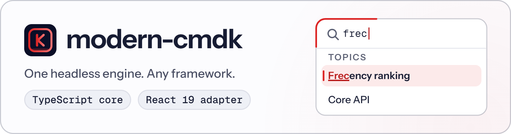

<p align="center">
  <picture>
    <source media="(prefers-color-scheme: dark)" srcset="apps/docs/public/brand/readme/modern-cmdk-dark.png">
    
  </picture>
</p>

Headless command palette engine: a framework-agnostic TypeScript core with fuzzy search, frecency ranking and keyboard shortcuts, plus a React 19 adapter.

```sh
npm install modern-cmdk react react-dom radix-ui
```

<!-- figures-line:start -->
**7.7 kB** gzip core · **12.0 kB** with the React adapter · ESM only · React ≥ 19 · TypeScript ≥ 5.6 · [Requirements](packages/modern-cmdk/README.md#requirements)
<!-- figures-line:end -->

<p align="center">
  <a href="https://abcrimson.github.io/modern-cmdk/"><strong>Documentation</strong></a> ·
  <a href="https://abcrimson.github.io/modern-cmdk/guide/getting-started.html">Getting started</a> ·
  <a href="https://www.npmjs.com/package/modern-cmdk">npm</a> ·
  <a href="https://abcrimson.github.io/modern-cmdk/guide/migration-from-cmdk.html">From cmdk</a> ·
  <a href="https://github.com/ABCrimson/modern-cmdk/releases">Releases</a>
</p>

> [!TIP]
> Starting a new app? `npm create modern-cmdk@latest my-palette` writes a Vite, React 19 and TypeScript project with a palette already in it.

## Quick start

```tsx
'use client';

import { Command } from 'modern-cmdk/react';
import 'modern-cmdk/styles.css';

function toggleColorScheme(): void {
  const root = document.documentElement;
  root.style.colorScheme =
    root.style.colorScheme === 'dark' ? 'light' : 'dark';
}

export function CommandPalette() {
  return (
    <Command label="Commands">
      <Command.Input placeholder="Type a command…" />
      <Command.List>
        <Command.Empty>No results.</Command.Empty>
        <Command.Group heading="Page">
          <Command.Item
            value="Copy page link"
            keywords={['url', 'share']}
            onSelect={() => navigator.clipboard.writeText(location.href)}
          >
            Copy page link
          </Command.Item>
          <Command.Item
            value="Toggle dark mode"
            shortcut="Mod+Shift+L"
            onSelect={toggleColorScheme}
          >
            Toggle dark mode
            <Command.Shortcut shortcut="Mod+Shift+L" />
          </Command.Item>
        </Command.Group>
        <Command.Group heading="Go to">
          <Command.Item
            value="Settings"
            keywords={['preferences']}
            onSelect={() => location.assign('/settings')}
          >
            Settings
          </Command.Item>
        </Command.Group>
      </Command.List>
    </Command>
  );
}
```

Typing filters the items with the built-in fuzzy scorer; `keywords` are searched but not shown. The `shortcut` on an item binds the key for as long as the palette is mounted, wherever focus is, and stops the key's default action, so bind keys the page does not need. `Command.Shortcut` only displays it: ⌘⇧L on Apple platforms, Ctrl+Shift+L elsewhere.

The [modern-cmdk README](packages/modern-cmdk/README.md), which is also its npm page, has the dialog and core samples, the options and the requirements.

## Packages

| Package | What it is | npm |
|---|---|---|
| [`modern-cmdk`](packages/modern-cmdk) | Core engine, React adapter, stylesheet | [](https://www.npmjs.com/package/modern-cmdk) |
| [`create-modern-cmdk`](packages/create-modern-cmdk) | Scaffolds a Vite, React 19 and TypeScript project with a palette | [](https://www.npmjs.com/package/create-modern-cmdk) |
| [`modern-cmdk-codemod`](packages/modern-cmdk-codemod) | Migrates code written for cmdk | [](https://www.npmjs.com/package/modern-cmdk-codemod) |

> [!NOTE]
> Two packages live only in this repository and are not on npm. [`modern-cmdk-search-wasm`](packages/command-search-wasm) is an experimental Rust/WASM search engine that does not work yet. [`vscode-modern-cmdk`](packages/vscode-modern-cmdk) is 14 VS Code snippets you build and install from source; the `vscode-modern-cmdk` 1.0.0 on npm was published by mistake and is not this extension.

## Size and speed

<!-- figures:start -->
| Measure | Value |
|---|--:|
| Core, `modern-cmdk` | 7.7 kB gzip[^size] |
| Core + `modern-cmdk/react` | 12.0 kB gzip[^size] |
| `modern-cmdk/styles.css` | 4.0 kB gzip[^size] |
| Search 10,000 items for one query | 3.8 ms median[^bench] |

Most of the unpacked size npm lists is the deprecated `modern-cmdk` bin and the packages it bundles (3.15 MB); no application bundle imports it.

[^size]: size-limit, gzip: the JavaScript entries bundled with rolldown and minified with `NODE_ENV=production`, the stylesheet as shipped; `react`, `react-dom` and `radix-ui` are not counted; 1 kB = 1,000 bytes. Record: [`size-history/1.7.0.json`](https://github.com/ABCrimson/modern-cmdk/blob/380e25e826341cebc46c8a844a524542fd1f8337/benchmarks/size-history/1.7.0.json).
[^bench]: `createSearchEngine()` searching an index of 10,000 items for `'apple'` and materialising the results; indexing is not timed. The median of five runs' p50 on a GitHub-hosted runner (AMD EPYC 7763, 4 cores), recorded on 2026-11-08; runner noise is ±20–40 %. Record: [`baseline.json`](https://github.com/ABCrimson/modern-cmdk/blob/380e25e826341cebc46c8a844a524542fd1f8337/benchmarks/baseline.json). Method: [Benchmarks](https://abcrimson.github.io/modern-cmdk/benchmarks.html).
<!-- figures:end -->

## The repository

| Path | What it holds |
|---|---|
| [`packages/modern-cmdk`](packages/modern-cmdk) | The library: core, React adapter, stylesheet |
| [`packages/create-modern-cmdk`](packages/create-modern-cmdk) | The project scaffolder and its two templates |
| [`packages/modern-cmdk-codemod`](packages/modern-cmdk-codemod) | The cmdk migration codemods |
| [`packages/command-search-wasm`](packages/command-search-wasm) | Experimental Rust/WASM search (private) |
| [`packages/vscode-modern-cmdk`](packages/vscode-modern-cmdk) | VS Code snippets (private) |
| [`apps/docs`](apps/docs) | The documentation site |
| [`apps/playground`](apps/playground) | A local playground app, not deployed |
| [`benchmarks`](benchmarks) | Benchmarks and the size and speed records |
| [`tests`](tests) | Unit, end-to-end, docs and package tests |

### Develop

```sh
git clone https://github.com/ABCrimson/modern-cmdk.git
cd modern-cmdk
pnpm install --frozen-lockfile
pnpm build && pnpm test
```

Use the Node version in `.nvmrc` and the pnpm version in `package.json`. The other checks and the release process are in [CONTRIBUTING.md](CONTRIBUTING.md); the design is in [ARCHITECTURE.md](ARCHITECTURE.md).

[](https://github.com/ABCrimson/modern-cmdk/actions/workflows/ci.yml)

## Contributing

Read [CONTRIBUTING.md](CONTRIBUTING.md); everyone here follows the [code of conduct](CODE_OF_CONDUCT.md). Questions go to [Discussions](https://github.com/ABCrimson/modern-cmdk/discussions).

## Security

Report vulnerabilities privately as described in [SECURITY.md](SECURITY.md); do not open a public issue.

## License

[MIT](LICENSE) © 2026 Albert Badalov
