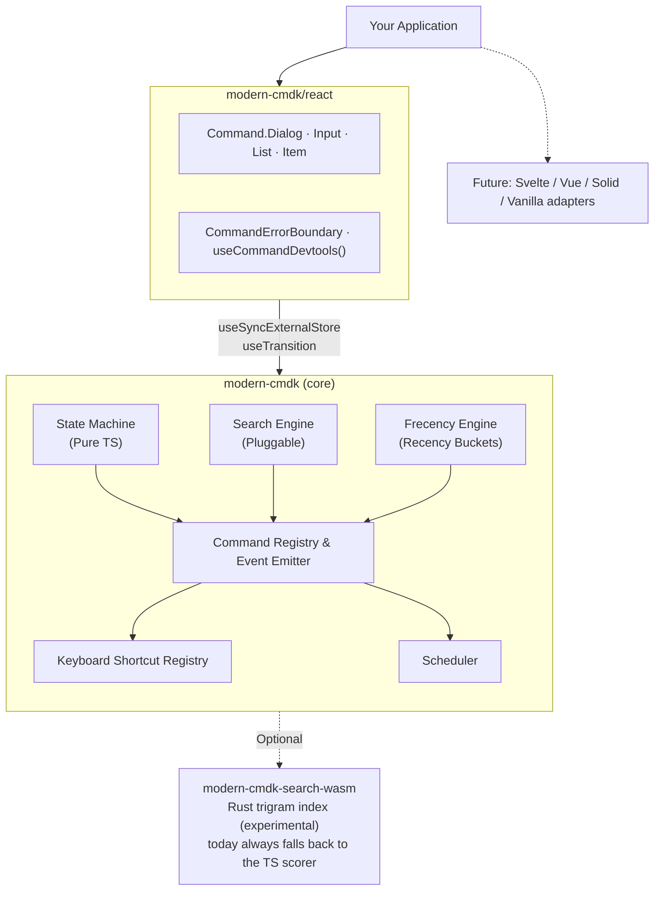

<p align="center">
  
</p>

<p align="center">
  <strong>modern-cmdk</strong><br/>
  The definitive command palette engine for the modern web.
</p>

<p align="center">
  <a href="https://www.npmjs.com/package/modern-cmdk"></a>
  <a href="./package.json"></a>
  <a href="./package.json"></a>
  <a href="https://github.com/ABCrimson/modern-cmdk/actions/workflows/ci.yml"></a>
  <a href="https://www.typescriptlang.org/"></a>
  <a href="https://react.dev/"></a>
  <a href="./LICENSE"></a>
</p>

<p align="center">
  <a href="https://abcrimson.github.io/modern-cmdk/">Documentation</a> &middot;
  <a href="https://abcrimson.github.io/modern-cmdk/guide/getting-started.html">Getting Started</a> &middot;
  <a href="https://abcrimson.github.io/modern-cmdk/api/command.html">API Reference</a> &middot;
  <a href="https://abcrimson.github.io/modern-cmdk/examples/basic.html">Examples</a>
</p>

---

## Why modern-cmdk?

A ground-up rewrite of `cmdk` for **React 19** and **TypeScript 7**, written in modern ECMAScript. Framework-agnostic core. Zero compromise on performance, accessibility, or developer experience.

| | cmdk | modern-cmdk |
|---|---|---|
| **Architecture** | React-only, tightly coupled | Framework-agnostic core + thin adapters |
| **React** | 18 / 19 | 19 (`use()`, `useOptimistic`, `useId`, `ref` as prop) |
| **Search** | Fuzzy (`command-score`) by default; replaceable via the `filter` prop | Fuzzy scoring, pluggable engine; experimental WASM engine (unpublished) |
| **Ranking** | Static order | Frecency with bucketed recency weights (hour/day/week/month/older) |
| **Virtualization** | None | Automatic variable-height, `content-visibility: auto` |
| **Animations** | CSS transitions | GPU-composited: `@starting-style`, `scroll-timeline`, spring easing |
| **Keyboard** | Arrow, Home/End and vim (Ctrl+N/J/P/K) bindings; no shortcut registry | Arrow and Home/End navigation (no vim bindings), plus a shortcut registry with `Mod` key and conflict detection |
| **Accessibility** | Partial ARIA | Full WAI-ARIA combobox, `forced-colors`, `prefers-contrast` |
| **Bundle** | not compared | Core ~6.4 kB, React ~9.8 kB gzip (budgets: < 6.5 kB, < 12 kB) |
| **TypeScript** | 4.x/5.x | 7.1.0-dev.20261104.1, isolated declarations, branded types |
| **Cleanup** | Manual | `using`/`await using` (Explicit Resource Management) |
| **Telemetry** | None | Pluggable telemetry middleware |
| **DevTools** | None | Built-in devtools hook for browser inspection |
| **Error handling** | None | `CommandErrorBoundary` with fallback UI |
| **Scaffolding** | None | `npm create modern-cmdk` CLI |
| **Editor** | None | VS Code snippets extension |

---

## Features

- **Framework-agnostic core** -- Pure TypeScript state machine. No React. No hard DOM dependency; DOM APIs are feature-detected and SSR-safe. The sole runtime dependency (`idb-keyval`) is lazy-loaded only if you opt into IndexedDB frecency persistence.
- **React 19 adapter** -- `useSyncExternalStore`, `useTransition`, `useOptimistic`, `useId`, `use()` for Suspense. React Compiler compatible.
- **Automatic virtualization** -- Variable-height virtual scrolling turns on when more than 100 items match and off again at 50 or fewer (fixed thresholds; force it either way with `<Command.List virtualize>` / `virtualize={false}`); off-screen items use `content-visibility: auto`. The `virtualizeThreshold` option is accepted but not read yet.
- **Fuzzy search** -- Built-in TS scorer with incremental filtering. Experimental Rust/WASM engine (`modern-cmdk-search-wasm`, unpublished and not benchmarked here).
- **Frecency ranking** -- Frequency x recency with bucketed recency weights (hour/day/week/month/older) and pluggable persistence (memory, IndexedDB).
- **Keyboard shortcuts** -- Built-in registry with cross-platform `Mod` key, conflict detection.
- **Full accessibility** -- WAI-ARIA combobox, `aria-live`, `forced-colors`, `prefers-contrast`, `prefers-reduced-motion`.
- **GPU-composited animations** -- `@starting-style` entry, `scroll-timeline` progress, spring `linear()` easing, all customizable via CSS custom properties.
- **Error boundary** -- `CommandErrorBoundary` with static or render-function fallback.
- **DevTools** -- `useCommandDevtools()` exposes machine state via `CustomEvent` for browser inspection.
- **Telemetry middleware** -- Pluggable hooks for palette open/close, search, and item selection analytics.
- **Modern ECMAScript** -- ES2025 Iterator helpers, `using`/`await using` (`Symbol.dispose` / `Symbol.asyncDispose`), `toSorted`, plus cross-browser helpers for grouping.
- **ESM-only** -- Zero CommonJS. Tree-shakeable -- the framework-agnostic core is side-effect-free; only the React entry and `styles.css` are flagged in `sideEffects`. Isolated declarations.

---

## Quick Start

```bash
pnpm add modern-cmdk
```

React is an **optional** peer dependency — use the core engine standalone in any framework, or pair it with the React adapter. `modern-cmdk/react` imports `react`, `react-dom` and `radix-ui`, which are optional peers that npm and pnpm do not install for you, so add them yourself (the Quick Start below needs all three):

```bash
pnpm add modern-cmdk react react-dom radix-ui
```

> [!NOTE]
> `modern-cmdk` is ESM-only. Development requires Node.js >= 26.4.0; the optional WASM search engine (`modern-cmdk-search-wasm`) is experimental and not yet published to npm.

Or scaffold a new project:

```bash
npm create modern-cmdk
```

```tsx
'use client';

import { Command } from 'modern-cmdk/react';
import 'modern-cmdk/styles.css';
import { useEffect, useState } from 'react';

function CommandPalette() {
  const [open, setOpen] = useState(false);

  // Nothing opens the dialog for you: toggle it from a Mod+K listener (Cmd+K / Ctrl+K).
  useEffect(() => {
    const onKeyDown = (e: KeyboardEvent) => {
      if (e.key === 'k' && (e.metaKey || e.ctrlKey)) {
        e.preventDefault();
        setOpen((o) => !o);
      }
    };
    document.addEventListener('keydown', onKeyDown);
    return () => document.removeEventListener('keydown', onKeyDown);
  }, []);

  return (
    <Command.Dialog open={open} onOpenChange={setOpen} label="Command Menu">
      <Command.Input placeholder="Type a command..." />
      <Command.List>
        <Command.Empty>No results found.</Command.Empty>

        <Command.Group heading="Actions">
          <Command.Item value="copy" onSelect={() => setOpen(false)}>
            Copy to Clipboard
            <Command.Shortcut shortcut="Mod+C" />
          </Command.Item>
          <Command.Item value="paste" onSelect={() => setOpen(false)}>
            Paste
            <Command.Shortcut shortcut="Mod+V" />
          </Command.Item>
        </Command.Group>

        <Command.Group heading="Navigation">
          <Command.Item value="settings" onSelect={() => setOpen(false)}>
            Settings
            <Command.Badge>New</Command.Badge>
          </Command.Item>
        </Command.Group>
      </Command.List>
    </Command.Dialog>
  );
}
```

---

## Packages

| Package | Description | Size |
|---|---|---|
| [`modern-cmdk`](./packages/modern-cmdk) | Framework-agnostic core -- state machine, search, frecency, keyboard | ~6.4 kB gzip |
| [`modern-cmdk/react`](./packages/modern-cmdk/src/react) | React 19 compound components -- Dialog, List, Item, Group, Input | ~9.8 kB gzip |
| [`modern-cmdk-search-wasm`](./packages/command-search-wasm) | Rust/WASM fuzzy search -- trigram index _(experimental, not yet published)_ | -- |
| [`modern-cmdk (codemods)`](./packages/modern-cmdk/src/codemod) | Migration codemods from cmdk -- 4 transforms | CLI |
| [`create-modern-cmdk`](./packages/create-modern-cmdk) | Project scaffolding -- 3 templates (react-basic, react-dialog, react-full) | CLI |
| [`vscode-modern-cmdk`](./packages/vscode-modern-cmdk) | VS Code snippets -- 15 snippets for fast development | Extension |

---

## Architecture



---

## Core API

```ts
import { createCommandMachine, itemId } from 'modern-cmdk';

using machine = createCommandMachine({
  items: [
    { id: itemId('copy'), value: 'Copy', shortcut: 'Mod+C', onSelect: () => copy() },
    { id: itemId('paste'), value: 'Paste', shortcut: 'Mod+V', onSelect: () => paste() },
  ],
  frecency: { enabled: true },
  loop: true,
});

machine.send({ type: 'SEARCH_CHANGE', query: 'cop' });
machine.send({ type: 'NAVIGATE', direction: 'next' });
machine.send({ type: 'ITEM_SELECT', id: itemId('copy') });

const unsubscribe = machine.subscribe(() => {
  console.log(machine.getState());
});
// Automatic cleanup via `using` -- no manual dispose needed
```

## React Components

```tsx
<Command>              {/* Root -- state machine */}
  <Command.Input />    {/* Search input */}
  <Command.List>       {/* Scrollable list -- auto-virtualization */}
    <Command.Empty />  {/* filteredCount === 0 */}
    <Command.Loading />{/* renders when the `loading` prop is true (or while the active-item transition is pending) */}
    <Command.Group>    {/* Heading + items */}
      <Command.Item>   {/* Selectable item */}
        <Command.Highlight text={label} ranges={ranges} />   {/* Fuzzy match highlight */}
        <Command.Badge />       {/* Status badge */}
        <Command.Shortcut />    {/* Keyboard shortcut */}
      </Command.Item>
    </Command.Group>
    <Command.Separator />
  </Command.List>
</Command>

<Command.Dialog />     {/* Radix Dialog + overlay + portal */}
<Command.Page />       {/* Nested page navigation */}
<Command.AsyncItems /> {/* Suspense async loading */}
```

---

## Performance

Numbers come from `benchmarks/baseline.json` and its committed history file `benchmarks/history/2026-11-04-45a9134.json`: one CI run of the 1.2.3 tree (commit `45a9134`, 2026-11-04, 3 runs averaged) on a GitHub-hosted Linux runner, Node v28.0.0-nightly2026110370074c6f98, AMD EPYC 7763 64-Core Processor (4 vCPUs). Runner noise is +/-20-40 %, so treat them as orders of magnitude, not guarantees.

| Benchmark | Target | Median | p99 |
|---|---|---|---|
| Search 10K items (TS scorer) | < 16 ms | 3.46 ms | 7.03 ms |
| State update: `SEARCH_CHANGE` | < 4 ms | 0.37 ms | 0.61 ms |
| State update: `NAVIGATE` | < 1 ms | 0.00075 ms | 0.0078 ms |

Bundle size (gzip, from `pnpm size`): core 6353 B against a 6.5 kB budget, React adapter 9842 B against 12 kB.

The WASM engine is unpublished and no gate builds or measures it, so no WASM figures are published. There is no head-to-head table against cmdk because none of its numbers are in the committed benchmark history.

CI compares only the three benchmarks above (`search:ts-scorer-10k`, `stateUpdate:navigate`, `stateUpdate:searchChange`) against the committed baseline, with a 5 % warning and 15 % failure threshold; a baseline median below the 0.01 ms floor (today only `stateUpdate:navigate`, 0.75 microseconds) is reported, not compared, and a median above its `target_ms` fails. Given the runner noise this is a coarse tripwire, not a regression gate; a stable gate is planned for 1.9.

### Feature Comparison

| Feature | cmdk | modern-cmdk |
|---|---|---|
| Basic command palette | Yes | Yes |
| Search filtering | Yes | Yes |
| Groups | Yes | Yes |
| Dialog mode | Yes | Yes |
| Loading state | Yes | Yes |
| Empty state | Yes | Yes |
| Keyboard navigation | Yes | Yes |
| Custom filtering | Yes | Yes |
| Nested pages | Yes | Yes |
| Separator | Yes | Yes |
| Match highlighting | -- | Yes |
| Framework-agnostic core | -- | Yes |
| Pluggable search engine | -- | Yes |
| Incremental search optimization | -- | Yes |
| Keyboard shortcut registry | -- | Yes |
| Frecency ranking | -- | Yes |
| Branded type safety | -- | Yes |
| Disposable pattern (`using`) | -- | Yes |
| ES2025 Iterator helpers pipeline | -- | Yes |
| Page navigation stack | -- | Yes |
| Error boundary | -- | Yes |
| React 18 support | Yes | -- |
| Vim bindings (Ctrl+N/J/P/K) | Yes | -- |
| `disablePointerSelection` prop | Yes | -- |

**11 exclusive features, 10 shared, 3 cmdk-only.**

---

## CSS Customization

All animations and dimensions are customizable via CSS custom properties on `[data-command-root]`:

```css
[data-command-root] {
  --command-duration-enter: 200ms;
  --command-duration-exit: 150ms;
  --command-scale-from: 0.96;
  --command-overlay-blur: 4px;
  --command-dialog-radius: 12px;
  --command-dialog-max-width: 640px;
  --command-item-height: 44px;
  --command-highlight-color: oklch(0.85 0.15 90 / 0.3);
}
```

All library styles use `@layer command` and CSS logical properties for full RTL support.

---

## Migration from cmdk

```bash
npx modern-cmdk import-rewrite ./src
npx modern-cmdk data-attrs ./src
npx modern-cmdk forward-ref ./src
npx modern-cmdk should-filter ./src
```

See the [migration guide](https://abcrimson.github.io/modern-cmdk/guide/migration-from-cmdk.html).

---

## Documentation

**[abcrimson.github.io/modern-cmdk](https://abcrimson.github.io/modern-cmdk/)**

**Guides:** [Getting Started](https://abcrimson.github.io/modern-cmdk/guide/getting-started.html) | [Installation](https://abcrimson.github.io/modern-cmdk/guide/installation.html) | [Basic Usage](https://abcrimson.github.io/modern-cmdk/guide/basic-usage.html) | [Async Items](https://abcrimson.github.io/modern-cmdk/guide/async-items.html) | [WASM Search](https://abcrimson.github.io/modern-cmdk/guide/wasm-search.html) | [Frecency](https://abcrimson.github.io/modern-cmdk/guide/frecency.html) | [Shortcuts](https://abcrimson.github.io/modern-cmdk/guide/shortcuts.html) | [Virtualization](https://abcrimson.github.io/modern-cmdk/guide/virtualization.html) | [SSR / Next.js](https://abcrimson.github.io/modern-cmdk/guide/ssr.html) | [TypeScript](https://abcrimson.github.io/modern-cmdk/guide/typescript-integration.html) | [Theming](https://abcrimson.github.io/modern-cmdk/guide/theming.html) | [Accessibility](https://abcrimson.github.io/modern-cmdk/guide/accessibility.html) | [Controlled Dialog](https://abcrimson.github.io/modern-cmdk/guide/controlled-dialog.html)

**Recipes:** [File Picker](https://abcrimson.github.io/modern-cmdk/recipes/file-picker.html) | [Emoji Picker](https://abcrimson.github.io/modern-cmdk/recipes/emoji-picker.html) | [AI Chat Commands](https://abcrimson.github.io/modern-cmdk/recipes/ai-chat-commands.html) | [Nested Commands](https://abcrimson.github.io/modern-cmdk/recipes/nested-commands.html) | [Spotlight Search](https://abcrimson.github.io/modern-cmdk/recipes/spotlight-search.html)

**API:** [Core Engine](https://abcrimson.github.io/modern-cmdk/api/command.html) | [React Adapter](https://abcrimson.github.io/modern-cmdk/api/command-react.html) | [WASM Search](https://abcrimson.github.io/modern-cmdk/api/command-search-wasm.html)

**[Benchmarks](https://abcrimson.github.io/modern-cmdk/benchmarks.html)** | **[Architecture](https://abcrimson.github.io/modern-cmdk/architecture/overview.html)** | **[Migration from cmdk](https://abcrimson.github.io/modern-cmdk/guide/migration-from-cmdk.html)**

---

## Development

```bash
git clone https://github.com/ABCrimson/modern-cmdk.git && cd modern-cmdk
pnpm install && pnpm build && pnpm test
```

| Command | Description |
|---|---|
| `pnpm build` | Build all packages in parallel |
| `pnpm test` | Unit tests (Vitest 5, happy-dom) |
| `pnpm test:e2e` | E2E tests (Playwright 1.66 -- Chromium; Firefox and WebKit opt-in via `E2E_ENGINES=all`) |
| `pnpm bench` | Benchmarks (Vitest bench mode) |
| `pnpm lint` | Lint (Biome 2.6.5) |
| `pnpm typecheck` | Type-check (TypeScript 7.1.0-dev.20261104.1) |
| `pnpm size` | Bundle size budgets |
| `pnpm docs:dev` | Docs dev server (VitePress 2.0) |

See [CONTRIBUTING.md](./CONTRIBUTING.md) for the full guide. See [ARCHITECTURE.md](./ARCHITECTURE.md) for technical design.

---

## Tech Stack

| Tool | Version | Purpose |
|---|---|---|
| TypeScript | 7.1.0-dev.20261104.1 | `isolatedDeclarations`, `erasableSyntaxOnly`, branded types |
| React | 0.0.0-experimental-e84e1492-20261031 | `use()`, `useOptimistic`, `ref` as prop, Activity API |
| Vite | 8.3.5 | Playground dev server, HMR, build tooling |
| Node.js | >= 26.4.0 (`.nvmrc`: Node 28 nightly 28.0.0-nightly20261104d36e9ba1f8) | ES2025 Iterator helpers, Explicit Resource Management |
| Vitest | 5.1.0 | Unit tests, benchmarks, V8 coverage |
| Playwright | 1.66.0-alpha-2026-11-04 | E2E (Chromium; Firefox and WebKit opt-in via `E2E_ENGINES=all`) |
| Biome | 2.6.5 | Lint + format (no ESLint, no Prettier) |
| tsdown | 0.23.5 | ESM builds, isolated declarations |
| pnpm | 12.17.0 | Workspace protocol, lockfile v9 |
| VitePress | 2.0.0-alpha.21 | Documentation, Shiki |
| Radix UI | 1.8.2-rc.1791984254107 | Accessible dialog primitives |
| Rust + wasm-pack | nightly-2026-11-04 + 0.15.1 | WASM fuzzy search engine |

---

## License

[MIT](./LICENSE) -- Copyright (c) 2026 Crimson Dev
