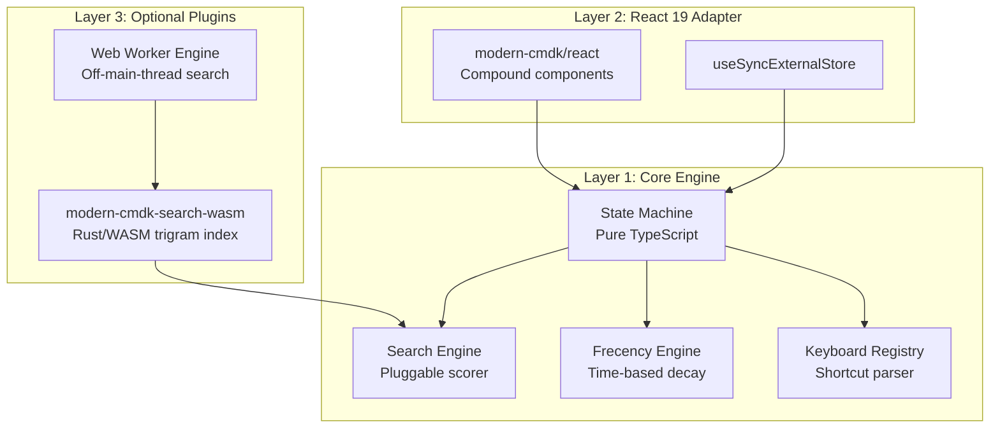
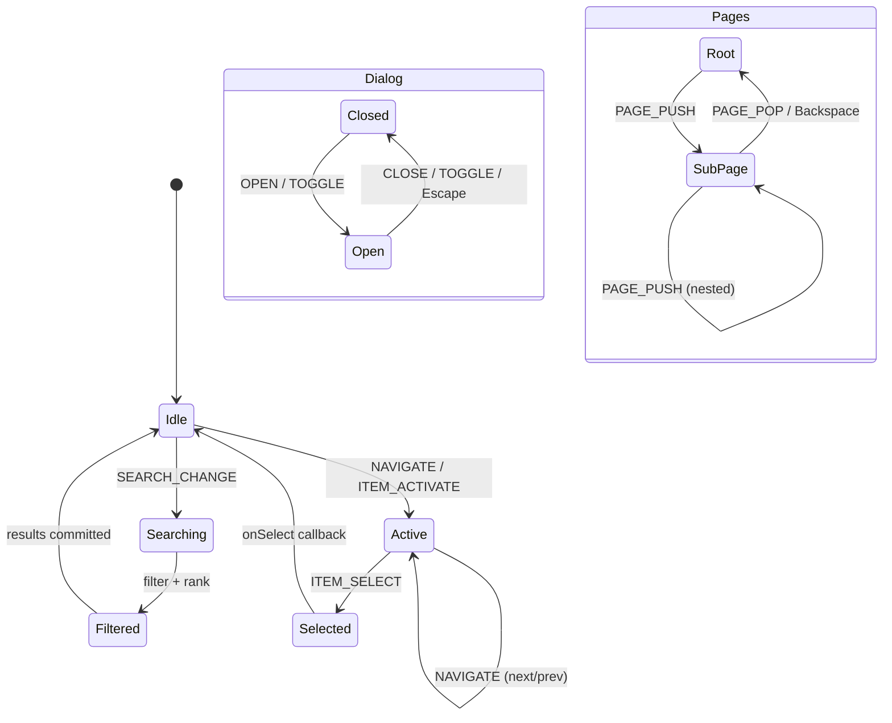
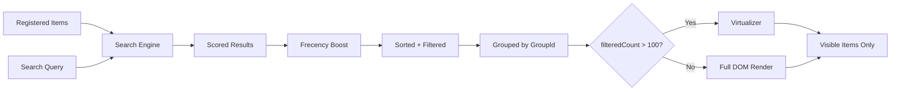
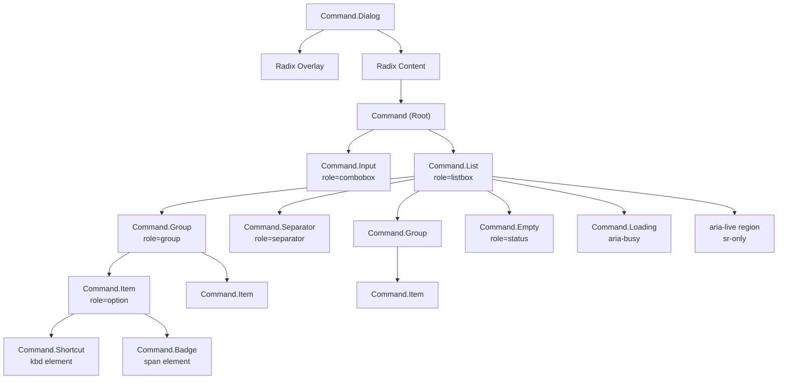
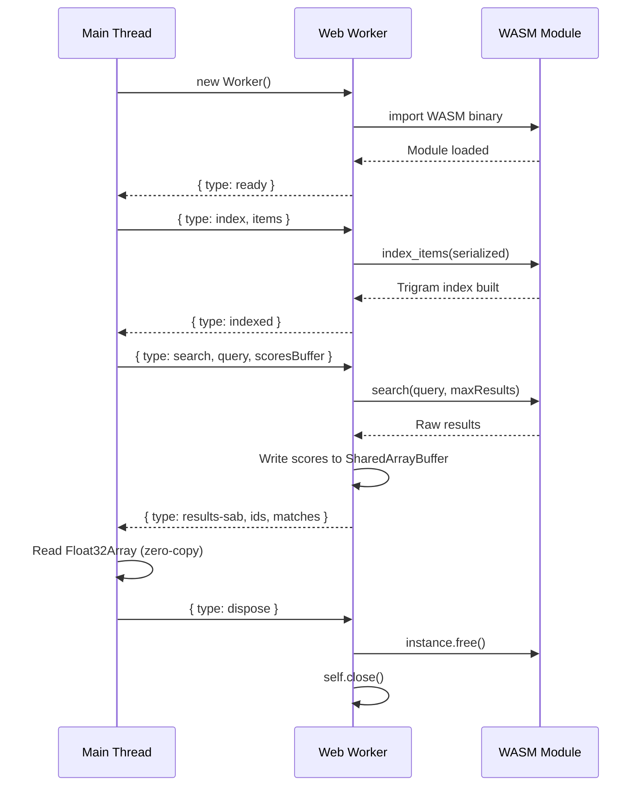

# Architecture Overview

`modern-cmdk` is built as a three-layer architecture: a framework-agnostic core engine, a React 19 adapter, and optional performance plugins. Each layer has a single responsibility and communicates through well-defined interfaces.

## Three-Layer Architecture



### Layer 1: Core Engine (`modern-cmdk`)

Pure TypeScript state machine with no hard DOM dependency (DOM APIs are feature-detected and SSR-safe). Manages:

- **Item registry** -- Registration, deregistration, grouping
- **Search and filtering** -- Pluggable `SearchEngine` interface
- **Frecency ranking** -- Time-based decay buckets with configurable weights
- **Keyboard shortcuts** -- Shortcut string parser, conflict detection via groupBy helper
- **Navigation** -- Active item tracking, page stack, loop/no-loop
- **State snapshots** -- Immutable `CommandState` objects for efficient change detection

Beyond notifying subscribers, the core has these side effects: every machine's keyboard registry attaches a document-level `keydown` listener when a document exists (removed by `suspend()` and by dispose; `resume()` attaches it again); when frecency is enabled, the engine loads from its storage, saves to it on a debounce, and listens for `pagehide` and `visibilitychange` (`suspend()` removes these listeners and flushes a pending save, `resume()` adds them again; dispose is terminal); and importing the core defines `Symbol.dispose` and `Symbol.asyncDispose` as `Symbol.for('Symbol.dispose')` and `Symbol.for('Symbol.asyncDispose')` where the runtime lacks them. It can be used with any UI framework or no framework at all.

### Layer 2: React Adapter (`modern-cmdk/react`)

Compound component API that bridges the core state machine to React 19:

- **`useSyncExternalStore`** -- Subscribes to machine state without tearing
- **One machine per mount** -- `Command` and `Command.Dialog` create the machine in a lazy ref, suspend it in the layout-effect cleanup and resume it in the setup, so StrictMode's replay and an `<Activity>` hide and show re-arm the same machine. The React root never disposes it; the search engine it created is released on collection (`react/hooks/use-command-setup.ts:150-166`, `:227-250`)
- **`Command.Input` keeps an urgent draft value** -- the machine catches up on its scheduler tick, outside React. `useCommand().isPending` is constant `false` and `setOptimisticActiveId(id)` sends `ITEM_ACTIVATE`; both are deprecated, removed in 2.0 (`react/hooks/use-command.ts:12-24`)
- **A pure `Command`** -- `Command` is a `/* @__PURE__ */ Object.assign(...)` (`react/command.tsx:132-152`), so a bundle that imports only individual components (such as `CommandSeparator`) drops the root and the other parts
- **`ref` as prop** -- React 19 native ref forwarding (no `forwardRef`)
- **`"use client"` directive** -- The shipped React components are client-only: `dist/react/index.mjs` and `dist/react/dialog.mjs` begin with the directive, added as a banner by `packages/modern-cmdk/tsdown.config.ts` (the source files under `src/react` do not carry it)
- **Radix UI integration** -- Dialog with focus trap, portal, overlay

### Layer 3: Optional Plugins

- **WASM Search** -- Rust trigram index compiled to WebAssembly for fuzzy search over large item sets
- **Web Worker** -- Runs WASM search off the main thread with `SharedArrayBuffer` zero-copy transfer
- **Custom storage** -- Pluggable `FrecencyStorage` implementations (memory, IndexedDB, custom)

## State Machine Flow



### Event Processing

1. External code calls `machine.send(event)`. It returns at once: the event is queued on the machine's scheduler, not handled.
2. The scheduler runs everything queued, in the order sent, as one batch on the next `requestAnimationFrame` in browsers, or in a microtask (`queueMicrotask`) where `requestAnimationFrame` is absent (Node, SSR). An event sent from inside a handler runs in the next batch.
3. Each handler replaces the immutable `CommandState` snapshot. A registry event (`REGISTER_ITEM`, `UPDATE_ITEM`, `UNREGISTER_ITEM`, `ITEMS_LOADED`, `REGISTER_GROUP`, `UNREGISTER_GROUP`) updates the registry, the search index and the shortcut bindings, and marks the results stale without refiltering. Stale results are refiltered once: by a later `SEARCH_CHANGE` of the batch (which filters when it runs), by a `NAVIGATE` or `ITEM_ACTIVATE` that needs them current, or else when the batch ends.
4. Handler-time notifications fire as their event runs, so they come before the batch's `stateChange`: the `openChange` emitter event and then the `onOpenChange` option, the `onSearchChange` and `onActiveChange` options, and for a selection the item's own `onSelect`, the `select` emitter event and the `onSelect` option.
5. After the last event, the machine emits one `stateChange` for the batch (if anything changed), and subscribers are notified with the new state.
6. React `useSyncExternalStore` triggers a re-render with the new snapshot.

Because of the batching, `machine.getState()` right after `machine.send()` still returns the previous state. Core-only code observes the result with `machine.subscribe` (or `subscribeState`), or by awaiting the next frame or microtask. Disposing the machine drops events that have not run yet.

## Data Flow: Items to Rendered Output



### Search Pipeline

1. **Registration** -- Items are registered via `REGISTER_ITEM` events (or React component mount)
2. **Query** -- User types in the input, triggering `SEARCH_CHANGE`
3. **Scoring** -- The search engine (TypeScript or WASM) scores each item against the query
4. **Frecency boost** -- If enabled, frecency bonuses are added to search scores of a non-empty query (an empty query lists registration order)
5. **Filtering** -- With the default engine, items that do not match are dropped. A custom `filter` function returning `false`, `0` or a negative number excludes the item, and a positive number keeps it as its score. Results from a pluggable `search` engine are kept as returned, except that frecency re-ranks them and `disabledItems: 'hide'` drops disabled ones, so such an engine returns only the items it matches
6. **Sorting** -- The default engine returns results by score (descending); with frecency enabled the machine re-sorts them by score plus bonus. Otherwise a pluggable engine's order is kept After the results are set, the active item stays the same while it is still listed and enabled under the new query; otherwise the first enabled item of the ranked list becomes active (`core/machine.ts:274-277`).
7. **Grouping** -- Results are partitioned into groups based on `groupId`
8. **Rendering** -- React adapter renders visible items, virtualizing if needed

::: tip Virtualization is latched, not a bare threshold
The `filteredCount > 100` test in the diagram above is the **turn-on** edge. Once
virtualization engages it stays engaged until the count falls to **50 or below**. That
hysteresis band stops a query hovering around 100 results from thrashing the list between
virtualized and full-DOM rendering on every keystroke. An explicit `virtualize` prop on
`<Command.List>` overrides both edges.
:::

## Component Tree



## WASM Worker Communication



When `SharedArrayBuffer` is available (cross-origin isolated), scores are written directly into shared memory. The main thread reads the `Float32Array` view without any data copying.

Without `SharedArrayBuffer`, results are transferred via structured clone (`postMessage`), which involves a copy but remains fast for typical result set sizes (< 100 items).

## Plugin Architecture

### Search Engine Interface

Any object implementing `SearchEngine` can replace the built-in TypeScript scorer:

```typescript
import type { CommandItem, ItemId, SearchResult } from 'modern-cmdk';

interface SearchEngine extends Disposable {
  index(items: readonly CommandItem[]): void;
  search(query: string, items: readonly CommandItem[]): IteratorObject<SearchResult>;
  remove(ids: ReadonlySet<ItemId>): void;
  clear(): void;
  [Symbol.dispose](): void;
}
```

::: warning `SearchEngine` extends `Disposable`
`[Symbol.dispose]()` is **required**, not optional -- a custom engine without it will not
typecheck. The machine disposes only an engine it created (neither `searchEngine` nor `search` passed). An engine you pass is yours to dispose, and it survives the machine's dispose, suspend and resume, so
call its `[Symbol.dispose]()` yourself (or write `using`) where you release indexes, workers, or WASM instances.
:::

### Frecency Storage Interface

Custom storage backends implement `FrecencyStorage`:

```typescript
import type { FrecencyData } from 'modern-cmdk';

interface FrecencyStorage extends Disposable {
  load(namespace: string): FrecencyData | Promise<FrecencyData>;
  save(namespace: string, data: FrecencyData): void | Promise<void>;
  [Symbol.dispose](): void;
}
```

Built-in implementations:
- **`MemoryFrecencyStorage`** -- In-memory `Map`, no persistence (default)
- **`IdbFrecencyStorage`** -- IndexedDB via `idb-keyval`, persists across sessions

### Extending the Architecture

To add a custom search engine:

```typescript
import { createCommandMachine, type SearchEngine } from 'modern-cmdk';

const myEngine: SearchEngine = {
  index(items) { /* build your index */ },
  *search(query, items) { /* yield SearchResult objects */ },
  remove(ids) { /* remove from index */ },
  clear() { /* clear index */ },
  [Symbol.dispose]() { /* release the index, worker, or WASM instance */ },
};

// The engine you pass is yours to dispose, and it outlives the machine: dispose the machine
// (`machine[Symbol.dispose]()`) and the engine when your UI goes away. A `using` at module level
// would dispose them as soon as the module has run.
const machine = createCommandMachine({ searchEngine: myEngine });
```

To add a custom frecency storage:

```typescript
import type { FrecencyData, FrecencyStorage } from 'modern-cmdk';

class RedisFrecencyStorage implements FrecencyStorage {
  async load(namespace: string): Promise<FrecencyData> {
    /* fetch from Redis */
    return { records: new Map() };
  }
  async save(namespace: string, data: FrecencyData): Promise<void> { /* write to Redis */ }
  [Symbol.dispose]() { /* close connection */ }
}
```

## Build Output

`packages/modern-cmdk/tsdown.config.ts` holds three tsdown configs:

1. **The core** (`dist/core/index.mjs`, with declarations).
2. **The React adapter**: two entries (`react/index` and `react/dialog` in `entry`), `modern-cmdk/react` and `modern-cmdk/react/dialog`, in one config so the code both use (context, hooks, `CommandDialog`) is emitted once as a shared chunk in `dist/react`. The core is external: the adapter imports it as `modern-cmdk`, so a bundle holds one core, not a second copy inlined into the adapter. `radix-ui` stays external too, and the two React outputs (`react/index.mjs`, `react/dialog.mjs`) begin with `'use client'`: the banner comes from this config, and no file under `src/react` carries the directive. `styles.css` is copied to `dist/react/styles.css`.
3. **The codemod** (`dist/codemod`): the deprecated `modern-cmdk` bin. Its source lives in the sibling package `packages/modern-cmdk-codemod` (bin `modern-cmdk-codemod`); this config builds `cli.mjs`, the worker and the transforms from that source, bundled with jscodeshift and its parser tree (ten packages), behind the shim `dist/codemod/bin.mjs`, which warns once and keeps the 1.x exit codes and 1.4's excludes until 2.0. `modern-cmdk` ships `THIRD-PARTY-NOTICES.md` for the bundled code (`pnpm check:notices`). Neither `modern-cmdk` nor `modern-cmdk-codemod` ships declarations for the codemod, because it is a CLI and not an importable API.

The configs hold 1 + 2 + 7 entries (the core, the two React entries, and `bin`, `cli`, `worker` and four `transforms/*` for the codemod), and `exports` in `packages/modern-cmdk/package.json` has five subpaths: `.` (`dist/core/index.mjs`), `./react`, `./react/dialog`, `./styles.css` and `./package.json`. `sideEffects` in `packages/modern-cmdk/package.json` is `["./dist/react/styles.css"]` only. `Command.Dialog` is a member of the `Command` compound, so every `modern-cmdk/react` import loads `radix-ui`, and `radix-ui` is a required peer dependency (`>=1.4.0 <2.0.0`) through 1.x. See [Server-Side Rendering](/guide/ssr#tree-shaking) for the measured consequence for bundle size.

## Language Features & Editions

| Feature | Edition | Where Used | Native/Helper |
|---|---|---|---|
| Iterator Helpers (`.map`, `.filter`, `.toArray`) | ES2025 | Search pipelines, registry operations | Native |
| `Symbol.dispose` / `Symbol.asyncDispose` (`using` / `await using`) | ESNext (TS `lib` `esnext.disposable`) | Machine, engine and storage lifecycle implement the protocol, so consumers can write `using` | Native, with a `Symbol.for` fallback where absent (`core/frecency/idb-storage.ts`) |
| `Promise.withResolvers()` | ES2024 | Worker request tracking in the unpublished `modern-cmdk-search-wasm` package | Native |
| `RegExp.escape` | ES2025 | Not used | -- |
| `Map.groupBy` / `Object.groupBy` | ES2024 | Shortcut conflict detection, item grouping | Helper functions |
| `Date.now()` | ES5 | Frecency timestamps, state `lastUpdated` | Native (replaces Temporal) |
| Set methods (`setIntersection`, etc. are the helpers) | ES2025 | Registry bulk operations | Helper functions |
| `String.prototype.toWellFormed` | ES2024 | Branded ID creation | Helper function |
| Branded types (`ItemId`, `GroupId`) | TypeScript | Type-safe ID handling | Compile-time (erased) |
| `satisfies` | TypeScript | Default configuration validation | Compile-time (erased) |
