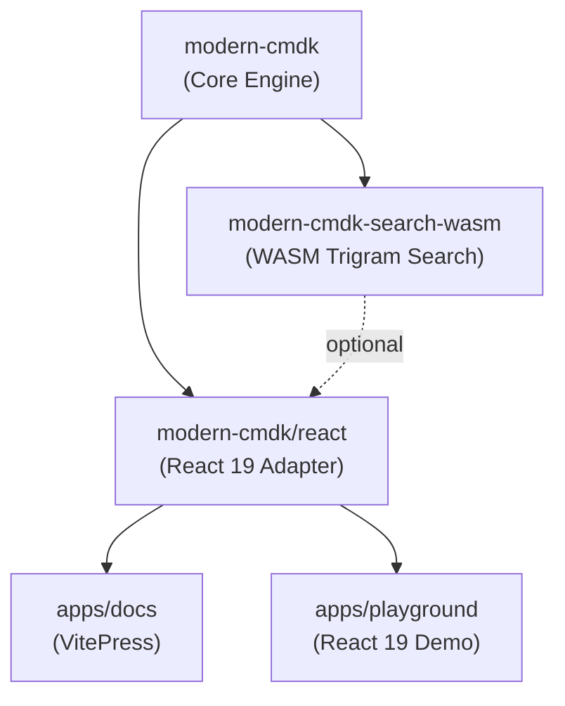
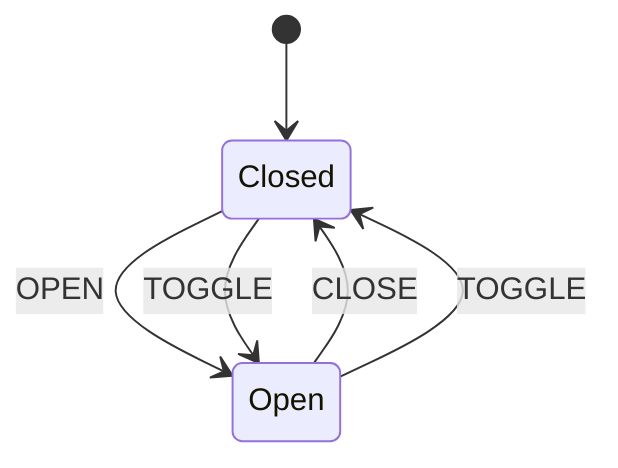
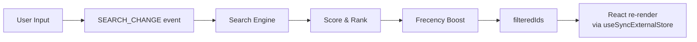
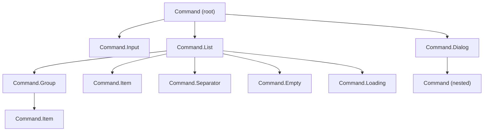
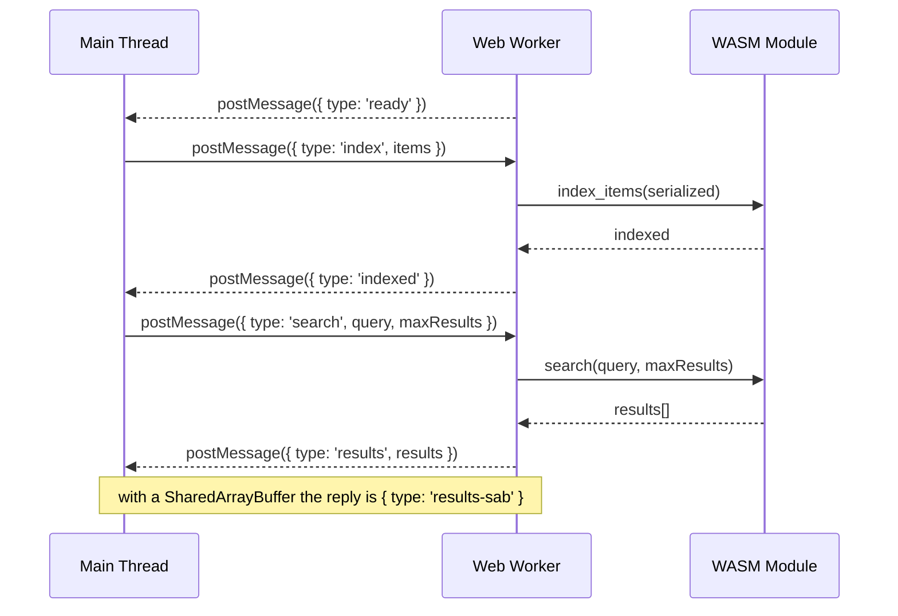

# Architecture Internals

::: tip Looking for the high-level tour?
Start with the [Architecture Overview](/architecture/overview) — this page drills into the monorepo package graph and per-subsystem internals.
:::

`modern-cmdk` is built as a three-layer architecture: a framework-agnostic **core engine**, a **React adapter**, and an optional **WASM search** acceleration layer.

## Package Dependency Graph



## Core Engine (`modern-cmdk`)

The core is a **pure TypeScript state machine** with no framework dependency and no hard DOM dependency (DOM APIs are feature-detected and SSR-safe). It manages search, filtering, keyboard navigation, frecency ranking, and keyboard shortcuts.



The machine has no named search or navigation states. It holds one `CommandState` record (read it with `machine.getState()`), and each event updates fields of it: `SEARCH_CHANGE` updates `search`, `filteredIds`, `groupedIds`, `filteredCount` and `activeId` (the active item stays the same while it is still listed and enabled under the new query, and otherwise the first enabled item of the ranked list becomes active, so a cleared search keeps the item that was active during it: `core/machine.ts:274-277`); `NAVIGATE` and `ITEM_ACTIVATE` update `activeId`; `ITEM_SELECT` changes no state field (it calls the item's and the machine's `onSelect`, emits `select` and records the selection in the frecency engine); and `PAGE_PUSH` / `PAGE_POP` update `page` and `pageStack`. Only `open` behaves like a state.

`send()` does not apply an event at once: it queues the event on the scheduler (`core/utils/scheduler.ts`), which runs the pending events on `requestAnimationFrame` in browsers and in a microtask where that is absent (Node.js, SSR), so `getState()` right after `send()` still returns the previous state. The events of one batch run in order. A `SEARCH_CHANGE` refilters when it runs. Registry events (`ITEMS_LOADED`, `REGISTER_ITEM`, `UPDATE_ITEM`, `UNREGISTER_ITEM`, the group events) only mark the results dirty: a `NAVIGATE` or `ITEM_ACTIVATE` after them in the same batch refilters first, and the end of the batch refilters once if they are still dirty. The machine emits `stateChange` at most once per batch, and only if an event changed the state. `openChange`, `onOpenChange` and `onSearchChange` run as their events are handled, before that `stateChange` (`core/machine.ts`: `send()`, `commit()`, `setOpen()`).

Three calls end or pause a machine. `suspend()` releases its global holds, reversibly: the document `keydown` listener of the shortcuts, the frecency `pagehide` and `visibilitychange` listeners, the debounce timer and the scheduled frame, after it flushes the pending batch and starts the save of pending frecency data; state, registrations, the search engine and the frecency storage stay. `resume()` takes the holds back. Both are idempotent and do nothing on a disposed machine (`core/machine.ts:565-576`). `dispose()` is the terminal teardown: afterwards `send()` reduces nothing and calls no callback (`core/machine.ts:75-78`). The machine disposes a search engine only when it created it, that is when neither `searchEngine` nor `search` is passed; an engine you pass is yours to dispose and survives the machine's dispose, suspend and resume. A machine-created engine is disposed by `machine[Symbol.dispose]()` or `using`, or when a machine nobody references is collected (a `FinalizationRegistry`, `core/machine.ts:91`, `core/machine.ts:600`).

### Key Subsystems

| Module | Responsibility |
|--------|---------------|
| `machine.ts` | State transitions, event batching, subscriber notification |
| `registry.ts` | Item/group registration with set operation helpers (union/intersection/difference) |
| `search/default-scorer.ts` | Fuzzy matching and scoring |
| `search/index.ts` | Search engine factory, pluggable scorer interface |
| `frecency/index.ts` | Time-based decay buckets (Date.now) |
| `frecency/idb-storage.ts` | IndexedDB persistence via idb-keyval |
| `keyboard/parser.ts` | Shortcut string parsing |
| `keyboard/matcher.ts` | Event matching + conflict detection via groupBy helper |
| `utils/scheduler.ts` | Update batching -- `requestAnimationFrame` in browsers, microtask in Node.js |
| `utils/event-emitter.ts` | Type-safe pub/sub with Disposable cleanup |

### Data Flow: Search Pipeline



## React Adapter (`modern-cmdk/react`)

The React adapter exposes 15 compound components (the `Command` root plus 14 subcomponents) that bind to the core state machine:



### React 19 Integration Points

- **`useSyncExternalStore`** — Subscribe to the core state machine without tearing
- **One machine per mount** — `Command` and `Command.Dialog` create the machine in a lazy ref, suspend it in the layout-effect cleanup and resume it in the setup, so StrictMode's replay and an `<Activity>` hide and show re-arm the same machine. The React root never disposes it; the engine it created is released on collection (`react/hooks/use-command-setup.ts:150-166`, `:227-250`)
- **`Command.Input` keeps an urgent draft value** — the machine catches up on its scheduler tick, outside React. `useCommand().isPending` is constant `false` and `setOptimisticActiveId(id)` sends `ITEM_ACTIVATE`; both are deprecated, removed in 2.0 (`react/hooks/use-command.ts:12-24`)
- **A pure `Command`** — `Command` is a `/* @__PURE__ */ Object.assign(...)` (`react/command.tsx:132-152`), so a bundle that imports only individual components (such as `CommandSeparator`) drops the root and the other parts
- **`ref` as prop** — No `forwardRef` needed (React 19 native)
- **Activity API** — `CommandActivity` for keep-alive state preservation

### Virtualization

The list component auto-virtualizes when filtered items exceed a threshold. The virtualizer uses:

- `ResizeObserver` for dynamic item height measurement
- `requestIdleCallback` for deferred measurement
- the `translate` property for transform-based positioning, off the layout path
- `content-visibility: auto` for off-screen rendering skip

## WASM Search (`modern-cmdk-search-wasm`)

Optional Rust-compiled trigram index for large datasets (10K+ items).



### Two Execution Modes

| Mode | Function | Thread | Use Case |
|------|----------|--------|----------|
| Main thread | `createWasmSearchEngine()` | Main | Simple setup, designed for up to ~50K items (a design target) |
| Worker thread | `createWorkerSearchEngine()` | Web Worker | Large datasets, non-blocking UI |

Both implement the `SearchEngine` interface from the core package and support `AsyncDisposable` for `await using` cleanup.

## Resource Management

All engines implement `Disposable` or `AsyncDisposable` for automatic cleanup:

```typescript
import { createSearchEngine, itemId } from 'modern-cmdk';
import type { CommandItem } from 'modern-cmdk';
import { createWasmSearchEngine } from 'modern-cmdk-search-wasm';

const items: readonly CommandItem[] = [
  { id: itemId('copy'), value: 'Copy' },
  { id: itemId('paste'), value: 'Paste' },
];

// Synchronous disposal — using
{
  using engine = createSearchEngine();
  engine.index(items);
  engine.search('query', items).toArray();
} // engine[Symbol.dispose]() called automatically

// Asynchronous disposal — await using
{
  await using engine = await createWasmSearchEngine();
  engine.index(items);
  // ...
} // engine[Symbol.asyncDispose]() called automatically
```

## Build Output

`packages/modern-cmdk/tsdown.config.ts` holds three tsdown configs:

1. **The core** (`dist/core/index.mjs`, with declarations).
2. **The React adapter**: two entries (`react/index` and `react/dialog` in `entry`), `modern-cmdk/react` and `modern-cmdk/react/dialog`, in one config so the code both use (context, hooks, `CommandDialog`) is emitted once as a shared chunk in `dist/react`. The core is external: the adapter imports it as `modern-cmdk`, so a bundle holds one core, not a second copy inlined into the adapter. `radix-ui` stays external too, and the two React outputs (`react/index.mjs`, `react/dialog.mjs`) begin with `'use client'`: the banner comes from this config, and no file under `src/react` carries the directive. `styles.css` is copied to `dist/react/styles.css`.
3. **The codemod** (`dist/codemod`): the deprecated `modern-cmdk` bin. Its source lives in the sibling package `packages/modern-cmdk-codemod` (bin `modern-cmdk-codemod`); this config builds `cli.mjs`, the worker and the transforms from that source, bundled with jscodeshift and its parser tree (ten packages), behind the shim `dist/codemod/bin.mjs`, which warns once and keeps the 1.x exit codes and 1.4's excludes until 2.0. `modern-cmdk` ships `THIRD-PARTY-NOTICES.md` for the bundled code (`pnpm check:notices`). Neither `modern-cmdk` nor `modern-cmdk-codemod` ships declarations for the codemod, because it is a CLI and not an importable API.

The configs hold 1 + 2 + 7 entries (the core, the two React entries, and `bin`, `cli`, `worker` and four `transforms/*` for the codemod), and `exports` in `packages/modern-cmdk/package.json` has five subpaths: `.` (`dist/core/index.mjs`), `./react`, `./react/dialog`, `./styles.css` and `./package.json`. `sideEffects` in `packages/modern-cmdk/package.json` is `["./dist/react/styles.css"]` only. `Command.Dialog` is a member of the `Command` compound, so every `modern-cmdk/react` import loads `radix-ui`, and `radix-ui` is a required peer dependency (`>=1.4.0 <2.0.0`) through 1.x. See [Server-Side Rendering](/guide/ssr#tree-shaking) for the measured consequence for bundle size.

## Language Features & Editions

| Feature | Edition | Where Used | Native/Helper |
|---------|---------|-----------|---------------|
| Iterator Helpers | ES2025 | Search pipelines, registry operations, frecency bonuses | Native |
| `Symbol.dispose` / `Symbol.asyncDispose` (`using` / `await using`) | ESNext (TS `lib` `esnext.disposable`) | Engines, storages and the machine implement the protocol, so consumers can write `using`; the built code has no `using` declaration. `createCommandMachine()` returns `CommandMachine & AsyncDisposable`: `await using` waits for the pending frecency save | Native where present; otherwise the core assigns `Symbol.for('Symbol.dispose')` and `Symbol.for('Symbol.asyncDispose')` (`core/frecency/idb-storage.ts`) |
| `Promise.withResolvers` | ES2024 | Worker communication in the unpublished `modern-cmdk-search-wasm` package (`packages/command-search-wasm/src/worker-engine.ts`) and per-file requests in the codemod CLI (`packages/modern-cmdk-codemod/src/cli.ts`); not in the core or React entries | Native |
| `RegExp.escape` | ES2025 | Not used in `packages/modern-cmdk/src`; `tests/unit/browser-floor.test.ts` fails if it appears in the built core or React code | -- |
| Set methods (`union`, `intersection`, `difference`) | ES2025 | Registry union/intersection/difference for group operations | Helper functions (`set-ops.ts`) |
| `Map.groupBy` / `Object.groupBy` | ES2024 | Shortcut conflict detection, item grouping | Helper functions (`group-by.ts`) |
| `Date.now()` | ES5 | Frecency timestamps, state `lastUpdated` | Native (replaces Temporal) |
| `String.prototype.toWellFormed` | ES2024 | Branded ID creation | Helper function (`string-wellformed.ts`) |

The browser floor that the built core and React code need (Chrome and Edge 122, Firefox 131, Safari 18.4, set by Iterator Helpers) is in [Installation](/guide/installation#requirements).
