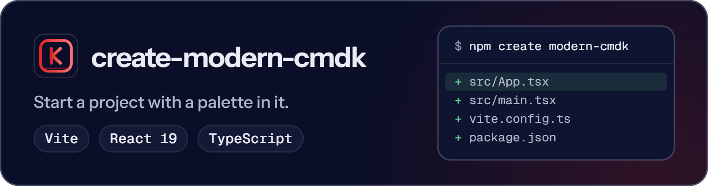

<p align="center">
  <picture>
    <source media="(prefers-color-scheme: dark)" srcset="https://raw.githubusercontent.com/ABCrimson/modern-cmdk/5d3cad159e4a509376b1a4f796a4e6bf6603b65d/apps/docs/public/brand/readme/create-modern-cmdk-dark.png">
    <source media="(prefers-color-scheme: light)" srcset="https://raw.githubusercontent.com/ABCrimson/modern-cmdk/5d3cad159e4a509376b1a4f796a4e6bf6603b65d/apps/docs/public/brand/readme/create-modern-cmdk-light.png">
    
  </picture>
</p>

Scaffold a Vite, React 19 and TypeScript project with a modern-cmdk command palette.

```sh
npm create modern-cmdk@latest my-palette
```

Two templates · writes 8 files · every dependency pinned to an exact version · no dependencies of its own · Node ≥ 26.4.0

<p align="center">
  <strong><a href="https://abcrimson.github.io/modern-cmdk/">Documentation</a></strong> ·
  <a href="https://abcrimson.github.io/modern-cmdk/guide/getting-started.html">Getting started</a> ·
  <a href="https://www.npmjs.com/package/modern-cmdk">modern-cmdk</a> ·
  <a href="https://github.com/ABCrimson/modern-cmdk/blob/main/packages/create-modern-cmdk/CHANGELOG.md">Changelog</a>
</p>

## Quick start

```sh
npm create modern-cmdk@latest my-palette -- --template=react-dialog
cd my-palette
npm install
npm run dev
```

| Template | What `src/App.tsx` renders |
|---|---|
| `react-basic` (default) | An inline palette with two groups |
| `react-dialog` | A palette in a dialog that <kbd>⌘K</kbd> on Apple platforms or <kbd>Ctrl+K</kbd> elsewhere opens and closes |

`react-full` is a deprecated alias of `react-basic` and prints a warning. `pnpm create modern-cmdk@latest my-palette` and `npx create-modern-cmdk my-palette` work too; the scaffolder prints the next commands for the package manager that ran it.

## What it writes

```text
my-palette/
├── index.html
├── package.json        exact versions; dev, build, typecheck, preview
├── tsconfig.json       references the two projects below (tsc -b)
├── tsconfig.app.json   strict, for src/
├── tsconfig.node.json  strict, for vite.config.ts
├── vite.config.ts      Vite with the React plugin
└── src/
    ├── main.tsx        imports modern-cmdk/styles.css
    └── App.tsx         the palette
```

`npm run build` runs `tsc -b && vite build`. The `react-basic` template begins `src/App.tsx` like this:

```tsx fragment
import { Command } from 'modern-cmdk/react';
import type { ReactElement } from 'react';

export function App(): ReactElement {
  return (
    <div style={{ padding: '2rem', fontFamily: 'system-ui' }}>
      <h1>Command Palette</h1>
      <Command label="Command menu">
        <Command.Input placeholder="Search..." />
        <Command.List>
          <Command.Empty>No results found.</Command.Empty>
          <Command.Group heading="Actions">
```

`modern-cmdk` is pinned to the modern-cmdk version this scaffolder was released with, read from the repository when it was built; the other pins are in [`src/versions.ts`](https://github.com/ABCrimson/modern-cmdk/blob/910a9af7655135ae1672bbdaa3ee70d3e21fcd93/packages/create-modern-cmdk/src/versions.ts).

## Options

| Option | Effect |
|---|---|
| `--template=<name>` | `react-basic` (default) or `react-dialog`; `--template <name>` works too |
| `--no-overwrite` | Refuse a target that already holds a file this run would write; write nothing |
| `--strict` | Exit `2` on every usage error, including an unknown option or template |
| `-h`, `--help` | Print the usage |

<details>
<summary>Exit codes</summary>

| Code | Default | Strict |
|---|---|---|
| `0` | Success, `--help`, a missing project name, a malformed known option | Success, `--help` |
| `1` | An unknown template, an unusable name, a collision, a file-system error | Only the collision and a file-system error |
| `2` | Not used | Every usage error, and an unusable name |

The Default column is a run without `--strict`; the Strict column is a run with it. A collision is a run with `--no-overwrite` that finds a file it would write. Without `--strict`, an unknown option is warned about and ignored when a project name is given.

</details>

<details>
<summary>A target that already holds files, and names</summary>

Before it writes anything, the scaffolder checks the files it would write. In 1.x a target that already holds any of them is listed on stderr (`warning: <dir> is not empty; this run will overwrite N files:`, then one path per line) and the run carries on and overwrites them. With `--no-overwrite` the same list is printed as an error, nothing is written and the exit code is `1`.

The directory you name is the project directory. The package name in the generated `package.json` is derived from it and sanitized: lower-cased, every run of characters npm does not allow becomes `-`, and leading `.`, `_` and `-` are dropped (a valid scoped name such as `@scope/app` is kept as given). The scaffolder prints `note: package name "<name>" (from "<directory>")` when it changed the name. Only a name that derives to nothing, or one over 214 characters, is refused. On Windows a directory name with a character Windows cannot use (`<`, `>`, `:`, `"`, `|`, `?`, `*` or a control character) or a reserved device name (`CON`, `PRN`, `AUX`, `NUL`, `COM1`-`COM9`, `LPT1`-`LPT9`) is refused before anything is written.

</details>

## Requirements

Node 26.4.0 or later; npm, pnpm, yarn or bun.

## The modern-cmdk packages

| Package | Use it to |
|---|---|
| [`modern-cmdk`](https://www.npmjs.com/package/modern-cmdk) | build the palette: core engine, React adapter, stylesheet |
| [`create-modern-cmdk`](https://www.npmjs.com/package/create-modern-cmdk) | start a Vite, React 19 and TypeScript project with a palette in it |
| [`modern-cmdk-codemod`](https://www.npmjs.com/package/modern-cmdk-codemod) | move code written for cmdk to modern-cmdk |

## Links

[Documentation](https://abcrimson.github.io/modern-cmdk/) · [Changelog](https://github.com/ABCrimson/modern-cmdk/blob/main/packages/create-modern-cmdk/CHANGELOG.md) · [Releases](https://github.com/ABCrimson/modern-cmdk/releases) · [Issues](https://github.com/ABCrimson/modern-cmdk/issues) · [Security policy](https://github.com/ABCrimson/modern-cmdk/security/policy) · [Repository](https://github.com/ABCrimson/modern-cmdk)

## License

[MIT](https://github.com/ABCrimson/modern-cmdk/blob/main/LICENSE) © 2026 Albert Badalov
