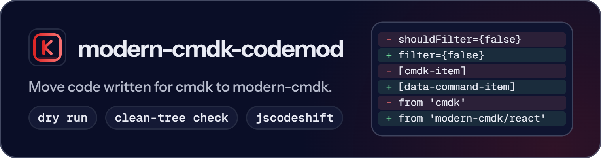

<p align="center">
  <picture>
    <source media="(prefers-color-scheme: dark)" srcset="https://raw.githubusercontent.com/ABCrimson/modern-cmdk/5d3cad159e4a509376b1a4f796a4e6bf6603b65d/apps/docs/public/brand/readme/modern-cmdk-codemod-dark.png">
    <source media="(prefers-color-scheme: light)" srcset="https://raw.githubusercontent.com/ABCrimson/modern-cmdk/5d3cad159e4a509376b1a4f796a4e6bf6603b65d/apps/docs/public/brand/readme/modern-cmdk-codemod-light.png">
    
  </picture>
</p>

Codemods that migrate cmdk code to modern-cmdk: four jscodeshift transforms that report every site they cannot migrate instead of guessing.

```sh
npx modern-cmdk-codemod --dry-run should-filter ./src
```

Four transforms · `--dry-run` writes nothing and prints a diff · by default writes only files that git has committed · Node ≥ 26.4.0

<p align="center">
  <strong><a href="https://abcrimson.github.io/modern-cmdk/guide/migration-from-cmdk.html">Migration guide</a></strong> ·
  <a href="https://www.npmjs.com/package/modern-cmdk">modern-cmdk</a> ·
  <a href="https://github.com/ABCrimson/modern-cmdk/blob/main/packages/modern-cmdk-codemod/CHANGELOG.md">Changelog</a>
</p>

## Quick start

Nothing to install: `npx` (or `pnpm dlx`) runs it. Start from a committed tree and commit after each transform, so every step is a diff you can review:

```sh
npx modern-cmdk-codemod should-filter ./src && git commit -am should-filter
npx modern-cmdk-codemod forward-ref ./src && git commit -am forward-ref
npx modern-cmdk-codemod data-attrs ./src && git commit -am data-attrs
npx modern-cmdk-codemod import-rewrite ./src && git commit -am import-rewrite
```

`import-rewrite` goes last: `should-filter` recognises a cmdk `filter` function only while the import still reads `'cmdk'`. Unless you pass `--force` or `--lenient`, a run that writes refuses to start when a file it matched has uncommitted changes or lies outside the git work tree you run it from, or when git is missing.

## What each transform changes

**1. `should-filter`**: `shouldFilter={false}` becomes `filter={false}`, `shouldFilter={expr}` becomes `filter={expr ? undefined : false}`, and a cmdk `filter` function is wrapped to take `(item, query)`.

<!-- fixture: should-filter/SF-1-values -->
```diff
-export const C = () => <Command label="c" shouldFilter={false} />;
+export const C = () => <Command label="c" filter={false} />;
```

**2. `forward-ref`**: `forwardRef` is unwrapped into a component that takes `ref` as a prop (React 19), keeping the props and ref types.

<!-- fixture: forward-ref/FR-2-props-annotation-only -->
```diff
-import { forwardRef, useImperativeHandle } from 'react';
+import { useImperativeHandle, type Ref } from 'react';
 type Props = { label: string };
-export const Tag = forwardRef((props: Props, ref) => {
+export const Tag = (
+  {
+    ref,
+    ...props
+  }: Props & {
+    ref?: Ref<unknown>;
+  }
+) => {
   useImperativeHandle(ref, () => ({}));
   return <span>{props.label}</span>;
-});
+};
```

**3. `data-attrs`**: `cmdk-*` attributes and `--cmdk-list-height` become their `data-command-*` and `--command-*` names in JSX, in selector strings and in `.css` and `.scss` files, with the state attributes beside them.

<!-- fixture: data-attrs/19-css -->
```diff
-[cmdk-item][data-selected="true"],
-[cmdk-item]:hover {
+[data-command-item][data-active],
+[data-command-item]:hover {
   background: #eee;
 }
```

**4. `import-rewrite`**: `'cmdk'` becomes `'modern-cmdk/react'` in imports, re-exports, `import()`, `require()` and `vi.mock` or `jest.mock`.

<!-- fixture: import-rewrite/IR-3-existing-forms -->
```diff
-import { Command } from 'cmdk';
-import 'cmdk';
-export { CommandItem } from 'cmdk';
+import { Command } from 'modern-cmdk/react';
+import 'modern-cmdk/react';
+export { CommandItem } from 'modern-cmdk/react';
```

A site a transform cannot migrate is printed as `<path>: <message>` on stderr, counted in the summary and left as it was.

<details>
<summary>Every message a transform can report</summary>

A report is printed as `<path>: <message>` on stderr, counted in the summary, and never changes the exit code; the site is left as it was for you to migrate by hand. These are the messages as the code writes them (`<...>` is filled in per site):

- `should-filter`: `<Command> at line N has both shouldFilter and filter; left unchanged for manual migration (...)`; `... has a filter value the transform cannot adapt; left unchanged for manual migration`; `... has a filter expression that may not be a function; left unchanged for manual migration`; `... has a filter expression that is computed where it stands (a call or other computed value), ...; left unchanged for manual migration: hoist it to a const and pass the name`; `<Command> at line N has a non-expression shouldFilter value; left unchanged for manual migration`; `... has an empty shouldFilter value; left unchanged for manual migration`.
- `forward-ref`: `forwardRef() without a render function: unwrap by hand`; `forwardRef(<name>): unwrap by hand` and `forwardRef(<expression>): unwrap by hand`; `forwardRef render function with more than two parameters: unwrap by hand`; `forwardRef props parameter is not an identifier or object pattern: unwrap by hand`; `forwardRef props pattern already has a 'ref' key: unwrap by hand`; `forwardRef ref parameter is not a plain identifier: unwrap by hand`; `forwardRef<T>() render function without parameters: unwrap by hand`; `forwardRef props pattern has a computed key that may be 'ref': unwrap by hand`; `forwardRef render function has a JSX spread and no ref type argument: unwrap by hand`; `forwardRef ref is annotated but the props type is unknown: unwrap by hand`.
- `data-attrs`: `<attr> has no modern-cmdk equivalent: <reason>; left unchanged` (`cmdk-label`, which cmdk renders as a visually hidden `<label>` while modern-cmdk puts the label on the root as `aria-label`, and `cmdk-item-select`, a DOM event that has no counterpart: use the item `onSelect` prop); `<selector> beside a cmdk attribute cannot be migrated automatically: ...; left unchanged` for a state attribute with a value other than `"true"` or `"false"`; `<selector> under a rule whose selectors only partly hold a cmdk attribute cannot be migrated automatically; left unchanged` (SCSS); `<variant>: on a cmdk element cannot be migrated automatically: ...; left unchanged` (Tailwind `data-[selected]:` and `data-[disabled]:` presence forms); `<attr> is a cmdk attribute name outside a selector; modern-cmdk renders <data-command-attr>; left unchanged` (a bare attribute name in a string); `<variant>: has no modern-cmdk equivalent, <presence> is a presence attribute with no false value (use not-<presence>:); left unchanged` (Tailwind `data-[selected=false]:` and `data-[disabled=false]:`). `<variant>: styles this element by the state of another element (an ancestor or a sibling) that need not be a cmdk element, so it cannot be migrated automatically; left unchanged: check it by hand` (a `group-`, `peer-` or `in-` data variant, such as `group-data-[selected=true]:`, `peer-has-data-[...]:` or `not-in-data-[...]:`; migrate it by hand once you know which element carries the state).
- `import-rewrite`: `<name> has no modern-cmdk/react export; left on the cmdk import` (`defaultFilter`, `CommandProps`); `useCommandState was rewritten, but its state is modern-cmdk's CommandState, not cmdk's; review the selector`; `'cmdk/<subpath>' is a cmdk subpath with no modern-cmdk/react counterpart; left unchanged`; `declare module 'cmdk' was left unchanged; move the declaration to 'modern-cmdk/react' by hand`; `the mock factory for 'cmdk' names ..., which modern-cmdk/react does not export under that name; the factory body is not rewritten, check it by hand`; `<name> has no modern-cmdk/react export; left on the cmdk export`; `<name> has no modern-cmdk/react export; used through <namespace or binding>`; `<name> has no modern-cmdk/react export; used through import('cmdk')`; `<name> has no modern-cmdk/react export under that name; destructured from the cmdk module`; `export * from 'cmdk' re-exported names that modern-cmdk/react lacks (CommandRoot, defaultFilter); re-export the modern-cmdk/react names by hand` (and the same for `export * as K from 'cmdk'`).

</details>

## Options

| Option | Effect |
|---|---|
| `--dry-run` | Write nothing; print a unified diff of every file that would change |
| `--force` | Write into a tree with uncommitted changes, or outside git |
| `--strict` | The default: exit `2` on a usage error, `1` when a file errors or nothing matches |
| `--lenient` | Lenient exit codes and no git check; not with `--strict` |
| `--concurrency=N` | Files processed at once (default: the smaller of 8 and the cores) |
| `-h`, `--help` | Print the usage |
| `-v`, `--version` | Print the package name and version |

The last line of a run is the summary: `N changed, N unchanged, N errors` count files. `, N skipped` counts files the transform does not read (a `.css` file under `should-filter`, for example) and `, N reported` counts the reports printed; each appears only above zero. A dry run ends the line with ` (dry run, nothing written)`.

<details>
<summary>Exit codes</summary>

| Code | Default (strict) | `--lenient` |
|---|---|---|
| `0` | Success, reports included; `--help` | `--help`, missing arguments, usage errors and per-file errors |
| `1` | A file errored, no file matched, or the run failed | An unknown transform, no matching files, an uncaught error |
| `2` | A usage error, or a refused dirty tree | `--strict` given with `--lenient` |

</details>

<details>
<summary>Which files are read</summary>

A directory argument covers its `.ts`, `.tsx`, `.mts`, `.cts`, `.js`, `.jsx`, `.mjs`, `.cjs`, `.css` and `.scss` files. A quoted glob works too: `"./src/**/*.{tsx,css}"`. Skipped: `node_modules`, `dist`, `build`, `.next`, `.git`, `coverage`, `.turbo`, `out`, `storybook-static`, `.vercel`, every path your `.gitignore` covers (when git is found), files reached through a symlinked directory, and names that start with a dot unless a pattern segment or a directory argument names them.

</details>

## The deprecated `modern-cmdk` bin

`modern-cmdk` also ships a `modern-cmdk` bin that runs the same four transforms. It is deprecated: it warns on every run, keeps lenient exit codes unless `--strict` is given, skips fewer directories, reads no `.gitignore` and makes no git check. Use `modern-cmdk-codemod`.

## Requirements

Node 26.4.0 or later; git for a run that writes, unless you pass `--force` or `--lenient`. One dependency: `jscodeshift`.

## The modern-cmdk packages

| Package | Use it to |
|---|---|
| [`modern-cmdk`](https://www.npmjs.com/package/modern-cmdk) | build the palette: core engine, React adapter, stylesheet |
| [`create-modern-cmdk`](https://www.npmjs.com/package/create-modern-cmdk) | start a Vite, React 19 and TypeScript project with a palette in it |
| [`modern-cmdk-codemod`](https://www.npmjs.com/package/modern-cmdk-codemod) | move code written for cmdk to modern-cmdk |

## Links

[Documentation](https://abcrimson.github.io/modern-cmdk/) · [Changelog](https://github.com/ABCrimson/modern-cmdk/blob/main/packages/modern-cmdk-codemod/CHANGELOG.md) · [Releases](https://github.com/ABCrimson/modern-cmdk/releases) · [Issues](https://github.com/ABCrimson/modern-cmdk/issues) · [Security policy](https://github.com/ABCrimson/modern-cmdk/security/policy) · [Repository](https://github.com/ABCrimson/modern-cmdk)

## License

[MIT](https://github.com/ABCrimson/modern-cmdk/blob/main/LICENSE) © 2026 Albert Badalov
