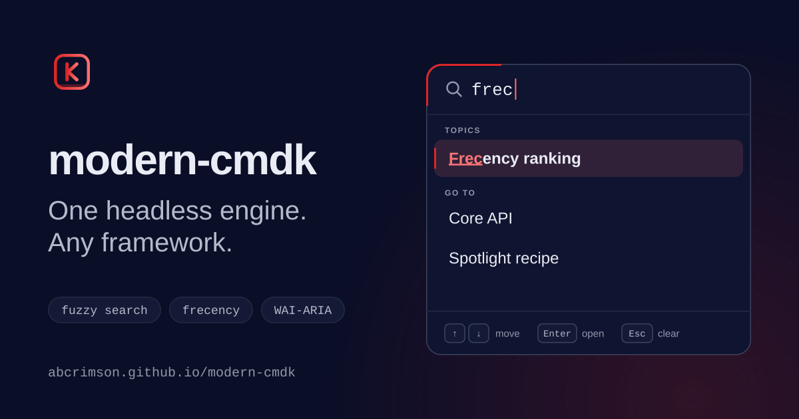

<p align="center">
  
</p>

<p align="center">
  <strong>modern-cmdk</strong><br/>
  The definitive command palette engine for the modern web.
</p>

<p align="center">
  <a href="https://www.npmjs.com/package/modern-cmdk"></a>
  <a href="https://github.com/ABCrimson/modern-cmdk/actions/workflows/ci.yml"></a>
  <a href="https://github.com/ABCrimson/modern-cmdk/blob/main/LICENSE"></a>
</p>

<p align="center">
  <a href="https://abcrimson.github.io/modern-cmdk/">Documentation</a> &middot;
  <a href="https://abcrimson.github.io/modern-cmdk/guide/getting-started.html">Getting Started</a> &middot;
  <a href="https://abcrimson.github.io/modern-cmdk/api/command.html">API Reference</a> &middot;
  <a href="https://abcrimson.github.io/modern-cmdk/examples/basic.html">Examples</a>
</p>

---

A ground-up rewrite of `cmdk` for **React 19**, written in modern ECMAScript: a framework-agnostic state machine (search, frecency ranking, keyboard shortcuts) in the core, and a thin React adapter on top.

## Install

```bash
npm install modern-cmdk
```

The package exports four entry points:

```ts
import { createCommandMachine } from 'modern-cmdk';            // Core engine (no React)
import { Command } from 'modern-cmdk/react';                    // React components
import { CommandDialog } from 'modern-cmdk/react/dialog';       // CommandDialog alone
import 'modern-cmdk/styles.css';                                 // Default styles
```

`modern-cmdk` is ESM-only. The core entry imports no peer. Every import of `modern-cmdk/react` and of `modern-cmdk/react/dialog` loads `react`, `react-dom` and `radix-ui` (the `radix-ui` import is static), so these are the peers:

| Peer | Range | Status |
|---|---|---|
| `react` | `>=19.0.0 <21.0.0` | optional (only the React entries use it) |
| `react-dom` | `>=19.0.0 <21.0.0` | optional (only the React entries use it) |
| `radix-ui` | `>=1.4.0 <2.0.0` | required through 1.x |

`radix-ui` is a required peer of `modern-cmdk` in 1.x, so npm 7+ and pnpm install it with `modern-cmdk` (or warn when they cannot), and with it its own required peers `react` and `react-dom`, even when you use only the core; `modern-cmdk` itself marks only `react` and `react-dom` optional. It becomes optional again in 2.0, when the barrel drops `Command.Dialog` and only `modern-cmdk/react/dialog` needs it. For the React entries, add the React peers yourself:

```bash
npm install modern-cmdk react react-dom
```

`Command.Dialog` stays on the `modern-cmdk/react` barrel through 1.x and leaves it in 2.0; `modern-cmdk/react/dialog` exports `CommandDialog` alone.

The codemod bin and `create-modern-cmdk` are supported on Node >=26.4.0 (`create-modern-cmdk` declares it in `engines`; the codemod no longer does, from 1.4.0). `modern-cmdk` itself declares no `engines`.

`sideEffects` lists only `./dist/react/styles.css`; every JavaScript entry is side-effect-free for bundlers.

## Quick Start

```tsx
'use client';

import { Command } from 'modern-cmdk/react';
import 'modern-cmdk/styles.css';
import { useEffect, useState } from 'react';

function CommandPalette() {
  const [open, setOpen] = useState(false);

  // Nothing opens the dialog for you: toggle it from a Mod+K listener (Cmd+K / Ctrl+K).
  useEffect(() => {
    const onKeyDown = (e: KeyboardEvent) => {
      if (e.key === 'k' && (e.metaKey || e.ctrlKey)) {
        e.preventDefault();
        setOpen((o) => !o);
      }
    };
    document.addEventListener('keydown', onKeyDown);
    return () => document.removeEventListener('keydown', onKeyDown);
  }, []);

  return (
    <Command.Dialog open={open} onOpenChange={setOpen} label="Command Menu">
      <Command.Input placeholder="Type a command..." />
      <Command.List>
        <Command.Empty>No results found.</Command.Empty>

        <Command.Group heading="Actions">
          <Command.Item value="copy" onSelect={() => setOpen(false)}>
            Copy to Clipboard
            <Command.Shortcut shortcut="Mod+C" />
          </Command.Item>
          <Command.Item value="paste" onSelect={() => setOpen(false)}>
            Paste
            <Command.Shortcut shortcut="Mod+V" />
          </Command.Item>
        </Command.Group>

        <Command.Group heading="Navigation">
          <Command.Item value="settings" onSelect={() => setOpen(false)}>
            Settings
            <Command.Badge>New</Command.Badge>
          </Command.Item>
        </Command.Group>
      </Command.List>
    </Command.Dialog>
  );
}
```

`<Command label="Command menu">` takes the same children inline, with no dialog; `<Command.Highlight text={...} ranges={...} />` renders match highlighting from scorer ranges. To scaffold a project instead: `npm create modern-cmdk@latest my-palette -- --template=react-basic`.

## Core API (no React)

```ts
import { createCommandMachine, itemId } from 'modern-cmdk';

using machine = createCommandMachine({
  items: [
    { id: itemId('copy'), value: 'Copy', shortcut: 'Mod+C', onSelect: () => navigator.clipboard.writeText(getSelection()?.toString() ?? '') },
    { id: itemId('paste'), value: 'Paste', shortcut: 'Mod+V', onSelect: () => navigator.clipboard.readText().then((text) => console.log('Pasted:', text)) },
  ],
  frecency: { enabled: true },
  loop: true,
});

machine.send({ type: 'SEARCH_CHANGE', query: 'cop' });
machine.send({ type: 'NAVIGATE', direction: 'next' });
machine.send({ type: 'ITEM_SELECT', id: itemId('copy') });

machine.subscribe(() => {
  console.log(machine.getState());
});
// Automatic cleanup via `using` -- no manual dispose needed
```

## What is in it

- **Framework-agnostic core** -- a pure TypeScript state machine; DOM APIs are feature-detected and SSR-safe. The sole runtime dependency (`idb-keyval`) is lazy-loaded only if you opt into IndexedDB frecency persistence.
- **React 19 adapter** -- compound components over `useSyncExternalStore`, `useTransition` and `use()`; React Compiler compatible.
- **Automatic virtualization** -- turns on when more than 100 items match and off again at 50 or fewer (fixed thresholds; force it with `<Command.List virtualize>` or `virtualize={false}`). The `virtualizeThreshold` option is accepted but not read yet.
- **Fuzzy search and frecency** -- a built-in TypeScript scorer with match ranges, and frequency x recency ranking with memory or IndexedDB persistence. `modern-cmdk-search-wasm` is an experimental, unpublished workspace package that does not work yet.
- **Keyboard shortcuts** -- a registry with a cross-platform `Mod` key and conflict detection.
- **Accessibility** -- WAI-ARIA combobox pattern, `aria-live` announcements, `forced-colors`, `prefers-contrast`, `prefers-reduced-motion`.
- **Animation** -- the stylesheet defines the dialog enter and exit on opacity, scale and translate, which are compositor-only; the overlay fades opacity and also transitions `--command-overlay-opacity`, its background alpha, which repaints, and the list height and item background-color transitions are not compositor-only either. In 1.x neither the dialog nor the overlay animates on enter or exit, because their duration and easing tokens are declared only on `[data-command-root]`, which sits inside the dialog (DT-19, planned for 1.8.0).
- **Extras** -- `CommandErrorBoundary`, `useCommandDevtools()` and telemetry middleware.

Theming (CSS custom properties, `@layer command`) is covered in the [theming guide](https://abcrimson.github.io/modern-cmdk/guide/theming.html).

## Sizes

Figures come from [`benchmarks/size-history/1.4.0.json`](https://github.com/ABCrimson/modern-cmdk/blob/5f1e01e/benchmarks/size-history/1.4.0.json) (committed in `5f1e01e`, measured at `07bfe79` with size-limit 14.3.0) and the `size-limit` entries in the root `package.json`. Method: size-limit, gzip, peers (`react`, `react-dom`, `radix-ui`) ignored; the codemod bin is raw installed size.

| Entry | Bytes | Method |
|---|---|---|
| `modern-cmdk` (core) | 6355 | gzip |
| `modern-cmdk/react`, adapter only | 5403 | gzip, `modern-cmdk` ignored |
| `modern-cmdk` + `modern-cmdk/react` | 9830 | gzip, core included |
| `modern-cmdk/react/dialog`, adapter only | 1425 | gzip, `modern-cmdk` ignored |
| `modern-cmdk/react`, `CommandSeparator` only | 4767 | gzip, `modern-cmdk` ignored; still contains `CommandDialog`, `CommandRoot` and the `radix-ui` import (tree-shaking of the barrel is a 2.0 item) |
| `modern-cmdk/styles.css` | 3959 | gzip |
| codemod bin (`dist/codemod/cli.mjs` plus `dist/codemod/transforms/*.mjs`) | 3325793 | raw installed size, not gzip |

1.3's 9844 B React figure measured `dist/react/index.mjs` with the core inlined, so it was core plus adapter, not the adapter.

## Migration from cmdk

Four codemods ship as the `modern-cmdk` bin, supported on Node >= 26.4.0. Pass a transform name and a glob (quote the glob so your shell does not expand it):

```bash
npx modern-cmdk --help
npx modern-cmdk import-rewrite "./src/**/*.tsx" --dry-run
npx modern-cmdk import-rewrite "./src/**/*.tsx"
```

| Transform | What it does |
|---|---|
| `import-rewrite` | Rewrites `cmdk` imports to `modern-cmdk/react` |
| `data-attrs` | Converts `[cmdk-*]` selectors to `[data-command-*]` |
| `forward-ref` | Removes `React.forwardRef` wrappers (React 19) |
| `should-filter` | Converts the `shouldFilter` prop to `filter` |

Options: `--dry-run` lists the files that would change and writes nothing; `--concurrency=N` sets how many files are processed at once (default: the smaller of 8 and the available cores); `--strict` is described below.

A run prints one `changed <file>` line per rewritten file and a summary. With `--dry-run` the lines read `would change <file>` and the summary ends in `(dry run, nothing written)`:

```text
would change src/a.tsx
1 changed, 0 unchanged, 0 errors (dry run, nothing written)
```

Exit codes in 1.x are unchanged by default: `0` for `--help`, missing arguments and per-file errors, and `1` for an unknown transform, a glob that matches no files, or an uncaught error. An unknown option is warned about on stderr and ignored when the transform and glob are present. A malformed known option (`--concurrency` with no value, `--dry-run=yes`) is a usage error that writes nothing and exits `0`. With `--strict`, every usage error (including an unknown option, an unknown transform and a malformed option) exits `2`, and any file error exits `1`.

See the [full migration guide](https://abcrimson.github.io/modern-cmdk/guide/migration-from-cmdk.html).

## Documentation

**[abcrimson.github.io/modern-cmdk](https://abcrimson.github.io/modern-cmdk/)** -- [Installation](https://abcrimson.github.io/modern-cmdk/guide/installation.html) | [Basic Usage](https://abcrimson.github.io/modern-cmdk/guide/basic-usage.html) | [SSR / Next.js](https://abcrimson.github.io/modern-cmdk/guide/ssr.html) | [Theming](https://abcrimson.github.io/modern-cmdk/guide/theming.html) | [Accessibility](https://abcrimson.github.io/modern-cmdk/guide/accessibility.html) | [Core API](https://abcrimson.github.io/modern-cmdk/api/command.html) | [React API](https://abcrimson.github.io/modern-cmdk/api/command-react.html) | [Benchmarks](https://abcrimson.github.io/modern-cmdk/benchmarks.html)

**More guides:** [Async Items](https://abcrimson.github.io/modern-cmdk/guide/async-items.html) | [Frecency](https://abcrimson.github.io/modern-cmdk/guide/frecency.html) | [Shortcuts](https://abcrimson.github.io/modern-cmdk/guide/shortcuts.html) | [Virtualization](https://abcrimson.github.io/modern-cmdk/guide/virtualization.html) | [TypeScript](https://abcrimson.github.io/modern-cmdk/guide/typescript-integration.html) | [Controlled Dialog](https://abcrimson.github.io/modern-cmdk/guide/controlled-dialog.html) | [WASM Search (experimental)](https://abcrimson.github.io/modern-cmdk/guide/wasm-search.html) | [WASM Search API (experimental)](https://abcrimson.github.io/modern-cmdk/api/command-search-wasm.html)

**Recipes:** [File Picker](https://abcrimson.github.io/modern-cmdk/recipes/file-picker.html) | [Emoji Picker](https://abcrimson.github.io/modern-cmdk/recipes/emoji-picker.html) | [AI Chat Commands](https://abcrimson.github.io/modern-cmdk/recipes/ai-chat-commands.html) | [Nested Commands](https://abcrimson.github.io/modern-cmdk/recipes/nested-commands.html) | [Spotlight Search](https://abcrimson.github.io/modern-cmdk/recipes/spotlight-search.html)

## Related packages

| Package | Status |
|---|---|
| [`create-modern-cmdk`](https://www.npmjs.com/package/create-modern-cmdk) | Published. `npm create modern-cmdk@latest <name>` scaffolds a new project. |
| `modern-cmdk-search-wasm` | Experimental Rust/WASM fuzzy search; private (0.9.0), not on npm. |
| `vscode-modern-cmdk` | Not on the VS Code Marketplace. The npm 1.0.0 of that name was an accidental publish and is not the extension; the package is private from 1.4.0. |

The repository page, with development and contributing notes, is [github.com/ABCrimson/modern-cmdk](https://github.com/ABCrimson/modern-cmdk).

## License

[MIT](https://github.com/ABCrimson/modern-cmdk/blob/main/LICENSE) -- Copyright (c) 2026 Albert Badalov
