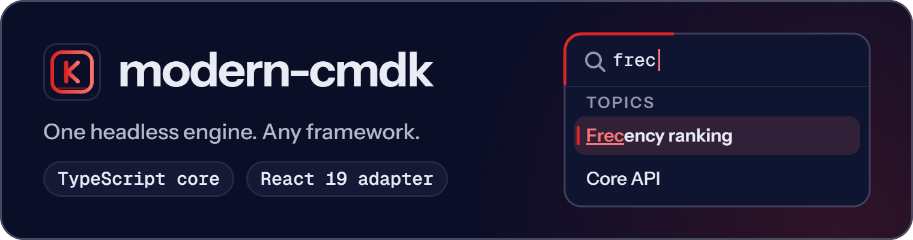

<p align="center">
  <picture>
    <source media="(prefers-color-scheme: dark)" srcset="https://raw.githubusercontent.com/ABCrimson/modern-cmdk/ASSET_COMMIT_PLACEHOLDER/apps/docs/public/brand/readme/modern-cmdk-dark.png">
    <source media="(prefers-color-scheme: light)" srcset="https://raw.githubusercontent.com/ABCrimson/modern-cmdk/ASSET_COMMIT_PLACEHOLDER/apps/docs/public/brand/readme/modern-cmdk-light.png">
    
  </picture>
</p>

Headless command palette engine: a framework-agnostic TypeScript core with fuzzy search, frecency ranking and keyboard shortcuts, plus a React 19 adapter.

```sh
npm install modern-cmdk react react-dom radix-ui
```

<!-- figures-line:start -->
**7.7 kB** gzip core · **12.0 kB** with the React adapter · ESM only · React ≥ 19 · TypeScript ≥ 5.6 · [Requirements](#requirements)
<!-- figures-line:end -->

<p align="center">
  <a href="https://abcrimson.github.io/modern-cmdk/"><strong>Documentation</strong></a> ·
  <a href="https://abcrimson.github.io/modern-cmdk/guide/getting-started.html">Getting started</a> ·
  <a href="https://abcrimson.github.io/modern-cmdk/api/command-react.html">React API</a> ·
  <a href="https://abcrimson.github.io/modern-cmdk/api/command.html">Core API</a> ·
  <a href="https://abcrimson.github.io/modern-cmdk/guide/migration-from-cmdk.html">From cmdk</a> ·
  <a href="https://github.com/ABCrimson/modern-cmdk/blob/main/packages/modern-cmdk/CHANGELOG.md">Changelog</a>
</p>

## Quick start

```tsx
'use client';

import { Command } from 'modern-cmdk/react';
import 'modern-cmdk/styles.css';

function toggleColorScheme(): void {
  const root = document.documentElement;
  root.style.colorScheme =
    root.style.colorScheme === 'dark' ? 'light' : 'dark';
}

export function CommandPalette() {
  return (
    <Command label="Commands">
      <Command.Input placeholder="Type a command…" />
      <Command.List>
        <Command.Empty>No results.</Command.Empty>
        <Command.Group heading="Page">
          <Command.Item
            value="Copy page link"
            keywords={['url', 'share']}
            onSelect={() => navigator.clipboard.writeText(location.href)}
          >
            Copy page link
          </Command.Item>
          <Command.Item
            value="Toggle dark mode"
            shortcut="Mod+Shift+L"
            onSelect={toggleColorScheme}
          >
            Toggle dark mode
            <Command.Shortcut shortcut="Mod+Shift+L" />
          </Command.Item>
        </Command.Group>
        <Command.Group heading="Go to">
          <Command.Item
            value="Settings"
            keywords={['preferences']}
            onSelect={() => location.assign('/settings')}
          >
            Settings
          </Command.Item>
        </Command.Group>
      </Command.List>
    </Command>
  );
}
```

Typing filters the items with the built-in fuzzy scorer; `keywords` are searched but not shown. The `shortcut` on an item binds the key for as long as the palette is mounted, wherever focus is, and stops the key's default action, so bind keys the page does not need. `Command.Shortcut` only displays it: ⌘⇧L on Apple platforms, Ctrl+Shift+L elsewhere.

## What it does

- **Framework-agnostic core.** `createCommandMachine` is a typed state machine that imports no framework; DOM APIs are feature-detected, so it is safe to import on a server. [Core API](https://abcrimson.github.io/modern-cmdk/api/command.html)
- **Fuzzy search** with match ranges for `Command.Highlight`; pass your own scorer or `SearchEngine`. [Basic usage](https://abcrimson.github.io/modern-cmdk/guide/basic-usage.html)
- **Frecency ranking**, opt-in, kept in memory or in IndexedDB (`idb-keyval`, the one dependency, loads only then). [Frecency](https://abcrimson.github.io/modern-cmdk/guide/frecency.html)
- **Keyboard shortcuts.** Write `Mod+K` once: it is parsed, shown as ⌘ on Apple platforms and Ctrl elsewhere, matched against key events and checked for conflicts. [Shortcuts](https://abcrimson.github.io/modern-cmdk/guide/shortcuts.html)
- **React 19 adapter.** Compound `Command.*` components on `useSyncExternalStore`; `ref` is a prop, with no `forwardRef`; `Command.Activity` wraps React's `<Activity>`. [React API](https://abcrimson.github.io/modern-cmdk/api/command-react.html)
- **WAI-ARIA combobox and listbox** that announce the result count. [Accessibility](https://abcrimson.github.io/modern-cmdk/guide/accessibility.html)
- **Virtualization** that switches on above 100 matches and off at 50 or fewer. [Virtualization](https://abcrimson.github.io/modern-cmdk/guide/virtualization.html)
- **Async items** with Suspense through `Command.AsyncItems`. [Async items](https://abcrimson.github.io/modern-cmdk/guide/async-items.html)
- **A stylesheet for structure**, in `@layer command`: layout, motion, and rules for forced colours, increased contrast and reduced motion. The active row, surfaces and borders are yours to style. [Theming](https://abcrimson.github.io/modern-cmdk/guide/theming.html)
- **SSR-safe**: the React entries carry `'use client'`. [SSR and Next.js](https://abcrimson.github.io/modern-cmdk/guide/ssr.html)
- **Explicit resource management**: the machine is `Disposable` and `AsyncDisposable`, so `using` and `await using` release it; telemetry hooks, `useCommandDevtools` and `CommandErrorBoundary` are built in. [Core API](https://abcrimson.github.io/modern-cmdk/api/command.html)

## Open it with ⌘K or Ctrl+K

```tsx
'use client';

import { matchesShortcut, parseShortcut } from 'modern-cmdk';
import { Command } from 'modern-cmdk/react';
import { useEffect, useState } from 'react';

export function CommandMenu() {
  const [open, setOpen] = useState(false);

  useEffect(() => {
    const toggle = parseShortcut('Mod+K');
    const controller = new AbortController();
    document.addEventListener(
      'keydown',
      (event) => {
        if (!matchesShortcut(event, toggle)) return;
        event.preventDefault();
        setOpen((isOpen) => !isOpen);
      },
      { signal: controller.signal },
    );
    return () => controller.abort();
  }, []);

  const run = (action: () => void) => () => {
    setOpen(false);
    action();
  };

  return (
    <Command.Dialog open={open} onOpenChange={setOpen} label="Command menu">
      <Command.Input placeholder="Search…" />
      <Command.List>
        <Command.Empty>No results.</Command.Empty>
        <Command.Item
          value="Settings"
          onSelect={run(() => location.assign('/settings'))}
        >
          Settings
        </Command.Item>
        <Command.Item value="Print this page" onSelect={run(() => print())}>
          Print this page
        </Command.Item>
      </Command.List>
    </Command.Dialog>
  );
}
```

`Command.Dialog` binds no open key, so you pass `open`. `Mod+K` matches ⌘K on Apple platforms and Ctrl+K elsewhere, and Caps Lock does not break it. Escape and a click outside call `onOpenChange(false)`; selecting an item does not close the dialog by itself, so `run` closes it first.

## Without React

```ts
import { createCommandMachine, itemId } from 'modern-cmdk';

const commands = new Map([
  [itemId('new-file'), 'New file'],
  [itemId('open-recent'), 'Open recent'],
  [itemId('toggle-theme'), 'Toggle theme'],
]);

/** Renders the filtered commands into `list` until disposed. */
export function mountPalette(
  input: HTMLInputElement,
  list: HTMLUListElement,
): Disposable {
  const machine = createCommandMachine({
    items: commands
      .entries()
      .map(([id, value]) => ({ id, value }))
      .toArray(),
  });
  const controller = new AbortController();

  const render = () => {
    const rows = machine.getState().filteredIds.map((id) => {
      const row = document.createElement('li');
      row.textContent = commands.get(id) ?? '';
      return row;
    });
    list.replaceChildren(...rows);
  };
  const subscription = machine.subscribeState(render);
  render();

  input.addEventListener(
    'input',
    () => machine.send({ type: 'SEARCH_CHANGE', query: input.value }),
    { signal: controller.signal },
  );

  return {
    [Symbol.dispose]() {
      controller.abort();
      subscription[Symbol.dispose]();
      machine[Symbol.dispose]();
    },
  };
}
```

`send()` is batched: the state changes on the next animation frame (a microtask where there is none), then subscribers run. `mountPalette` returns a `Disposable`, so a caller can write `using palette = mountPalette(input, list);`.

## Entry points

| Import | What it holds |
|---|---|
| `modern-cmdk` | The core: machine, search, frecency, shortcuts, telemetry. Imports no peer. |
| `modern-cmdk/react` | `Command` and its parts, the hooks, `CommandErrorBoundary`. `'use client'`. |
| `modern-cmdk/react/dialog` | `CommandDialog` alone. `'use client'`. |
| `modern-cmdk/styles.css` | The stylesheet. The only file with side effects. |

ESM only. Every export is listed in the [Core API](https://abcrimson.github.io/modern-cmdk/api/command.html) and [React API](https://abcrimson.github.io/modern-cmdk/api/command-react.html) pages.

<details>
<summary><strong>Options</strong> of <code>createCommandMachine</code>, also props of <code>&lt;Command&gt;</code> and <code>&lt;Command.Dialog&gt;</code></summary>

| Option | What it does |
|---|---|
| `items`, `groups` | Items and groups registered at creation; in React, `<Command.Item>` and `<Command.Group>` register themselves |
| `filter` | Your scorer, `(item, query) => number \| false`, or `false` to turn filtering off |
| `searchEngine` | A `SearchEngine` that replaces the built-in scorer; one you pass is yours to dispose |
| `frecency` | `{ enabled, storage, namespace, decayConfig }`; history in memory by default, or `new IdbFrecencyStorage()` |
| `shortcutAction` | `'direct'` (default): a shortcut calls the item's `onSelect`. `'select'`: it selects the item, so frecency and the root's `onSelect` run too |
| `disabledItems` | `'show'` (default) lists disabled items without making them selectable; `'hide'` drops them |
| `loop` | Arrow keys wrap from the last item to the first (default `true`) |
| `activeId`, `onActiveChange` | Control the active item |
| `open`, `onOpenChange` | The open state; `Command.Dialog` treats `open` as controlled |
| `onSelect`, `onSearchChange` | Called on every select of an enabled item, and on every query |
| `label` | The accessible name (default `'Command palette'`) |
| `telemetry` | `onPaletteOpen`, `onPaletteClose`, `onSearchComplete`, `onItemSelected`, called once per batch |
| `search` | Deprecated name of `searchEngine` |
| `virtualizeThreshold` | Accepted but not read: the list virtualizes above 100 matches and stops at 50 or fewer |

In React, `shortcutAction`, `frecency`, `searchEngine` and whether `filter` is a function are read once, at mount.

</details>

## Coming from cmdk

[cmdk](https://github.com/dip/cmdk) code moves over with [`modern-cmdk-codemod`](https://www.npmjs.com/package/modern-cmdk-codemod): four transforms, one per run, in this order: `should-filter`, `forward-ref`, `data-attrs`, `import-rewrite`. Start with a dry run, which writes nothing:

```sh
npx modern-cmdk-codemod --dry-run should-filter ./src
```

The [migration guide](https://abcrimson.github.io/modern-cmdk/guide/migration-from-cmdk.html) covers what the codemods leave to you. This package also ships a `modern-cmdk` bin over the same transforms. It is deprecated: it warns on every run and keeps lenient exit codes, so use `modern-cmdk-codemod`. The ten third-party packages that bin bundles are listed with their licences in `THIRD-PARTY-NOTICES.md`, inside this package.

A rewrite of [cmdk](https://github.com/dip/cmdk) for React 19.

## Size and speed

<!-- figures:start -->
| Measure | Value |
|---|--:|
| Core, `modern-cmdk` | 7.7 kB gzip[^size] |
| Core + `modern-cmdk/react` | 12.0 kB gzip[^size] |
| `modern-cmdk/styles.css` | 4.0 kB gzip[^size] |
| Search 10,000 items for one query | 3.8 ms median[^bench] |

Most of the unpacked size npm lists, 3.15 MB, is the deprecated `modern-cmdk` bin and the packages it bundles; no application bundle imports it.

[^size]: size-limit with rolldown, minified with `NODE_ENV=production`, gzip; `react`, `react-dom` and `radix-ui` are not counted; 1 kB = 1,000 bytes. Record: [`size-history/1.7.0.json`](https://github.com/ABCrimson/modern-cmdk/blob/380e25e826341cebc46c8a844a524542fd1f8337/benchmarks/size-history/1.7.0.json).
[^bench]: `createSearchEngine()` searching an index of 10,000 items for `'apple'` and materialising the results; indexing is not timed. The median of five runs' p50 on a GitHub-hosted runner (AMD EPYC 7763, 4 cores), recorded on 2026-11-08; runner noise is ±20–40 %. Record: [`baseline.json`](https://github.com/ABCrimson/modern-cmdk/blob/380e25e826341cebc46c8a844a524542fd1f8337/benchmarks/baseline.json). Method: [Benchmarks](https://abcrimson.github.io/modern-cmdk/benchmarks.html).
<!-- figures:end -->

## Requirements

| | |
|---|---|
| Module format | ESM only |
| React | `react` and `react-dom` `>=19.0.0 <21.0.0`, for the React entries (optional peers) |
| radix-ui | `>=1.4.0 <2.0.0`, a required peer: npm 7+ and pnpm install it, with `react` and `react-dom` as its own peers, even if you import only the core |
| TypeScript | 5.6 or later, with `"lib": ["ESNext", "DOM"]` |
| Browsers | Chrome and Edge 122, Firefox 131, Safari 18.4: the built code uses iterator helpers |
| Node | No `engines` field; any Node with iterator helpers. The deprecated bin needs Node 26.4.0 or later |
| Other package managers | `pnpm add` and `yarn add` take the same four names |

## The modern-cmdk packages

| Package | Use it to |
|---|---|
| [`modern-cmdk`](https://www.npmjs.com/package/modern-cmdk) | build the palette: core engine, React adapter, stylesheet |
| [`create-modern-cmdk`](https://www.npmjs.com/package/create-modern-cmdk) | start a Vite, React 19 and TypeScript project with a palette in it |
| [`modern-cmdk-codemod`](https://www.npmjs.com/package/modern-cmdk-codemod) | move code written for cmdk to modern-cmdk |

## Links

[Documentation](https://abcrimson.github.io/modern-cmdk/) · [Changelog](https://github.com/ABCrimson/modern-cmdk/blob/main/packages/modern-cmdk/CHANGELOG.md) · [Releases](https://github.com/ABCrimson/modern-cmdk/releases) · [Issues](https://github.com/ABCrimson/modern-cmdk/issues) · [Security policy](https://github.com/ABCrimson/modern-cmdk/security/policy) · [Repository](https://github.com/ABCrimson/modern-cmdk)

## License

[MIT](https://github.com/ABCrimson/modern-cmdk/blob/main/LICENSE) © 2026 Albert Badalov
